# K’NEX Studio

A browser-based Three.js editor for classic K’NEX parts, connected mechanisms, and interactive physics experiments. Independent software, not an official K’NEX product.

**[Open the live demo](https://ed-gpt.github.io/knex-studio/)** · [Report a bug or suggest an improvement](https://github.com/Ed-GPT/knex-studio/issues)

No installation required. Builds save in your browser; use **Save** to download a portable copy.


## Screenshots

### Build with real part references


### Explore the examples


Screenshots captured from the working editor. Parts and physics are approximations; see the accuracy notes below.

## Run locally

Use a current Node.js release. No dependency installation or build step is needed.

```sh
npm run dev
```

Open http://127.0.0.1:5577. To use another port: `PORT=5578 npm run dev`.

```sh
npm run check
npm test
```

The complete static application is in `dist/`, including Three.js and cannon-es. See [hosting instructions](docs/HOSTING.md) for a website demo.

## Build and interact

- Drag parts from the library. Compatible endpoints and sockets snap together.
- Select a part or group. Pink stays selected; mint indicates hover.
- Drag movement arrows and rotation rings. Connected parts follow their mechanical joints.
- **Lock / Unlock** fixes a part's position and orientation. Press **G** or use the padlock. Layer editing locks are separate.
- **Detach** releases external joints while preserving the joints inside a selection. **Reconnect** snaps it elsewhere.
- **Clone** copies a selection. **Repeat +** uses the section's connection-grid spacing, reuses coincident parts, and skips obstructed additions.
- Open **Physics** for gravity, joints, balls and tipping; select a motor for its playback controls. **Test drive** runs a vehicle copy in a separate playground.
- **Hints** toggles optional on-screen guidance. Fine adjustment, mass, transforms, connections, and part information are expandable.

| Shortcut | Action |
| --- | --- |
| V / B | Select / place |
| W / E | Move / rotate |
| G | Lock / unlock |
| F | Frame selection |
| Middle-drag / R | Rotate |
| C / Tab while placing | Connection method / socket |
| Alt-click | Select one part inside a group |
| Ctrl/Cmd D | Clone |
| Ctrl/Cmd Z | Undo |
| Escape | Cancel the current operation |

## Example gallery

The gallery opens immediately; visible thumbnails are generated one at a time and cached for the session. Every thumbnail is rendered from the actual example model. Counts come from its parts, rather than handwritten claims. Opening an example first archives the current model; simulations start when requested.

| Level | Builds | Explore |
| --- | --- | --- |
| Simple | One square, Single hinge, Axle & bearings | Snapping, patterns, locking, sliding and rotation |
| Intermediate | Shared-edge grid, Playground swing, Wheeled chassis, Snap-on idler gears | Shared boundaries, gravity, wheels and axles |
| Advanced | Motor windmill, Two-stage gearbox, Braced tower, Twin-motor rover, Double hinge, Molded double hinge, Balance scale, Pantograph | Motor drives, gearing, layers, remote control, payloads and closed-loop joints |

The swing is a single-bay adaptation of a published guide. The wheeled chassis follows an illustrated vehicle guide with supported part variants. The other builds are original demonstrations of referenced K’NEX connection methods; they are not verified official building plans. The single hinge deliberately fixes its axle in space. Reference scenes for connector shapes, hubs/tyres and motor housings are separated from the build gallery. Each build has optional reference information.

Example definitions and factories live in `dist/examples.js`. Existing models remain compatible with the version-1 JSON format.

## Classic spring motor

**Motors → Spring motor** adds the original **92890** with a reconstructed transparent case, visible mechanism and four mounting eyes. The eyes form two paired passages for support rods; the central bore drives a separate axle.

Open **Examples → Spring motor fan**. Drag the rotor's rotation ring backward to wind it, or use **↶ +1 turn**. **Release spring** uses the stored turns and stops; **Hold** pauses. Winding survives save, undo and cloning. The 14-part fixture holds its supports fixed while the connected rotor turns.

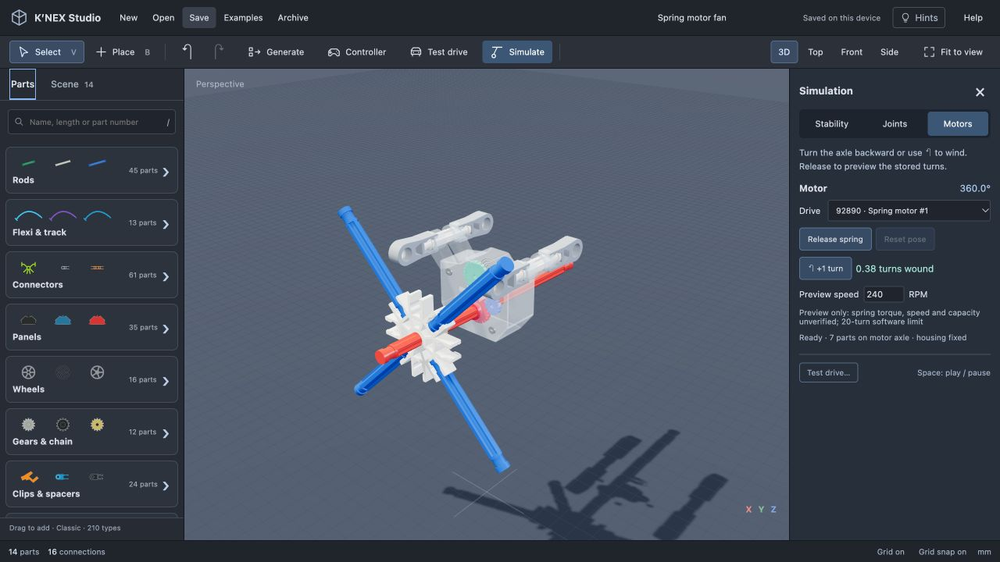

This is a finite-turn mechanical preview, with adjustable playback speed. Spring torque, real winding capacity and load-dependent speed remain unverified. The 20-turn software cap is not a physical specification. Spring vehicle motion is not yet supported in Test drive. See [sources, geometry estimates and limits](docs/CLASSIC-PARTS.md#classic-spring-motor-92890).

## Classic rod colors

The **Rods** flyout now filters by length and includes 34 additional Classic straight-rod colors plus the translucent rigid 90956W. **Generate → Grid & frame → Color** changes the cell rods without changing their stock size. Where available, braces use the same named color in the next stock length; otherwise they use the standard next-size rod.

Try **Examples → Rod color lattice**, or the **Classic rod colors** reference bench. Every variant has a separate part number and supplier approximate mass. Short rods retain their no-side-grip restriction. [Sources and reconstruction limits](docs/CLASSIC-PARTS.md#classic-rod-color-variants) include the two deferred mismatched supplier photos and the still-pending permanent curved rods.

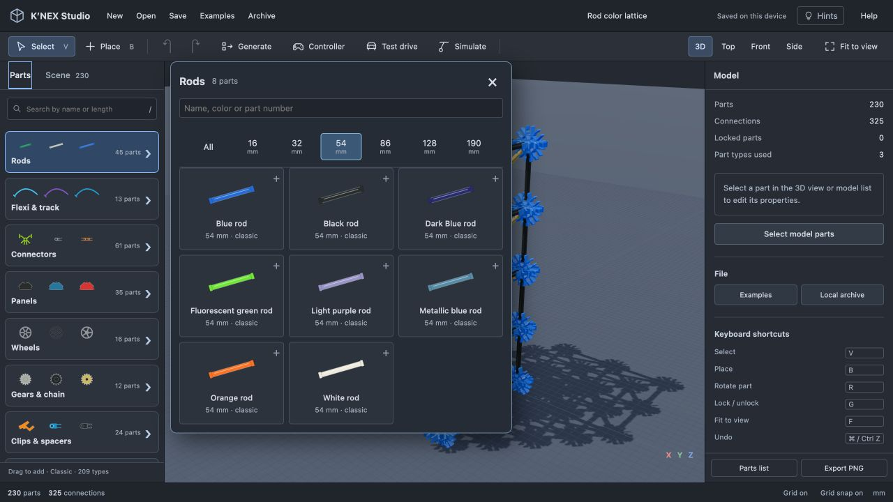

## Classic connector colors

**Connectors** now includes 51 additional original-size color variants. Use the illustrated shape buttons to narrow the flyout, or search a part number. Matching eight-way colors retain motor mounts and tyre fitting; 3D variants retain their interlocking channels. Each variant keeps its own saved identity and approximate supplier mass.

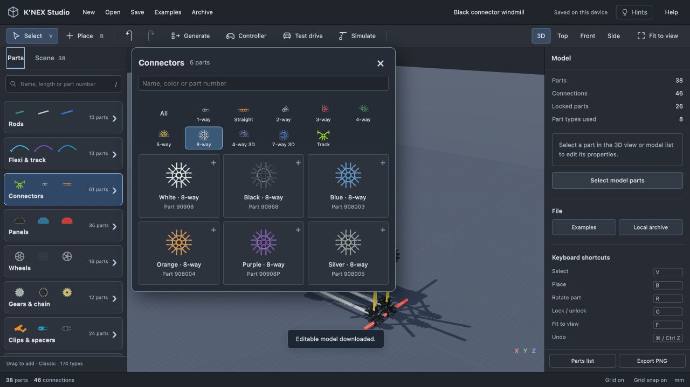

Try **Examples → Black connector windmill** or the **Classic connector colors** reference scene. [Sources and reconstruction limits](docs/CLASSIC-PARTS.md#classic-connector-color-variants) cover every added identity. Colors and finishes are approximate; no Micro or K-Force parts are included.

## Snap-on idler gears

The original gray 91324 and black 99119 gears snap onto a rod end and spin independently of that rod. A locked support can therefore hold an idler while a motor drives the gears on either side. Select **Examples → Snap-on idler gears**, then start the motor. Gold and dark-blue 14-tooth, gray 34-tooth crown and black 82-tooth crown variants are also available under **Gears & chain**.

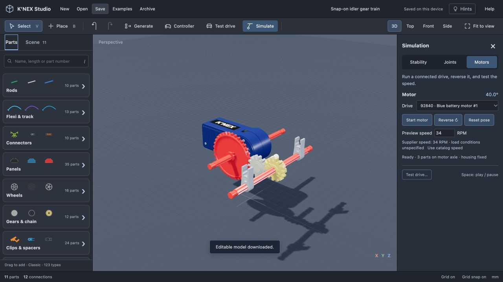

See [part references and limits](docs/CLASSIC-PARTS.md#classic-snap-on-and-color-variant-gears). Geometry is reconstructed from photos; gear playback uses ideal parallel-axis and right-angle crown ratios, without torque or contact simulation.

## Visual grid and frame builder

Open **Generate → Grid & frame**. Choose a panel, rectangular frame, octagonal ring or tower, then use **+ / −** to grow its width, height and depth. The live 3D preview supports orbit, zoom, Front and Top views. Pick a Classic rod by its colored thumbnail; the cell size follows the actual modeled rod length plus its connector seats.


- **2D grids** use white 8-way 90908 connectors, vertically or horizontally. **3D frames** use interlocking pairs of blue 90907 connectors with sockets along all three axes. Shared cell boundaries contain one set of parts.
- Optional diagonal braces use the next stock rod size, with no rod stretching. Frame braces occupy XY and XZ faces. Gray-rod cells have no longer stock diagonal in this catalog, so braces are disabled for that size.
- The preview reports new, reused and skipped parts. **Position & details** allows precise placement against an existing build. Matching parts keep their IDs, groups, locks and mass settings; obstructed pieces, incomplete rods and isolated new hubs are skipped. Reused parts are cyan; skipped parts are pink. Collision bounds are conservative approximations.
- Generation is one undo step and produces individually editable parts, one selection group and layers for rows or levels. It is not a persistent parametric object. Use another adjacent generation or the existing pattern controls to extend it after insertion.
- Counts range from 1 to 30 cells per direction, subject to the existing 2,500-part model limit. Tests cover every stock rod size, all shared boundary directions, socket alignment, duplicate reuse, obstacles, save/import and a connected 2,072-part frame. The preview batches repeated geometry for large structures.

These are procedural demonstrations of the existing referenced Classic connector and rod system, not official building plans. Connector geometry and fit tolerances remain approximate; generated frames do not add structural load or collision simulation.

### Octagonal cell grids and frames

Choose **Octagonal grid** for a flat lattice or **Cell frame** for a spatial array. **Columns +** and **Rows +** repeat cells; **Levels +** grows their height. **Segments per side +** enlarges each octagon using whole stock rods. Flat grids can stand vertically or lie horizontally.

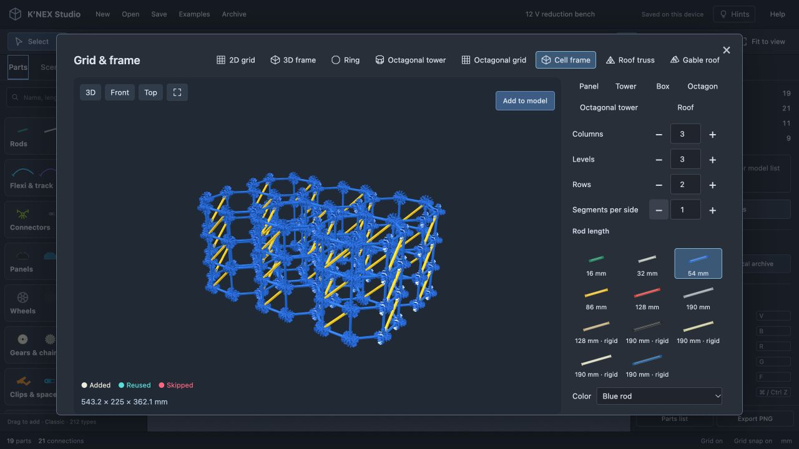

Touching cells share full edges, rods and connectors. Four adjacent octagons leave a square opening between them. Spatial cells use paired blue 3D connectors and brace only the four compatible wall planes; shared walls retain one diagonal, not two crossing rods. Each cell has a layer, with shared boundary parts assigned to the first cell. Matching existing parts are reused on insertion, blocked spans are skipped, and insertion remains one undo step.

**Examples → Octagonal cell frame** opens a 589-part, six-cell example. Tests cover connected 2,300-part flat grids and 2,275-part spatial frames, all supported Classic rod variants, socket alignment, save/import, shared-wall extension and obstacles. These are original procedural constructions using existing modeled Classic parts, not official manual models or verified physical load-bearing designs. Connector geometry and collision bounds remain approximate; connector bending and buckling are not simulated. Molded panels are not generated for these shapes.

### Roof trusses and gable roofs

Choose **Roof truss** for a flat triangle or **Gable roof** for repeated triangular frames. **Half-span +** increases both half the width and the rise by one stock cell; the slope stays at 45°. **Depth bays +** extends the roof. The rafters always use the next matching stock rod length; unsupported rod choices are disabled. **Interior braces** adds diagonals inside the trusses and horizontal cross-bay planes while keeping the outside rafters when disabled.

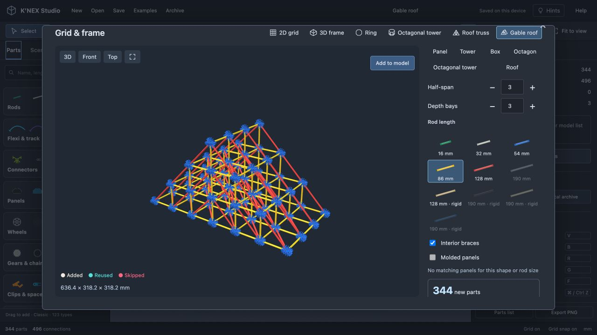

Each bay gets a scene layer. Repeating at the previous roof's depth reuses the shared boundary truss. The same placement rules skip obstacles and incomplete spans, preserve existing parts and make insertion one undo step. **Examples → Gable roof** opens a 344-part demonstration. Tests cover a connected 2,334-part roof. This is an original procedural lattice, not a certified structural design; connector flexibility and buckling are not simulated. Only the actual XY and XZ socket planes receive braces. No molded roof panels or arbitrary slopes are inferred.

### Paneled grids and frames

Enable **Molded panels** and choose a color thumbnail. The builder offers only square panels that fit the selected stock rods: white, blue, yellow, red and tan rigid. Choosing panels turns diagonal braces off because they share sockets; choosing braces removes panels. Unsupported sizes disable the panel option.

Grids fill every cell in either plane. Rectangular frames cover front, back, top and bottom, with separate panel layers. Their two side faces stay open because the paired blue connectors do not provide diagonal sockets in that plane. Every panel has four actual peg connections. **Examples → Paneled tunnel** opens a 144-part, 240-connection demonstration with a clear interior and open ends.

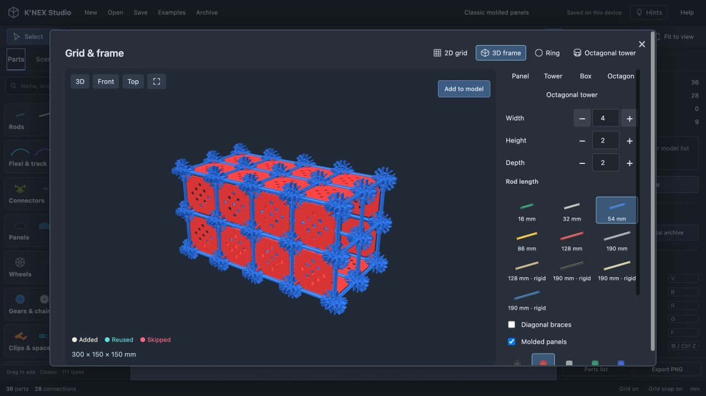

Shared boundaries reuse panels as well as rods and connectors. A blocked corner omits the whole new panel, preserving existing parts and connections. Broad overlap checks include the full size of large plates. Tests cover every compatible panel, extensions along all three axes, competing occupied sockets, save/import and a connected 2,401-part sheet. Browser verification includes previewing and inserting that sheet, then undoing it. The same 2,500-part model limit applies. Structural loads, flex and buckling are not simulated by the generator.

### Octagonal rings and towers

**Ring** makes a flat octagon in either plane. **Octagonal tower** stacks complete rings, with **+ / −** for stock rod segments per side and vertical levels. White 8-way connectors form rings; paired blue 3D connectors form tower nodes. The shape uses real 45° sockets and whole stock rods. Its width follows those lengths rather than an arbitrary radius.

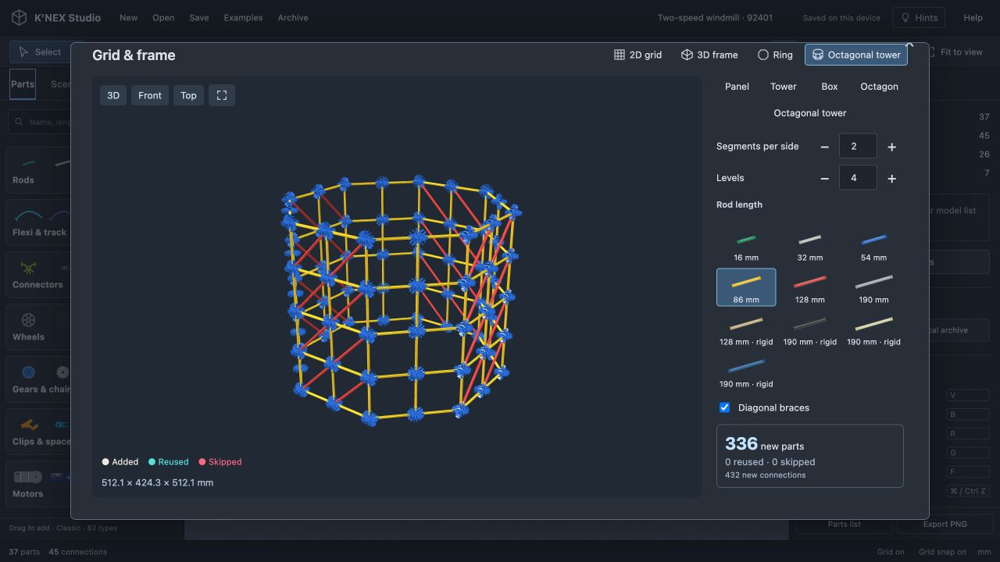

Tower braces occupy four alternating walls, where the paired connectors have a matching diagonal socket. Other walls remain open. Adjacent generations reuse a complete shared boundary ring, and duplicate or obstructed pieces follow the same reuse/skip rules as rectangular frames. Tests cover every offered rod size, both ring planes, a connected 2,400-part tower, obstacles, shared rings and saved user properties. **Examples → Octagonal tower** opens a 336-part demonstration with separate level layers. It is an original procedural build, not an official model or a verified load-bearing design.

## Visual path builder

Open **Generate → Path builder**, or choose **Flexi & track** in the part library.


Importable paths: [hill](docs/paths/hill.json), [S-bend](docs/paths/s.json), [corner](docs/paths/bend.json).

- Drag pink handles in 3D; Shift-drag changes height. Top and Front views, numeric coordinates, add/remove handles, and Hill/S-bend/Corner presets provide alternative controls. Hints can be hidden.
- **Track:** repeat real green cross-ties 91430 along a spline, set spacing and banking, and generate two purple split-tubing cuts. The tubing is identified from the Thunderbolt Strike set 51587 manual, which documents 6.096 m stock lengths and cutting. Each rail must fit one stock length; rail joins are not generated.
- **Flexi:** select a documented 32, 52, 86 or 190 mm rod and its original color using length buttons and swatches, with two gray 90901 end connectors. Click a flexi in the library to shape that exact part; drag it into the workspace to place it straight. Editing resizes the reference curve to preserve the rod length. End sockets follow the curve tangents.
- **Save path / Import path:** exchange a `knex-path` version 1 JSON file containing `kind` (`track` or `flexi`), 2–24 XYZ `points` in millimetres, `spacing` (30–190 mm), and `bank` (−60 to 60 degrees). Flexi paths also save `flexiType`; older files default to green 91108. These are editor input bounds, not manufacturer bending limits. No proprietary coaster file import yet.
- **Add to model** inserts an editable group in one undo step. The generated local curves and tubing bank survive model saves, duplication and patterns. Save the path separately to retain the authoring handles; committed parts do not yet reopen as a procedural path.

Through-hole placement follows the pointer anywhere along a rod and seeks nearby clear space when occupied. It respects part thickness at the ends. The attached part remains free to slide; the existing continuous obstruction checks still apply.

### Real parts and uncertainties

| Part | Verified reference | Still approximate |
| --- | --- | --- |
| Classic flexi variants | [Supplier picture catalog, Classic Flexi rods and Rods sections](https://www.knexusergroup.org.uk/en/kpartslist.pdf): 32 mm 91480B/91480; 52 mm 91490/914901; 86 mm 91282/91282D/91283; 190 mm 91108/91107/91107Y/91109/90966 | Lengths are supplier approximations. Profile, colors, bend/twist limits and unsourced masses remain estimated. |
| Green flexi 91108 | [Supplier photo, approx. 190 mm, approx. 3.7 g](https://shop.knexusergroup.org.uk/products/91108) | Cross-section, flange details, minimum bend radius, spring stiffness |
| Green cross-tie 91430 | [Supplier photo and approx. 3.68 g](https://shop.knexusergroup.org.uk/products/91430) | Body dimensions, socket tolerances and gauge (rendered at an unverified 44 mm) |
| Purple split tubing, set 51587 | [K’NEX Thunderbolt Strike manual](https://www.knexusergroup.org.uk/bk/51587.pdf), pages 5 and 34–39 | Tube section, bending/twist limits and mass. No individual part number is claimed. |

The library expansion is tracked in [Classic parts coverage](docs/CLASSIC-PARTS.md).

The [Classic coaster guide](https://www.knexusergroup.org.uk/en/knex-hint-R2.html) confirms tubing on cross-tie posts. Shapes are photo/manual reconstructions, not factory CAD. Red tubing 403420V was not used because its supplier title and description disagree on stock length.

**Track output is an unsupported layout preview.** It does not include structural frames, flexi backbones, splices, lift chains or a car. Tubing-to-post links keep the layout together for editing; they are not an elastic solver. Curvature is reported geometrically, with no claim of a verified buildable bend. The editor does not validate self-intersections, rail clearance or structural feasibility. For balance, curves are held rigid; tubing mass uses an explicit unverified estimate of 0.019 g/mm until measured data is available.

## Mechanism stress examples

**Balance scale** is a 106-part adaptation of the [79565 balance instructions](https://www.knexusergroup.org.uk/bk/79565Levers.pdf), pages 3–6. Its braced beam has a low center of mass and independent hanging wheel weights. Run Joints, pull a weight, and release. Equal loads restore toward level; adding **Extra payload** to either side in the Joints panel makes that side fall. Changing payload pauses the simulation; press Run hinge to test the new load. Individual part mass remains editable under Weight & payload. The taller stand, 75 mm beam modules and vertically oriented weights differ from the manual.


**Pantograph · 2×** is a 52-part adaptation of [Maths activity 16](https://www.knexusergroup.org.uk/en/K60030maths.pdf), pages 10–11. It uses equal 150 mm connector-center spans, real red rods and stacked rod-axle bearings. The guide's dedicated hinge halves are replaced with explicit Classic connector/axle stacks; the two long members each contain two rods. The central short-link joint is the input point and the far tip is the output. In Top view, run Joints and drag the input: the output moves at twice its displacement from the locked pivot. The model currently has no pencil, drawing surface or trace export.


Parallel-axis mechanisms preserve their plane, and joint closure accounts for both translation and rotational inertia. Mixed-axis mechanisms retain the spatial solver. Regression tests check equal/unequal loads, natural release motion, fixed supports, stock-length connections, retained axle stacks, harsh unreachable pulls, cancellation, saved-pose resumption and 30/60/120 FPS consistency. The pantograph's tested working-range copy residual is below 0.01 mm; the release test allows 0.2 mm near full extension, where the geometry is ill-conditioned. These are numerical checks, not hardware accuracy claims. Part collisions, travel stops, real bearing friction and elastic deformation remain unsimulated.

## Visual parts library

The left rail shows compact families. Click a family to open its visual flyout, search by color/name/part number, then click a part or drag it into the workspace. Escape, the close button or a click outside dismisses the picker. The main search finds parts across every family without expanding the rail.


## Classic rigid rods

The Rods flyout includes tan **90957** (128 mm), black **919561**, yellow-white **91956**, translucent **90956W** and blue **90956B** (190 mm). Each keeps its own part identity, supplier approximate mass and color. The yellow-white and translucent rods use a solid square shaft reconstruction; the others use reconstructed ribbed profiles. These are the original-size stronger rods documented in [Hint A7](https://www.knexusergroup.org.uk/en/knex-hint-A7.html).

**Generate → Grid & frame** now accepts these rods. Tan rigid cells use black rigid diagonals; 190 mm cells have no matching stock diagonal, so braces switch off. Generated edges, shared boundaries and connections retain stock dimensions. **Examples → Rigid-rod tower** demonstrates a four-storey structure with tan edges and black braces, ready for a stability test.

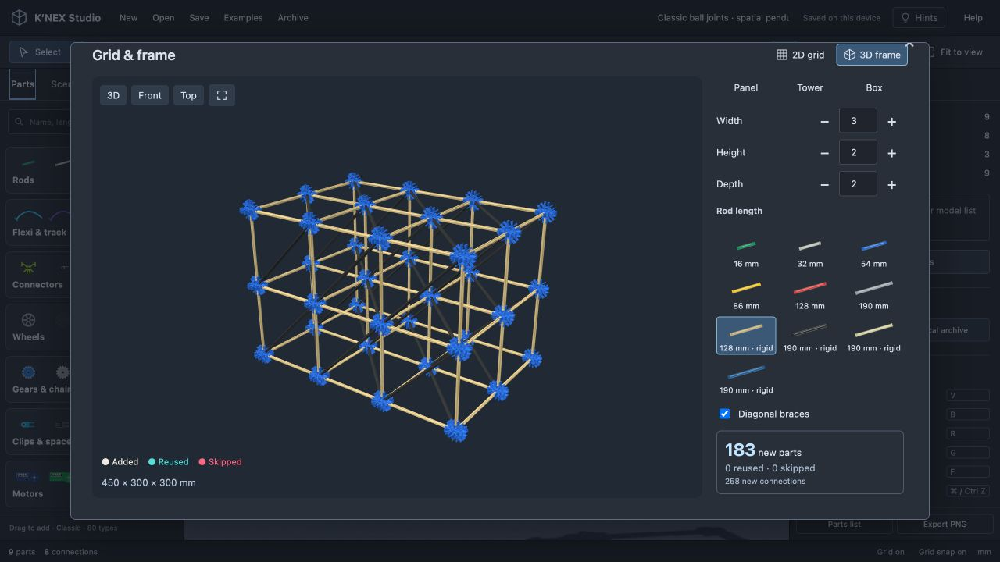

End snapping and axle bearings work with all five. Side gripping is available on ribbed variants; the solid yellow-white and translucent shafts’ side fit remains unverified and is disabled. Nominal lengths are rounded supplier labels; endpoints use the existing Classic grid spacing. Shaft section sizes and fit tolerances remain photo estimates. Rod bending, stiffness differences, buckling and fracture are not simulated. See [part references and limitations](docs/CLASSIC-PARTS.md#classic-rigid-rods).

## Classic clips and molded hinges

The Clips & spacers flyout includes blue **90912**, black **90919** and green **90913** hinge halves, plus blue **91440** and bronze **914401** rod-end stops. Each part has its own saved identity and photo-based profile. Blue pin halves mate with black or green socket halves through **Hinge** mode; the editor chooses this mode when a matching free half is present. Rod sockets use End or Side-on connections. End stops use End only.

Select the outer arm to rotate it with the gold ring or **R**. The pivot cannot slide apart. For a chain of hinges, run **Physics** and drag either arm. **Examples → Molded double hinge** is a two-joint stress model with its small mounting fixture locked in space; it is not a freestanding stand or an official building plan. **Part reference scenes → Clips & hinge halves** also shows the two end-stop colors.


The [Classic hinge guide](https://www.knexusergroup.org.uk/en/knex-hint-A8.html) documents the mating halves. Dimensions, boss clearances and contact stops remain estimates; hinge-to-hinge contact and physical maximum travel are not simulated. Generic through-rod use of the hinge bore is disabled until verified. [Part sources and approximate masses](docs/CLASSIC-PARTS.md#classic-clips-and-hinge-halves) are recorded separately.

## Classic Y clips

Ten referenced Classic Y-clip colors are available in **Clips & spacers**. Their compact C-jaw grips the side of a ribbed rod; their short male peg accepts a standard connector socket. Choose **Side-on** for the grip and **End** for the peg. The jaw is not treated as a full rod-end socket, axle bore or drive key. Short green rods cannot receive a side grip.

Side-on placement now follows the pointer along the shaft and seeks nearby clear space if the preferred position is occupied. After placement it is a rigid clip connection; use **Detach** and **Reconnect** to reposition a section. A Y clip with its jaw occupied can reconnect its free peg while carrying the attached rod with it.

**Examples → Part reference scenes → Y clips · grip & peg** shows all ten variants assembled on rods. The reference scene demonstrates connections and colors; it is not a manual build.


Identities, photos and approximate supplier masses are recorded in [Classic parts coverage](docs/CLASSIC-PARTS.md#classic-y-clips). The [supplier's connection guide](https://www.knexusergroup.org.uk/en/knex-hint-A10.html) documents side gripping and connector attachment. Jaw/peg dimensions, metallic appearance, clearances and grip strength remain approximate. There is no elastic clip or slipping-force simulation.

## Classic ball-and-socket joints

The Clips & spacers flyout contains standard **90940 / 90945** and large **99036B / 99036S** ball-and-socket clips. Matching halves snap through **Ball joint** mode, selected automatically when a free compatible partner exists. The two sizes cannot cross-connect. Each half also has a standard rod jaw; neither has a generic axle hole or drive key.

Drag a terminal arm directly to aim it around its ball center, or use the three colored rotation rings. Clipped parts follow as a rigid group. For linked arms, use **Physics → Play**, pull either arm and release. **Examples → Ball-joint pendulum** uses both sizes in a nine-part chain with a three-part fixture locked in space. It is an original motion demo, not a freestanding build or official manual model.


The [Classic connection guide](https://www.knexusergroup.org.uk/en/knex-hint-A9.html) identifies these joint families and their spatial movement. [Part identities and approximate masses](docs/CLASSIC-PARTS.md#classic-ball-and-socket-clips) come from supplier listings. Geometry is reconstructed from photos, with unverified ball radii, cup profiles and clearances. Simulation constrains the ball center, but does not yet model socket contact, angular stops, friction at the snap fit or separation force. Extreme orientations can therefore overlap the cup. Mixed ball-and-hinge chains, hard pulling, locked supports, cancellation, frame-rate consistency and save/reload have automated coverage.

## Classic wheels

The library includes 16 referenced hubs and tyres, including silver/black spoked hubs, 37 and 50 mm racing hubs, narrow hubs, racing tread and slick tyres. **Examples → Part reference scenes → Racing wheels & bearings** opens a comparison bench.

Racing hubs snap onto rod ends and spin freely without sliding. Narrow and spoked hubs use through-holes. Tyres accept their documented hub families; the wide 50 mm racing tyre can hold two narrow hubs. A tan drive clip couples a compatible hub to a motor-driven axle. [Part identities, source guides and remaining limits](docs/CLASSIC-PARTS.md#classic-wheel-expansion) are documented separately.


## Classic angled supports

The orange 91690 clip fits a connector's triangular recess and holds a rod at 45° to its plane. Choose it from **Clips & spacers** and aim at a free recess. The keyed fit works from either face, preserves the connected assembly, and supports pattern copies. **Examples → Splayed support** opens an original four-leg build. [Sources and dimensional limits](docs/CLASSIC-PARTS.md#classic-angled-clip).


## Original two-speed motor

The larger gray **92401 Tony motor** has its own reconstructed four-AA housing and mounting geometry. Open **Examples → Two-speed windmill**, then choose **Slow** or **Fast** in the motor playback panel. The switch is saved with the part and used by controller keys and playground driving. Supplier approximate speeds are 48 and 240 RPM; playback does not calculate torque or battery load. [Sources and dimensional limits](docs/CLASSIC-PARTS.md#original-two-speed-motor).


## Classic molded panels

**Parts → Panels** opens a searchable flyout with 35 original 910xx variants: four triangular sizes and four square sizes. Each uses molded rod-end pegs that snap into ordinary connector sockets. Square panels close four corner joints automatically when placed in a matching frame. Triangle panels have three straight pegs. No axle hole is inferred from the face perforations.

**Examples → Panel wall** opens a 35-part shared-corner build. **Part reference scenes → Classic molded panels** compares all eight shapes. Panels move with their connected assembly and retain their pegs through disconnect/reconnect, repeat and save. Supplier approximate masses contribute to balance and joint simulation.

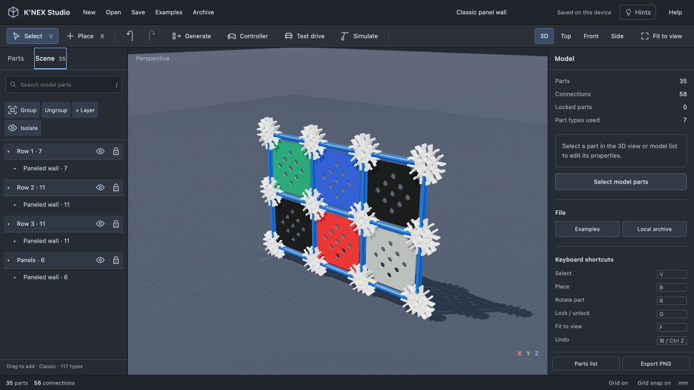

The photos determine the outline, perforation pattern and peg arrangement; plate thickness, rib/peg tolerances and some dimensions remain estimates. Curved and flexible panels are still separate pending work. [Part identities and fit limits](docs/CLASSIC-PARTS.md#classic-molded-panels).

## Shared physics workspace

Open **Physics** in the main workspace, then **Play**. Gravity, articulated hinges, ball-and-socket joints, freely moving rigid sections, rolling balls, contacts and tipping share one Cannon world. Pull a free part with the mouse and release. **Reset** restores the starting pose; leaving Physics restores the editor build. Settings and ball start positions are saved, but simulated poses are temporary.

- **Free:** responds to gravity and contacts. There is no automatic hidden anchor.
- **Locked:** holds a rigidly connected section in space while it supports and collides with other objects. The editor's lock remains the same saved property.
- **Bypass:** holds a rigid section and excludes its contacts and joints. It does not act as an invisible support.
- **Rigid assemblies:** freezes relative joint movement for the preview; an unlocked whole assembly can still fall or tip.
- **Build-to-build collisions:** turn off to allow separate structure bodies to pass through one another. Balls and the floor still collide.

**Place ball** previews a vertical drop above the pointed surface and centers between nearby compatible rails. **Above selection** places directly above a selected part; **Drop height** controls clearance. **Ball track example** loads an original locked fixture using real 92602 orange tubing, 90910 clips and blue cross-rods. It is not a freestanding or manual-derived model.

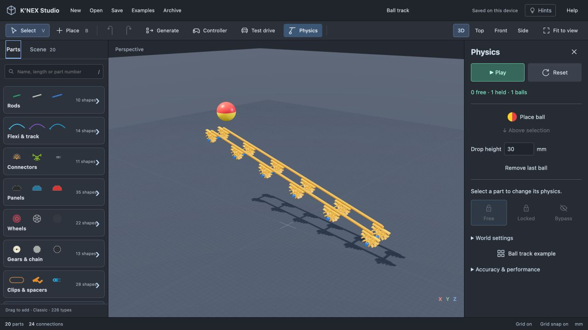

The ball represents assembled **90990 red + 90991 yellow halves**, approximately **46 mm** in diameter, identified by the [K’NEX User Group ball-coaster guide](https://www.knexusergroup.org.uk/en/knex-hint-R5.html). The outer profile is reconstructed; internal clips and manufacturing tolerances are not modeled. Its 24 g mass, hollow-shell inertia, grip and restitution are estimates.

Collision shapes use simple rod, hub, socket and rail proxies. Other housings, panels and specialty fittings use conservative bounds. Small ribs, cavities, exact snap-fit friction, angular stops, separation force, flexible deformation and tooth contact are not simulated. The solver uses 240 Hz substeps, limited mouse forces and bounded catch-up work. Speeds are capped at 5 m/s and 100 rad/s. This is not a continuous-collision guarantee; difficult intersections and very fast contact can remain approximate. Limits are 32 balls and 12,000 collision shapes, with a visible error rather than silently missing colliders. A selected rigid section can be bypassed to reduce cost.

## Part colors and crossing selection

Rod and connector cards show one entry per mechanically equivalent shape or length, with real catalog color swatches. The last chosen color is remembered on this browser. Square, ribbed, rigid and molded-stop rods remain distinct where their geometry differs. Flat grids offer real 8-way variants, blue/purple 3D pairs and metallic-blue/silver 3D pairs; their socket orientations and interlocks remain genuine.

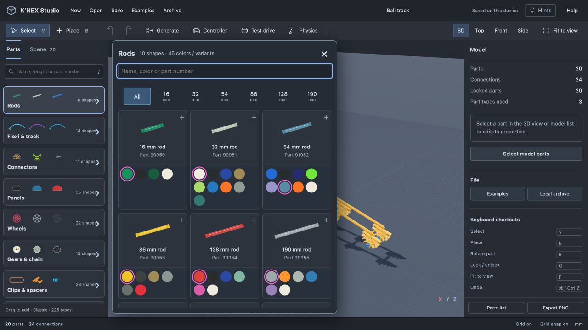

**Shift-drag in Select mode** selects parts whose projected bounds touch the box. A rod tip can be selected without enclosing its center. This is a conservative bounds test, not pixel-perfect silhouette selection; it does not automatically expand to the whole connected build.

## Performance and limits

The model limit remains **2,500 parts**. Rigid rod and connector render meshes are merged per material and cached, preserving their triangles and ray picking. Simulation attaches collision shapes in a batch and uses ID maps for pose updates. [Benchmark details](docs/PERFORMANCE.md) include before/after rendering, selection and solver measurements. Open `benchmark.html` on the demo or development server to reproduce the synthetic grid test. These device-specific results do not establish a safe higher cap for arbitrary builds.

## Physics and accuracy

Parts are procedural reconstructions from identified references, not production CAD. Nominal rod lengths differ from effective connector-center spacing. Small clip details, clearances, motor housing dimensions and tooth shapes remain approximate. Classic flexi rods and split-tubing track are shape previews; Micro track is not included.

The shared physics workspace handles moving structures and balls. **Motor/gear playback and the driving playground remain prescribed-motion previews**, without torque, battery-load, suspension or full vehicle contacts. The shared world now has its own torque-limited drive controls for the 92840, 22722 and 92401 enclosed motors. Placement and sliding retain separate conservative fit checks; rotation has no complete swept collision check. Supplier approximate masses and speed references are recorded in `dist/part-specs.js`; structural masses can be overridden for batteries or payload.

## Saving

Autosave and the recovery archive are local to a browser and site origin. **Save** downloads editable JSON; **Open** imports it. Use a downloaded file to transfer a build between the local editor, the hosted demo and another device. Export tools also provide a parts list and an image.

## References

- [K’NEX patent US7666054B2](https://patents.google.com/patent/US7666054B2/en): connection geometry and rod proportions.
- [Classic connection methods](https://www.knexusergroup.org.uk/en/knex-hint-A2.html) and [3D connectors](https://www.knexusergroup.org.uk/en/knex-hint-A4.html).
- [Enclosed motor mounting](https://www.knexusergroup.org.uk/en/knex-hint-M4.html) and [drive clips](https://www.knexusergroup.org.uk/en/knex-hint-W6.html).
- [Swing guide](https://www.knexusergroup.org.uk/en/knex-project-swing.html) and [wheeled vehicle guide](https://www.knexusergroup.org.uk/en/knex-project-vehiclewheeled.html).
- [Basic Fun Builder Basics instructions](https://www.basicfun.com/wp-content/uploads/2023/02/17010-Imagine-Builder-Basics.pdf) and [motorized instructions](https://www.basicfun.com/wp-content/uploads/2023/02/85049-325PC-Motorized-Creations-Core-Instructions.pdf).
- Part-specific sources are linked from the editor and retained in the catalog and `part-specs.js`.

## Project structure

- `dist/engine.js`: parts, sockets, snapping, connection graph and file validation.
- `dist/geometry.js` and `*-geometry.js`: procedural Three.js geometry.
- `dist/app.js`: editor, selection, interactions and simulation controls.
- `dist/examples.js`, `dist/example-gallery.js`: example factories and rendered gallery.
- `dist/hinge-system.js`, `dist/stability.js`, `dist/motor.js`: simulation modes.
- `dist/path-builder.js`, `dist/path-builder-ui.js`, `dist/flexible-parts.js`: sourced flexible parts and visual path generation.
- `dist/axle-placement.js`: nearest clear through-hole placement along a shaft.
- `tests/`: Node test suite for geometry, connections, motion, collisions, examples and serialization.

Bundled third-party notices: [Three.js](dist/vendor/THREE-LICENSE), [cannon-es](dist/vendor/cannon-es.LICENSE), and the font OFL notices under `dist/fonts/`.

## Right-angle crown gearing

Choose a gear, then **90° gears** in the floating placement toolbar. Point at a crown gear and use **R** to move the contact around its rim. Either assembly order works. Mount both gears on independent rods; add a tan key for freely spinning gears.

**Examples → Three-axis crown gearbox** runs two 34:14 stages through two corners. Its output turns at (34/14)², approximately 5.90 times input speed. The motor and four bearing connectors are locked test supports, not a freestanding frame.

Based on [K’NEX User Group Hint G1](https://www.knexusergroup.org.uk/en/knex-hint-G1.html). Pitch distances and the 3 mm crown contact plane are reconstructed estimates. This is ideal kinematic transmission without torque, tooth contact, backlash, slipping or swept collision simulation. Joints mode does not solve gear transmission.

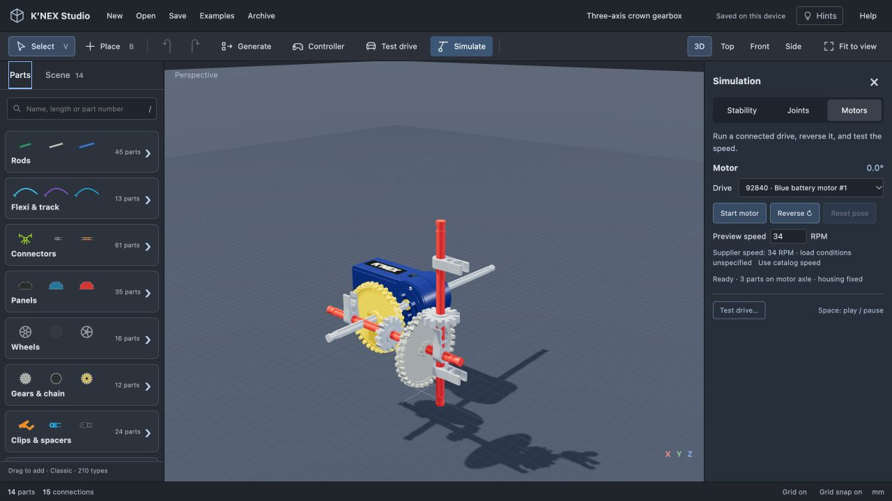

## Original 12 V motor and white gear

The **92815 12 V motor** and **90983 dedicated white gear** have separate part identities. The housing mounts on two rods through its underside sleeves. **Worm drive** snaps only the matching motor/gear pair; the white gear cannot mesh with ordinary gears. Support its axle independently and use a tan clip to key the gear.

Open **Examples → 12 V reduction bench**. Its dedicated gear drives an axle carrying a separate 14-tooth gear, which drives the 82-tooth output at 14/82 speed. The 19-part fixture has 21 connections and 11 locked support parts. It is an original test fixture, not an official manual reproduction.

The RPM control previews the **white-gear axle**, defaulting to 5 RPM as a software choice. The supplier lists approximately 66 RPM without clearly identifying the shaft; neither that value nor an invented worm ratio is applied to the output. Reverse previews supply polarity. This tethered motor is excluded from remote vehicle controllers.

The housing, mounting dimensions, 41 mm gear diameter, 56 visual teeth and seven visible worm turns are reconstruction estimates. Tooth count, worm starts/lead, internal speed ratio, torque, electrical dynamics and tooth contact are unverified. The worm is static display geometry; preview imposes motion on the keyed output, not a calibrated worm simulation. Sources and mass provenance are in [Classic parts coverage](docs/CLASSIC-PARTS.md#original-12-v-worm-drive).

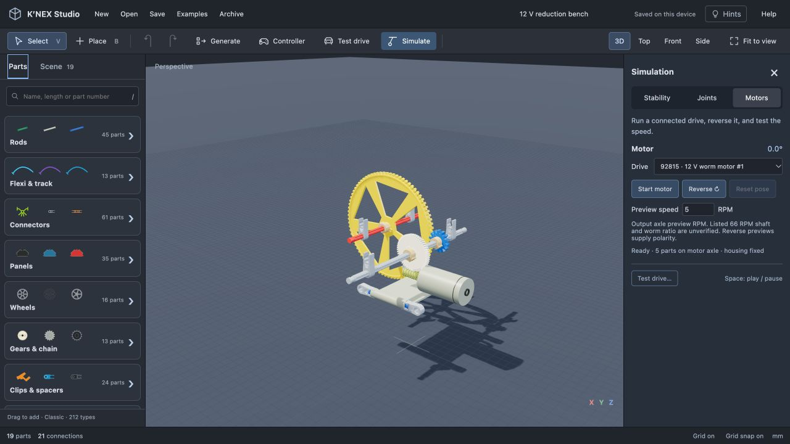


### Small Classic wheels: grip or free bearing

**Parts → Wheels** includes [91140 open-center](https://shop.knexusergroup.org.uk/products/91140) and [918300 closed-center](https://shop.knexusergroup.org.uk/products/918300) 25 mm wheels. The open wheel grips the axle and turns with it; a tan key is optional. The closed wheel snaps onto a rod end and spins independently. Neither takes an extra tyre. These distinct connections follow [Hint W1](https://www.knexusergroup.org.uk/en/knex-hint-W1.html).

**Examples → Small wheels · grip and spin** compares them on one powered shaft. Its support fixture is locked in space. The playground also recognizes complete wheels as rolling surfaces. Diameter and supplier mass are approximate; the 6.3 mm width, 4.3 mm bearing depth and molded details are photo estimates. Grip is idealized, with no calibrated slip or traction model.

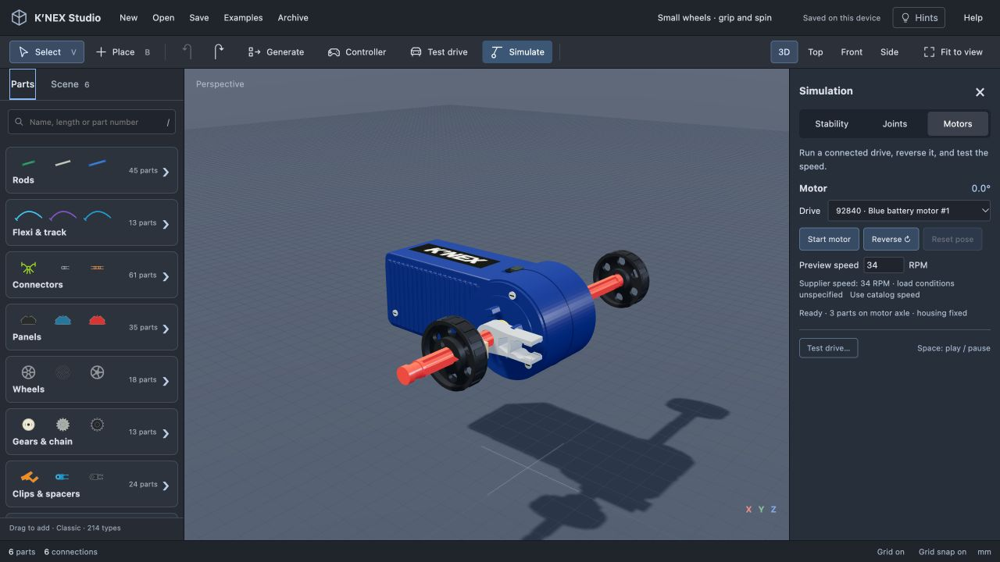


### Pulley belts

**Generate → Pulley belt** connects two existing small or medium Classic hub/pulleys with the [original brown 92001 band](https://shop.knexusergroup.org.uk/products/92001). The preview shows the loop, fitted length and ideal speed ratio. Select a band to refit it after moving the pulleys. Both insertion and refitting are undoable; models retain the band and its two contacts.

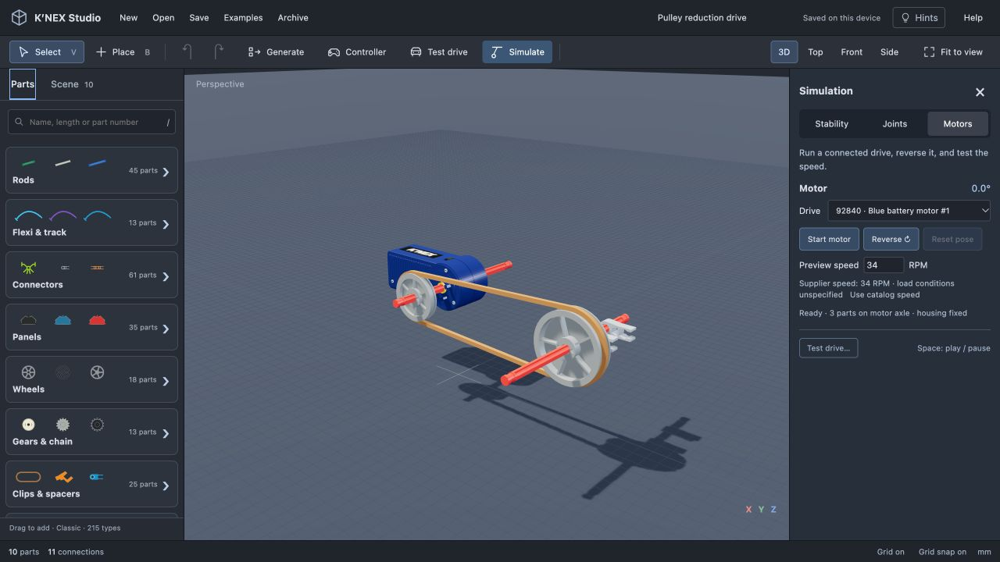

**Examples → Pulley reduction drive** demonstrates a 0.74× reduction with both shafts turning the same way. Belts and gears can form one transmission. Locked or displaced outputs stop the motor before any part turns. The mounting follows [Hint W7](https://www.knexusergroup.org.uk/en/knex-hint-W7.html); the example is an original fixture locked in space.

Belt fit and tension are unverified. Supplier approximate section is 3 × 3 mm; modeled groove pitch radii are reconstruction estimates. The stated 185 mm unstretched length has an unspecified measurement convention. Playback assumes no slip and does not calculate elasticity, torque, friction, joint forces or a safe stretch limit. Crossed belts and multi-pulley routing remain future work.


### Original pulley colors and tyre fittings

The Wheels flyout now includes [gray small 90978G](https://shop.knexusergroup.org.uk/products/90978g), [gray medium 90979G](https://shop.knexusergroup.org.uk/products/90979g) and [white small 909782](https://shop.knexusergroup.org.uk/products/909782), alongside the silver variants. Each keeps its part number, supplier approximate mass, documented tyre fits and visible color. They slide and spin on rods, accept tan drive clips and work with the pulley-band builder.

**Examples → Pulley colors & fits** compares a white-to-gray 0.74× belt drive with a separate freely rotating tyre. The medium pulley now has the photographed five-rib front face. Small moulding details, widths, groove profile and reverse-face key recesses remain estimates; see the [reference ledger](docs/CLASSIC-PARTS.md#classic-pulley-variants).

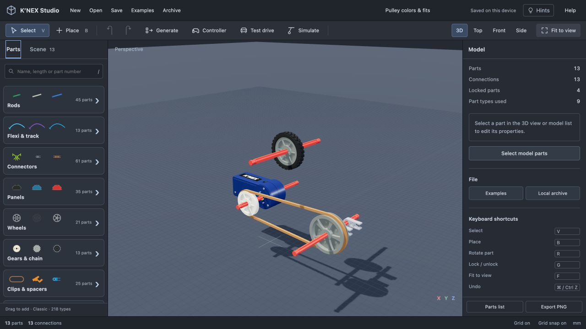

### Stepped structures

**Generate → Grid & frame → Stepped profile / Stepped frame** creates flat stepped lattices or wider 3D frames. Use **+ / −** for Steps, Rise cells and Depth bays, or type a value for a live preview. Rod lengths and diagonals use the existing Classic stock families. Higher rises contain intermediate connectors and rods; no part is stretched.

The preview shows physical dimensions and added, reused or blocked pieces. Placing a larger structure at the same origin reuses the existing lattice, including its IDs, locks and payloads. Insertion is one undo step. Each step has its own layer.

The gallery includes a 37-part profile and a 755-part grandstand frame. These are original open frameworks, not official manual replicas, solid stairs or load-rated seating. The frame has XY and XZ bracing; paired blue connectors do not provide the YZ diagonal plane. Tests exercise connected 1,801-part flat and 2,435-part spatial builds.

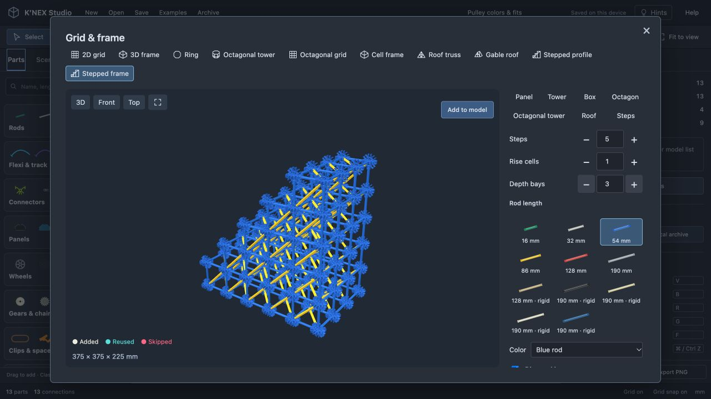

### Original orange coaster track

Path builder now offers the original orange tubing system alongside purple tubing and green cross-ties. It generates 90910 five-way track connectors on 90958 rods with end stops, using cuts from the supplier's approximately 1.73 m 92602 tubing stock. The **Original orange track** example follows the assembly method in [63030, pages 3–4](https://www.knexusergroup.org.uk/bk/63030.pdf). Gauge, tab dimensions, stop profiles and bend limits remain unverified; these are layout assemblies requiring supports, with no running coaster-car physics. See [part evidence and limitations](docs/CLASSIC-PARTS.md#original-orange-coaster-track).

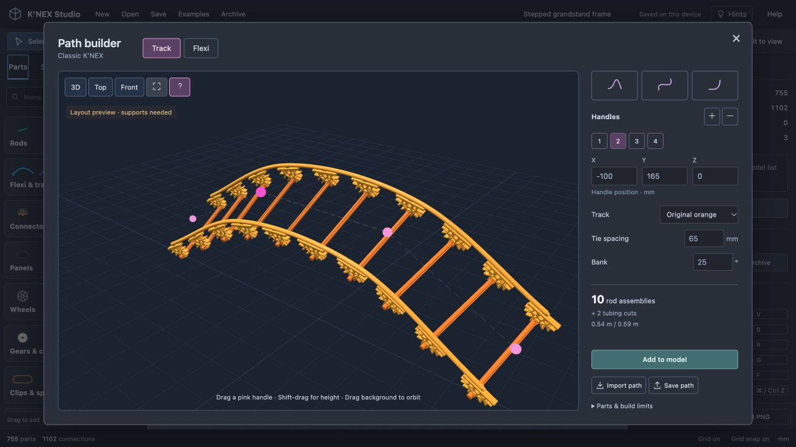

Long orange paths now use multiple stock-sized tubing cuts joined by original 20501 red inserts. Optional cyan markers show the joints in the path preview. **Supported tubing splice** demonstrates the separate 90911 rod clip from the original manual. The library contains 224 Classic part types; fitting dimensions remain photo estimates. See [splice references and limits](docs/CLASSIC-PARTS.md#classic-tubing-splices-and-longer-generated-paths).


### Classic tethered motor kits

**Parts → Motors** now includes the original red **92875** and gray **20554** kits. Through-hole placement chooses the central drive or a mounting passage; End placement fits the perpendicular drive socket. Both shafts drive their connected assemblies together while the case and mounting rods stay fixed. Open **Tethered motor · two outputs** or **Gray tethered motor** to try the 17-part fixtures.

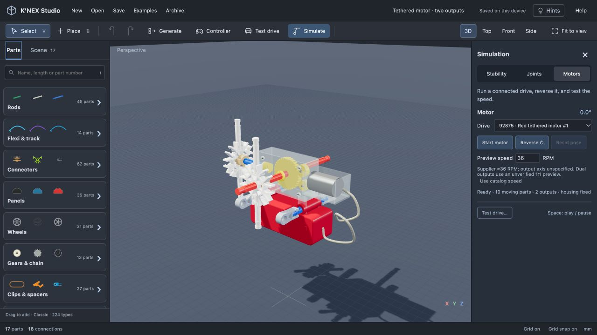

The separate holder is currently modeled docked to the motor as one kit; its lead is schematic. Supplier approximate speed is 36 RPM, but its reference axis and relative output ratio are unspecified, so dual-output playback is labeled an uncalibrated 1:1 preview. Geometry, battery inclusion in the supplier mass, torque and load response remain unverified. See [sources and limitations](docs/CLASSIC-PARTS.md#classic-tethered-motors).


### Molded axle stops

The original orange 90958 rod now stops coaxial bearings at its molded barriers. Dragging a bearing or the rod cannot jump through a stop; sliding back and rotating remain available. Placement finds a nearby clear position. Try **Examples → Molded axle stops**, then select **Slide and spin** and drag the gold arrow.

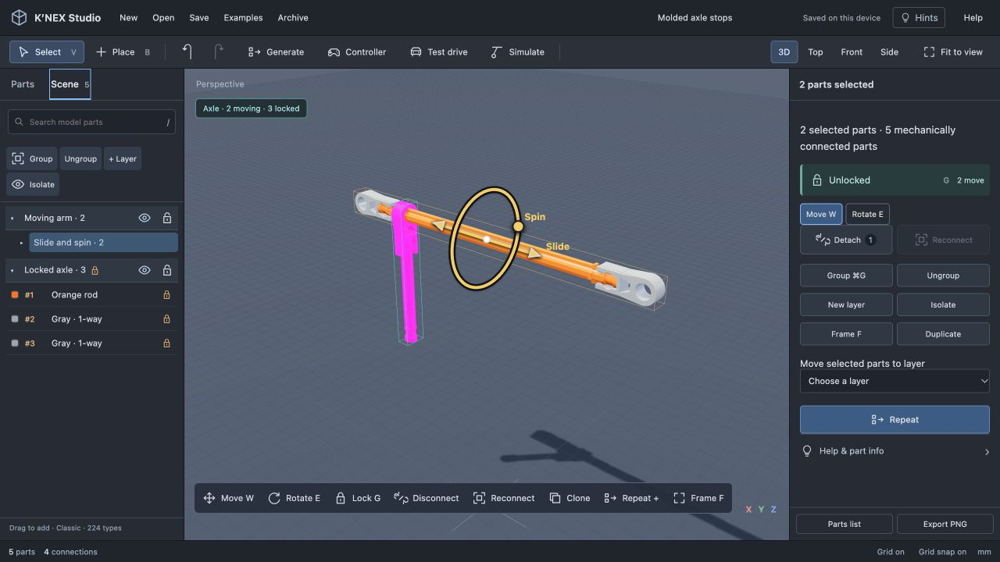

Stop dimensions and bore clearances remain photo estimates. This is an editor collision constraint, not a measured snap-force or contact-physics model. See [reference and limits](docs/CLASSIC-PARTS.md#molded-stops-on-orange-rods).


### Hollow halls and tunnels

**Generate → Grid & frame → Hall** creates a stock-rod outer frame. **Open interior** removes the generated internal lattice; **Open ends** also removes the two X-end grids to leave a continuous passage. Use + / − to grow the shell, choose another Classic rod size, or replace diagonal braces with matching molded panels.

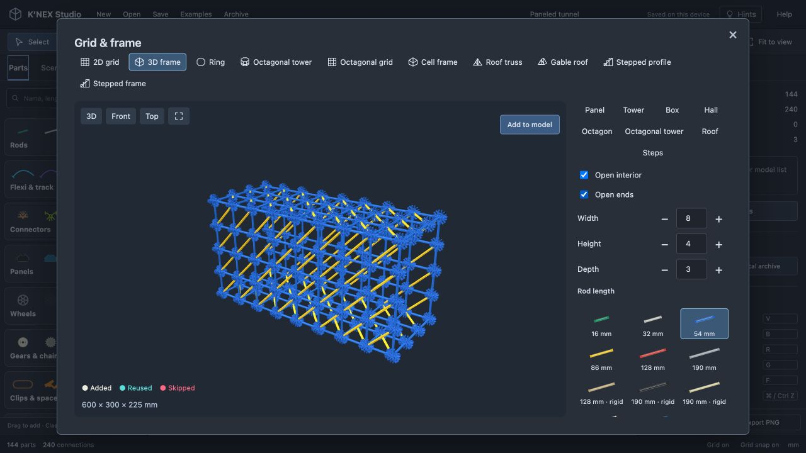

The gallery's **Hollow hall frame** has 660 parts. **Paneled tunnel** now uses 144 parts and 240 connections with no interior crossbars or end-face grids. Existing saved builds are preserved. Adding a shell alongside another shares matching boundaries; generating over an existing filled frame does not remove its internal parts.

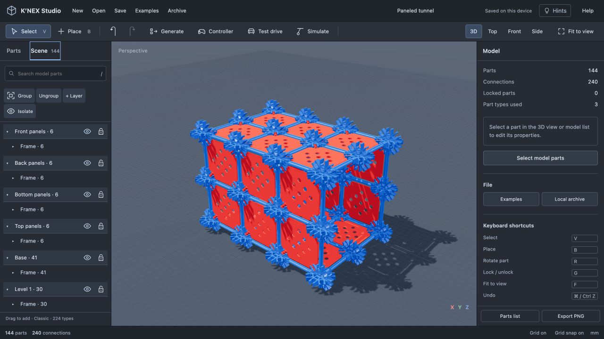

All members use existing stock lengths and real sockets. Tests cover a connected 2,116-part shell, every standard rod length, thin one-cell dimensions, all matching square-panel sizes, shared faces, preserved payloads and a clear passage. These are generated examples, not official manual replicas or load-rated structures. XY and XZ faces can be braced; the paired blue connectors do not provide YZ diagonal sockets. Dimensions refer to connector centers; molded bodies project into openings.


## Narrow red wheel and automatic drive-clip capture

The [20301 narrow red wheel](https://shop.knexusergroup.org.uk/products/20301) is now in Wheels, bringing the visible Classic catalog to 225 types. Its supplier photograph establishes the flanged rim and crossed spoke pattern; the listing identifies 37 mm diameter and its product data gives approximately 2.06 g. Width (modeled 6.2 mm), rib section, bore tolerances and key clearance remain photo estimates.

The original [12078 Ferris Wheel manual, page 9, step 13](https://static.knexdb.com/12078-Collect-and-Build-Ferris-Wheel.pdf) shows this wheel threading onto a Classic gray axle, then receiving a tan drive clip. The editor supports that through-hole and keyed mounting. It slides and spins freely until keyed to the shaft. No tyre, belt fit or extra spoke attachment is offered without verified compatibility. The manual's Micro spokes and brick components are not added to this Classic-only catalog.

Placing a tan drive clip against an already mounted wheel, pulley, gear or compatible connector now also captures the aligned shaft if it reaches through the clip's full bore. Adding that shaft last works too. Off-axis, perpendicular and out-of-reach rods are rejected; one bore cannot capture two overlapping rods. Existing saved models are not rewritten. Redundant hand-authored shaft links were removed from the affected example factories.

Examples → Part reference scenes → Racing wheels & bearings includes the red wheel with its clip: 25 parts and 19 connections. The part remains a reconstruction, not measured CAD or a grip-force simulation. Tests verify both assembly orders, independent sliding/spinning, keyed motor rotation, unsupported tyre rejection, round trips and the existing pantograph/scale mechanisms.

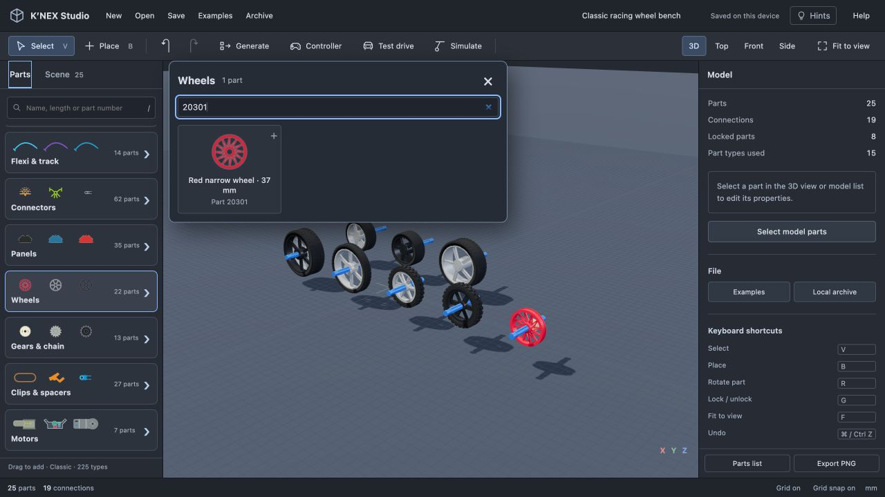


## Smooth Classic end cap

**23692E Black sleeve end cap** joins the existing 848900 snap cap as a separate catalog part, bringing the visible Classic catalog to 226 types. The [supplier photograph](https://shop.knexusergroup.org.uk/products/23692e) shows a smooth cylindrical shell, and its product data gives approximately 0.32 g. The supplier-linked [50 Model Building Set manual, page 5, Surfer step 4](https://www.knexusergroup.org.uk/bk/12211.pdf) explicitly illustrates the smooth cap as an alternative to the snap cap on a Classic rod end.

The cap attaches rigidly to either rod end, in either assembly order. It has one end socket and no through bore, side grip or drive key. Its modeled 8.4 mm outside diameter, 10 mm length, insertion depth and wall thickness are estimates, not measured CAD or verified fit tolerances. Existing cap models remain unchanged.

**Examples → Part reference scenes → Clips & hinge halves** includes an **Alternative end caps** group showing both caps on a white rod. Isolate and frame that group to inspect them. Tests cover rotated assembly, endpoint alignment, socket occupancy, mass, open mouth/closed rear geometry and saved-model round trips.

The [9091213 packaged hinge](https://shop.knexusergroup.org.uk/products/9091213) is confirmed as the existing 90912 blue and 90919 black halves, not another molded part. The orange 90914OR listing remains deferred because its photo shows a ball-shaped end inconsistent with the listed rod-end identity. The [91620 stub-axle hint](https://www.knexusergroup.org.uk/en/knex-hint-W8.html) establishes attachment to 5-way/8-way connector faces and a free wheel on its rod end; detailed mounting geometry remains pending.

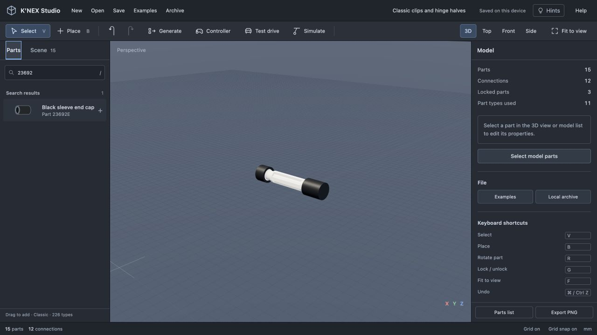


## Motorized ball run and fitting between connectors

**Examples → Motor lift & ball run → Physics → Play** runs a 120-part, single-pass fixture. A continuously rotating **92840** motor drives a blue-rod crank, gray connecting rod and yellow-rod rocker through four physical pivots. That linkage raises and lowers the lift into a narrowed tubing intake. Banked orange rails descend around two bends, the ball drops onto two **91108 190 mm flexis**, then reaches the rod catcher. **Reset** reloads the ball. Build-to-build collisions are enabled. The track and motor housing are locked in space; this is an original test fixture, not a freestanding model or a recirculating elevator.

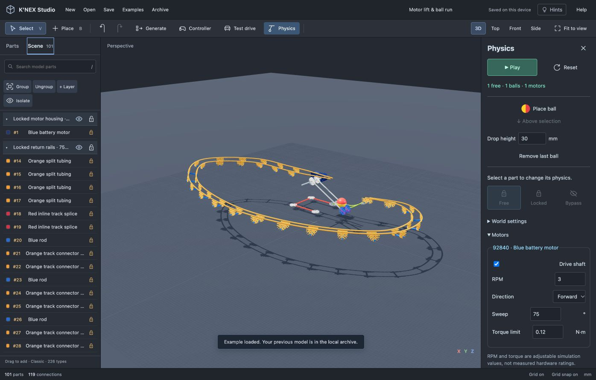

**Physics → Motors** enables a drive shaft and adjusts RPM, direction and estimated torque limit. Supported enclosed motors: 92840, 22722 and 92401. Motor constraints, ball contacts, gravity and hinges run in the same solver. Automatic reversing has been removed: older saved sweep values load with a warning and the motor rotates continuously. Gear teeth, belt tension and flexible chains do not yet transmit physical torque here. The separate motor preview still offers ideal gear and belt playback. RPM and torque settings are simulation parameters, not verified hardware ratings.

Select two connectors, then **Generate → Fit between**. Choose the open sockets, stock rod or flexi, and bend direction in a 3D preview. Both connectors remain fixed; both ends connect when accepted. Rigid rods require the correct distance and facing sockets. Flexis retain their documented approximate stock length. Impossible spans are rejected; no rods are stretched. Bend limits and interference checks remain unverified.

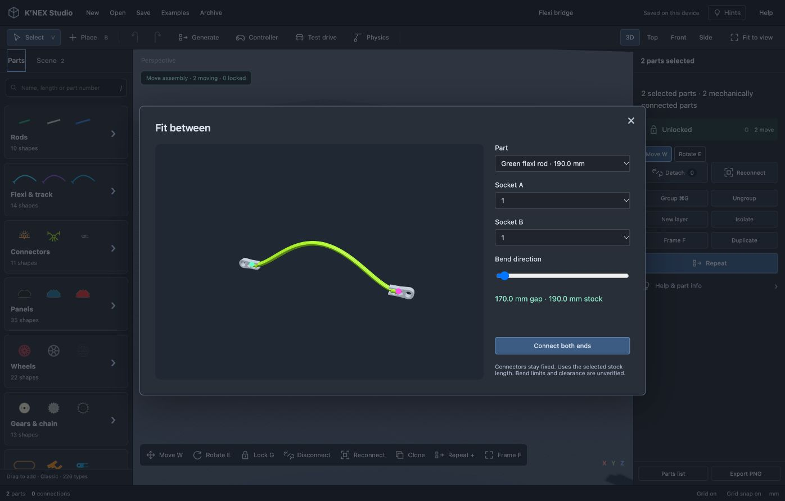

**Path builder → Ball rails** uses real blue cross-rods with 90910 track connectors and 92602 tubing cuts. Narrow transfer blends the entrance rail spacing from a white-rod-sized gap to the blue-rod gauge; clamps retain their actual side connections. Level ends blends banking to zero over the first and last 250 mm. Tubing joins use the existing 20501 inserts. The lift fixture leaves its intake tips overhanging the next cross-tie, with the fixture lock holding that geometry.

Part evidence: [92840 motor and mounting](https://www.knexusergroup.org.uk/en/knex-hint-M4.html), [92602 tubing](https://shop.knexusergroup.org.uk/products/92602), [90910 track connector](https://shop.knexusergroup.org.uk/products/90910), [91108 flexi](https://shop.knexusergroup.org.uk/products/91108). These are identified parts with reconstructed profiles and approximate dimensions, not exact manufacturing CAD.

Physics now refreshes the rotated floor's collision bounds and uses consistently sorted bounds for long assemblies, avoiding missed contacts. Large locked compounds are partitioned for collision lookup without changing their rendered parts or saved connections. Contact shapes remain simplified; small transient contact penetration and different outcomes after editing a track are still possible.

The lift is an original stock-part crank-rocker adaptation, not a copied official model. Mechanism references: [four-bar linkage kinematics, University of Illinois](https://dynref.engr.illinois.edu/aml.html) and [K’NEX crank-operated arm lifts, builder guide](https://shadowman39.github.io/official-lift-guide/lifts/arm-lifts/). Only the motor shaft is powered; the three other joints are passive. The flexi fixture has open exit tips to clear the ball, with its curved shape held by the simulation lock. Real flex under load is not modeled. Smoother 24-sided collision cylinders reduce artificial ledges at rail joins. Anchored planar closed linkages use additional solver iterations to maintain their pivots.

### Motor axle clearance correction, 13 October 2026

The motor lift now uses a stock yellow rod for its drive axle, offset through the 92840 housing so it still reaches the keyed crank hub but ends behind the connecting rod. The earlier gray axle intersected that rod during rotation. A regression checks rendered part bounds through more than a complete motor revolution, in addition to the full ball-run and pivot tests. Collision filtering for connected bodies is unchanged; this fixes the fixture geometry rather than claiming universal interference detection. Reopen **Examples → Motor lift & ball run** after updating to load the corrected fixture. Existing saved builds are preserved.

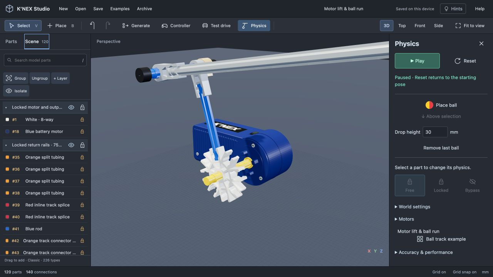

### Interference guard

The unified Physics workspace validates the modeled part surfaces before Play and after every solver substep. Hinge contact exemptions no longer hide collisions between other parts of the joined assemblies. A detected overlap stops playback, restores the last valid solver pose, highlights both parts and marks the intersection. **Show collision** focuses that point. The saved build is untouched. Reset or return to building to repair it.

Placement, direct dragging, transform handles and discrete rotations also reject intersecting edits. Swept checks sample motion at up to 0.5 mm surface travel; excessive movement stops validation instead of silently skipping it. The guard uses reconstructed mesh dimensions with a 0.12 mm surface tolerance, not measured manufacturing tolerances. Directly fitted part pairs are exempt to allow modeled snap fits. Balls and floor retain solver contact response. Bypass and the explicit build-collisions-off setting disable the corresponding physics checks. Prescribed motor/controller/playground previews and bulk generators are not yet fully guarded; opening Physics performs a full preflight on their result.

The unchanged motor-lift/ball-run example currently fails that preflight: orange tubing #37 intersects white connector #8; purple connectors #11 and #12 also overlap. These are reported rather than automatically altering the layout. The isolated crank linkage passes a full revolution with its current shaft; restoring the earlier long gray shaft causes a detected shaft/coupler collision and rollback.

Mesh queries use [three-mesh-bvh 0.9.1](https://github.com/gkjohnson/three-mesh-bvh/tree/v0.9.1), vendored from the npm release under its MIT license in `dist/vendor/three-mesh-bvh.LICENSE`. Only the Three.js import path is adjusted for the local bundled module.

### Prompt-to-build MCP server

A local MCP companion lets an AI host search actual K’NEX parts, inspect sockets, assemble and repeat sections, undo edits, validate collisions and publish an editable build. It preserves an experimental 1,700-part aircraft grid test and a rough-volume grid converter. These are not manual-based aircraft builders. The server uses the same snapping and mesh checks as the editor, with atomic edits and revision checks. Published builds open through a local **Load AI build** preview and are saved as `.knex` files. [Setup, tools and limitations](docs/mcp/README.md).

### Experimental grid shells

**Generate → Grid shell · experimental** converts editable boxes, ellipsoids and tapers into surface frames using actual stock rods and compatible connectors. Drag volumes, resize them, preview the conversion and add it as one reversible edit. The MCP `shape_to_frame` tool exposes the same conversion. **Examples → Aircraft grid test** preserves the 1,700-part stepped-grid prototype. The next aircraft approach follows real angled assemblies; see [the manual study](docs/mcp/aircraft-manual-study.md). This is an original approximate display model, not a flight simulation or a physically certified build. [Workflow, screenshots and model](docs/mcp/shapes.md).
