# K’NEX Studio

A browser-based Three.js editor for classic K’NEX parts, connected mechanisms, and interactive physics experiments. Independent software, not an official K’NEX product.

**[Open the live demo](https://ed-gpt.github.io/knex-studio/)** · [Report a bug or suggest an improvement](https://github.com/Ed-GPT/knex-studio/issues)

No installation required. Builds save in your browser; use **Save** to download a portable copy.

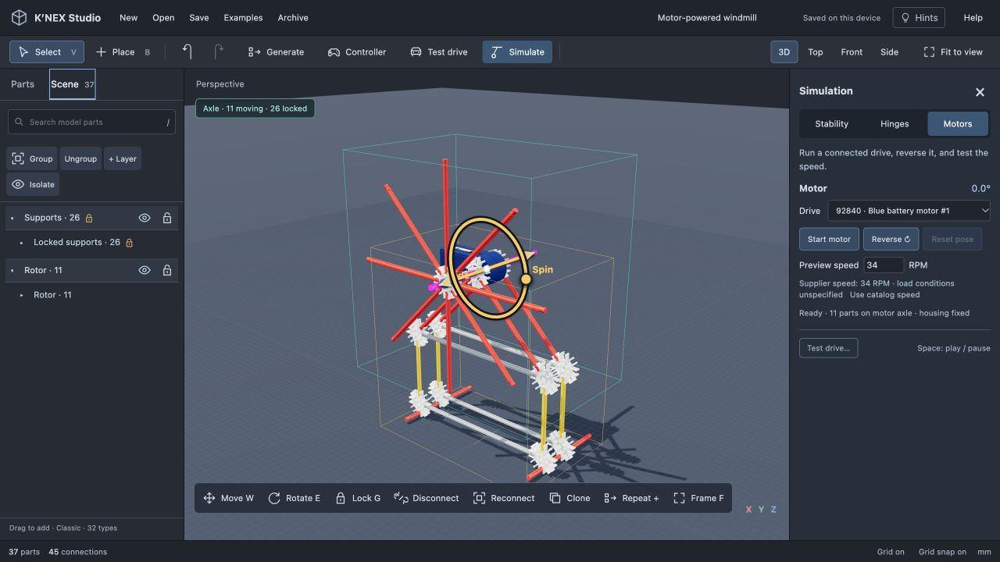

## Screenshots

### Build with real part references

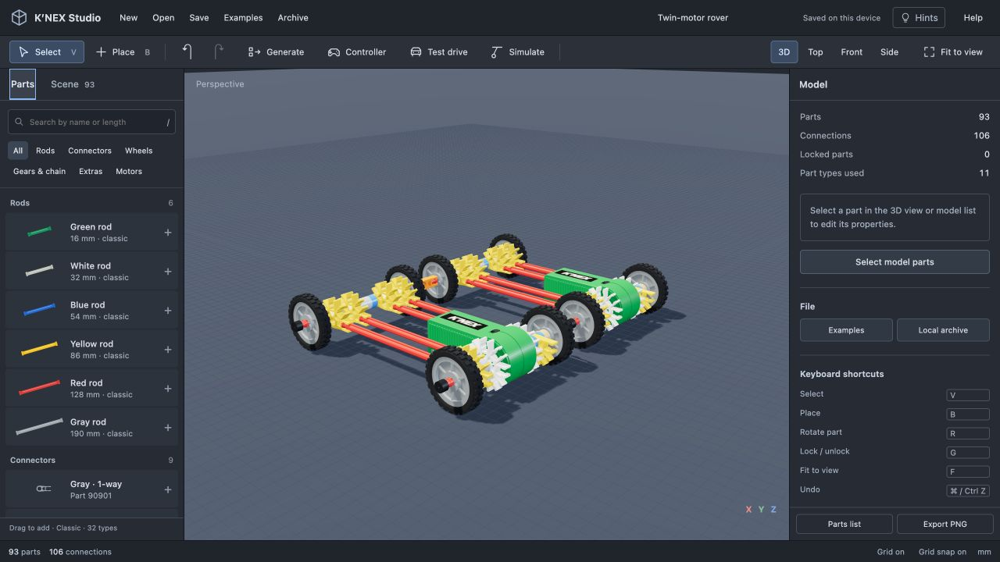

### Explore the examples

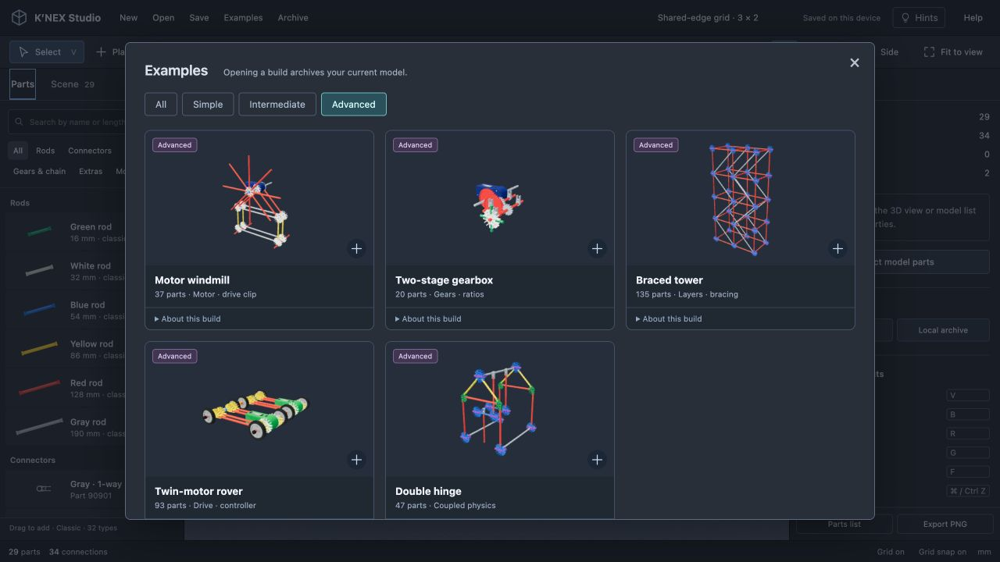

Screenshots captured from the working editor. Parts and physics are approximations; see the accuracy notes below.

## Run locally

Use a current Node.js release. No dependency installation or build step is needed.

```sh
npm run dev
```

Open http://127.0.0.1:5577. To use another port: `PORT=5578 npm run dev`.

```sh
npm run check
npm test
```

The complete static application is in `dist/`, including Three.js and cannon-es. See [hosting instructions](docs/HOSTING.md) for a website demo.

## Build and interact

- Drag parts from the library. Compatible endpoints and sockets snap together.
- Select a part or group. Pink stays selected; mint indicates hover.
- Drag movement arrows and rotation rings. Connected parts follow their mechanical joints.
- **Lock / Unlock** fixes a part's position and orientation. Press **G** or use the padlock. Layer editing locks are separate.
- **Detach** releases external joints while preserving the joints inside a selection. **Reconnect** snaps it elsewhere.
- **Clone** copies a selection. **Repeat +** uses the section's connection-grid spacing, reuses coincident parts, and skips obstructed additions.
- Open **Simulate** for stability, coupled joints, or motor playback. **Test drive** runs a vehicle copy in a separate playground.
- **Hints** toggles optional on-screen guidance. Fine adjustment, mass, transforms, connections, and part information are expandable.

| Shortcut | Action |
| --- | --- |
| V / B | Select / place |
| W / E | Move / rotate |
| G | Lock / unlock |
| F | Frame selection |
| Middle-drag / R | Rotate |
| C / Tab while placing | Connection method / socket |
| Alt-click | Select one part inside a group |
| Ctrl/Cmd D | Clone |
| Ctrl/Cmd Z | Undo |
| Escape | Cancel the current operation |

## Example gallery

Every thumbnail is rendered from the actual example model. Counts come from its parts, rather than handwritten claims. Opening an example first archives the current model; simulations start when requested.

| Level | Builds | Explore |
| --- | --- | --- |
| Simple | One square, Single hinge, Axle & bearings | Snapping, patterns, locking, sliding and rotation |
| Intermediate | Shared-edge grid, Playground swing, Wheeled chassis | Shared boundaries, gravity, wheels and axles |
| Advanced | Motor windmill, Two-stage gearbox, Braced tower, Twin-motor rover, Double hinge, Molded double hinge, Balance scale, Pantograph | Motor drives, gearing, layers, remote control, payloads and closed-loop joints |

The swing is a single-bay adaptation of a published guide. The wheeled chassis follows an illustrated vehicle guide with supported part variants. The other builds are original demonstrations of referenced K’NEX connection methods; they are not verified official building plans. The single hinge deliberately fixes its axle in space. Reference scenes for connector shapes, hubs/tyres and motor housings are separated from the build gallery. Each build has optional reference information.

Example definitions and factories live in `dist/examples.js`. Existing models remain compatible with the version-1 JSON format.

## Visual grid and frame builder

Open **Generate → Grid & frame**. Choose a panel, tower or box, then use **+ / −** to grow its width, height and depth. The live 3D preview supports orbit, zoom, Front and Top views. Pick a Classic rod by its colored thumbnail; the cell size follows the actual modeled rod length plus its connector seats.

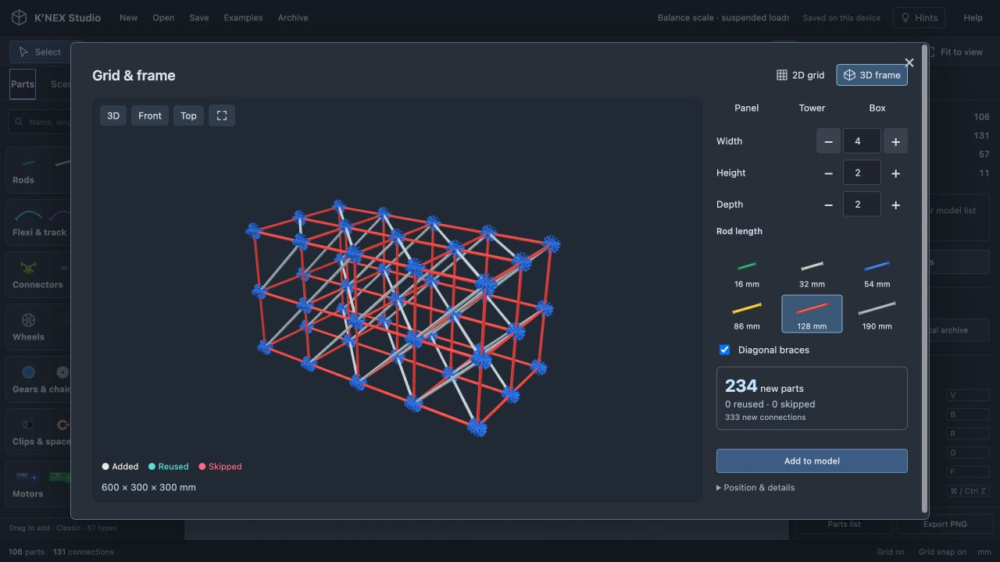

- **2D grids** use white 8-way 90908 connectors, vertically or horizontally. **3D frames** use interlocking pairs of blue 90907 connectors with sockets along all three axes. Shared cell boundaries contain one set of parts.
- Optional diagonal braces use the next stock rod size, with no rod stretching. Frame braces occupy XY and XZ faces. Gray-rod cells have no longer stock diagonal in this catalog, so braces are disabled for that size.
- The preview reports new, reused and skipped parts. **Position & details** allows precise placement against an existing build. Matching parts keep their IDs, groups, locks and mass settings; obstructed pieces, incomplete rods and isolated new hubs are skipped. Reused parts are cyan; skipped parts are pink. Collision bounds are conservative approximations.
- Generation is one undo step and produces individually editable parts, one selection group and layers for rows or levels. It is not a persistent parametric object. Use another adjacent generation or the existing pattern controls to extend it after insertion.
- Counts range from 1 to 30 cells per direction, subject to the existing 2,500-part model limit. Tests cover every stock rod size, all shared boundary directions, socket alignment, duplicate reuse, obstacles, save/import and a connected 2,072-part frame. The preview batches repeated geometry for large structures.

These are procedural demonstrations of the existing referenced Classic connector and rod system, not official building plans. Connector geometry and fit tolerances remain approximate; generated frames do not add structural load or collision simulation.

## Visual path builder

Open **Generate → Path builder**, or choose **Flexi & track** in the part library.

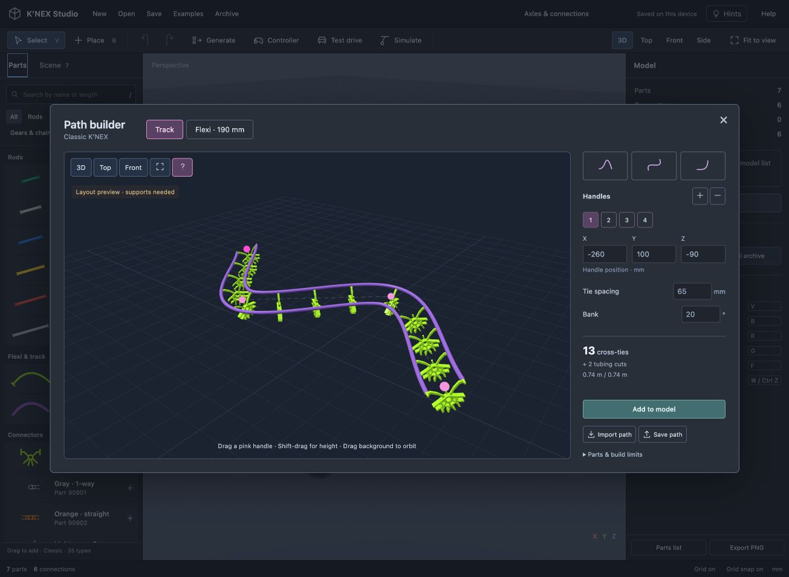

Importable paths: [hill](docs/paths/hill.json), [S-bend](docs/paths/s.json), [corner](docs/paths/bend.json).

- Drag pink handles in 3D; Shift-drag changes height. Top and Front views, numeric coordinates, add/remove handles, and Hill/S-bend/Corner presets provide alternative controls. Hints can be hidden.
- **Track:** repeat real green cross-ties 91430 along a spline, set spacing and banking, and generate two purple split-tubing cuts. The tubing is identified from the Thunderbolt Strike set 51587 manual, which documents 6.096 m stock lengths and cutting. Each rail must fit one stock length; rail joins are not generated.
- **Flexi:** select a documented 32, 52, 86 or 190 mm rod and its original color using length buttons and swatches, with two gray 90901 end connectors. Click a flexi in the library to shape that exact part; drag it into the workspace to place it straight. Editing resizes the reference curve to preserve the rod length. End sockets follow the curve tangents.
- **Save path / Import path:** exchange a `knex-path` version 1 JSON file containing `kind` (`track` or `flexi`), 2–24 XYZ `points` in millimetres, `spacing` (30–190 mm), and `bank` (−60 to 60 degrees). Flexi paths also save `flexiType`; older files default to green 91108. These are editor input bounds, not manufacturer bending limits. No proprietary coaster file import yet.
- **Add to model** inserts an editable group in one undo step. The generated local curves and tubing bank survive model saves, duplication and patterns. Save the path separately to retain the authoring handles; committed parts do not yet reopen as a procedural path.

Through-hole placement follows the pointer anywhere along a rod and seeks nearby clear space when occupied. It respects part thickness at the ends. The attached part remains free to slide; the existing continuous obstruction checks still apply.

### Real parts and uncertainties

| Part | Verified reference | Still approximate |
| --- | --- | --- |
| Classic flexi variants | [Supplier picture catalog, Classic Flexi rods and Rods sections](https://www.knexusergroup.org.uk/en/kpartslist.pdf): 32 mm 91480B/91480; 52 mm 91490/914901; 86 mm 91282/91282D/91283; 190 mm 91108/91107/91107Y/91109/90966 | Lengths are supplier approximations. Profile, colors, bend/twist limits and unsourced masses remain estimated. |
| Green flexi 91108 | [Supplier photo, approx. 190 mm, approx. 3.7 g](https://shop.knexusergroup.org.uk/products/91108) | Cross-section, flange details, minimum bend radius, spring stiffness |
| Green cross-tie 91430 | [Supplier photo and approx. 3.68 g](https://shop.knexusergroup.org.uk/products/91430) | Body dimensions, socket tolerances and gauge (rendered at an unverified 44 mm) |
| Purple split tubing, set 51587 | [K’NEX Thunderbolt Strike manual](https://www.knexusergroup.org.uk/bk/51587.pdf), pages 5 and 34–39 | Tube section, bending/twist limits and mass. No individual part number is claimed. |

The library expansion is tracked in [Classic parts coverage](docs/CLASSIC-PARTS.md).

The [Classic coaster guide](https://www.knexusergroup.org.uk/en/knex-hint-R2.html) confirms tubing on cross-tie posts. Shapes are photo/manual reconstructions, not factory CAD. Red tubing 403420V was not used because its supplier title and description disagree on stock length.

**Track output is an unsupported layout preview.** It does not include structural frames, flexi backbones, splices, lift chains or a car. Tubing-to-post links keep the layout together for editing; they are not an elastic solver. Curvature is reported geometrically, with no claim of a verified buildable bend. The editor does not validate self-intersections, rail clearance or structural feasibility. For balance, curves are held rigid; tubing mass uses an explicit unverified estimate of 0.019 g/mm until measured data is available.

## Mechanism stress examples

**Balance scale** is a 106-part adaptation of the [79565 balance instructions](https://www.knexusergroup.org.uk/bk/79565Levers.pdf), pages 3–6. Its braced beam has a low center of mass and independent hanging wheel weights. Run Joints, pull a weight, and release. Equal loads restore toward level; adding **Extra payload** to either side in the Joints panel makes that side fall. Changing payload pauses the simulation; press Run hinge to test the new load. Individual part mass remains editable under Weight & payload. The taller stand, 75 mm beam modules and vertically oriented weights differ from the manual.

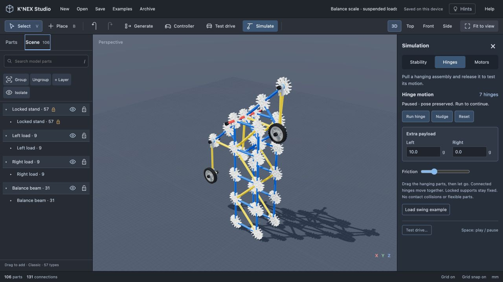

**Pantograph · 2×** is a 52-part adaptation of [Maths activity 16](https://www.knexusergroup.org.uk/en/K60030maths.pdf), pages 10–11. It uses equal 150 mm connector-center spans, real red rods and stacked rod-axle bearings. The guide's dedicated hinge halves are replaced with explicit Classic connector/axle stacks; the two long members each contain two rods. The central short-link joint is the input point and the far tip is the output. In Top view, run Joints and drag the input: the output moves at twice its displacement from the locked pivot. The model currently has no pencil, drawing surface or trace export.

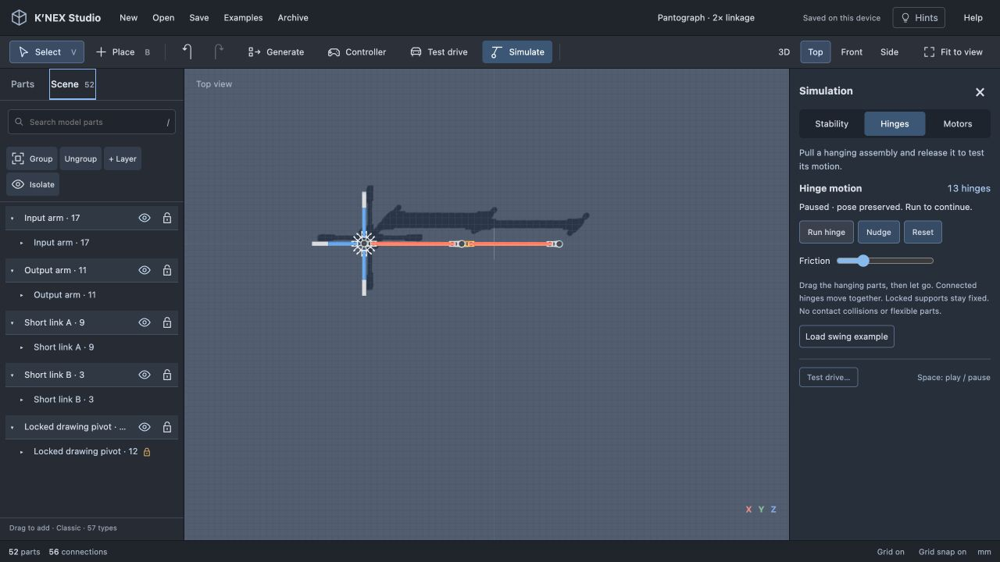

Parallel-axis mechanisms preserve their plane, and joint closure accounts for both translation and rotational inertia. Mixed-axis mechanisms retain the spatial solver. Regression tests check equal/unequal loads, natural release motion, fixed supports, stock-length connections, retained axle stacks, harsh unreachable pulls, cancellation, saved-pose resumption and 30/60/120 FPS consistency. The pantograph's tested working-range copy residual is below 0.01 mm; the release test allows 0.2 mm near full extension, where the geometry is ill-conditioned. These are numerical checks, not hardware accuracy claims. Part collisions, travel stops, real bearing friction and elastic deformation remain unsimulated.

## Visual parts library

The left rail shows compact families. Click a family to open its visual flyout, search by color/name/part number, then click a part or drag it into the workspace. Escape, the close button or a click outside dismisses the picker. The main search finds parts across every family without expanding the rail.

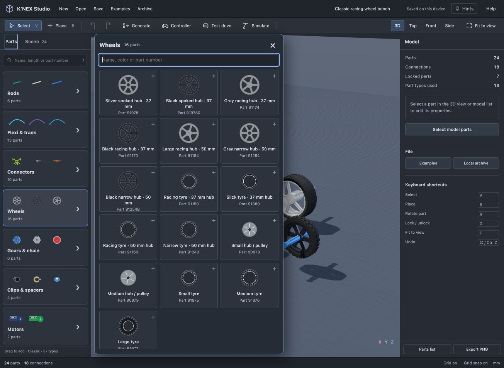

## Classic clips and molded hinges

The Clips & spacers flyout includes blue **90912**, black **90919** and green **90913** hinge halves, plus blue **91440** and bronze **914401** rod-end stops. Each part has its own saved identity and photo-based profile. Blue pin halves mate with black or green socket halves through **Hinge** mode; the editor chooses this mode when a matching free half is present. Rod sockets use End or Side-on connections. End stops use End only.

Select the outer arm to rotate it with the gold ring or **R**. The pivot cannot slide apart. For a chain of hinges, run **Simulate → Joints** and drag either arm. **Examples → Molded double hinge** is a two-joint stress model with its small mounting fixture locked in space; it is not a freestanding stand or an official building plan. **Part reference scenes → Clips & hinge halves** also shows the two end-stop colors.

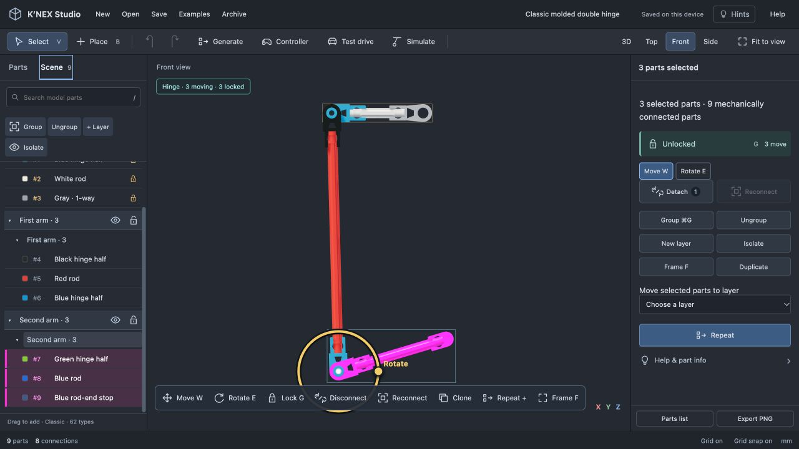

The [Classic hinge guide](https://www.knexusergroup.org.uk/en/knex-hint-A8.html) documents the mating halves. Dimensions, boss clearances and contact stops remain estimates; hinge-to-hinge contact and physical maximum travel are not simulated. Generic through-rod use of the hinge bore is disabled until verified. [Part sources and approximate masses](docs/CLASSIC-PARTS.md#classic-clips-and-hinge-halves) are recorded separately.

## Classic Y clips

Ten referenced Classic Y-clip colors are available in **Clips & spacers**. Their compact C-jaw grips the side of a ribbed rod; their short male peg accepts a standard connector socket. Choose **Side-on** for the grip and **End** for the peg. The jaw is not treated as a full rod-end socket, axle bore or drive key. Short green rods cannot receive a side grip.

Side-on placement now follows the pointer along the shaft and seeks nearby clear space if the preferred position is occupied. After placement it is a rigid clip connection; use **Detach** and **Reconnect** to reposition a section. A Y clip with its jaw occupied can reconnect its free peg while carrying the attached rod with it.

**Examples → Part reference scenes → Y clips · grip & peg** shows all ten variants assembled on rods. The reference scene demonstrates connections and colors; it is not a manual build.

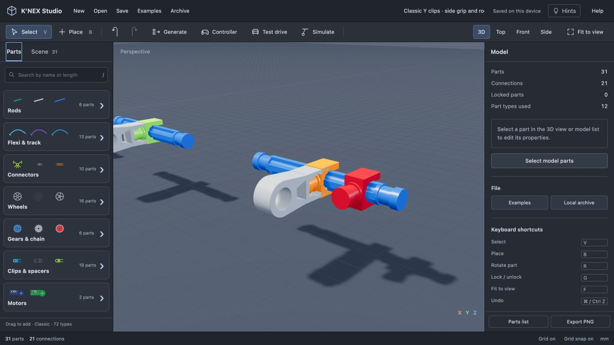

Identities, photos and approximate supplier masses are recorded in [Classic parts coverage](docs/CLASSIC-PARTS.md#classic-y-clips). The [supplier's connection guide](https://www.knexusergroup.org.uk/en/knex-hint-A10.html) documents side gripping and connector attachment. Jaw/peg dimensions, metallic appearance, clearances and grip strength remain approximate. There is no elastic clip or slipping-force simulation.

## Classic ball-and-socket joints

The Clips & spacers flyout contains standard **90940 / 90945** and large **99036B / 99036S** ball-and-socket clips. Matching halves snap through **Ball joint** mode, selected automatically when a free compatible partner exists. The two sizes cannot cross-connect. Each half also has a standard rod jaw; neither has a generic axle hole or drive key.

Drag a terminal arm directly to aim it around its ball center, or use the three colored rotation rings. Clipped parts follow as a rigid group. For linked arms, use **Simulate → Joints → Run joints**, pull either arm and release. **Examples → Ball-joint pendulum** uses both sizes in a nine-part chain with a three-part fixture locked in space. It is an original motion demo, not a freestanding build or official manual model.

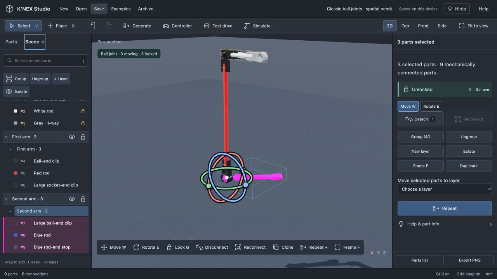

The [Classic connection guide](https://www.knexusergroup.org.uk/en/knex-hint-A9.html) identifies these joint families and their spatial movement. [Part identities and approximate masses](docs/CLASSIC-PARTS.md#classic-ball-and-socket-clips) come from supplier listings. Geometry is reconstructed from photos, with unverified ball radii, cup profiles and clearances. Simulation constrains the ball center, but does not yet model socket contact, angular stops, friction at the snap fit or separation force. Extreme orientations can therefore overlap the cup. Mixed ball-and-hinge chains, hard pulling, locked supports, cancellation, frame-rate consistency and save/reload have automated coverage.

## Classic wheels

The library includes 16 referenced hubs and tyres, including silver/black spoked hubs, 37 and 50 mm racing hubs, narrow hubs, racing tread and slick tyres. **Examples → Part reference scenes → Racing wheels & bearings** opens a comparison bench.

Racing hubs snap onto rod ends and spin freely without sliding. Narrow and spoked hubs use through-holes. Tyres accept their documented hub families; the wide 50 mm racing tyre can hold two narrow hubs. A tan drive clip couples a compatible hub to a motor-driven axle. [Part identities, source guides and remaining limits](docs/CLASSIC-PARTS.md#classic-wheel-expansion) are documented separately.


## Physics and accuracy

Parts are procedural reconstructions from identified references, not production CAD. Nominal rod lengths differ from effective connector-center spacing. Small clip details, clearances, motor housing dimensions and tooth shapes remain approximate. The catalog does not include every historical part. Classic flexi rods in four stock lengths and split-tubing track are available as shape previews; Micro track is not included.

- **Joints:** coupled rigid groups with gravity, mass and approximate inertia. Mouse pulling uses a force-limited, damped spring; pivot correction keeps connected hinges closed under hard pulls. Parallel-axis networks also correct rotational drift and preserve their motion plane, including closed loops. Ball-and-socket joints constrain their center while allowing spatial rotation; mixed networks remain spatial. Locked supports remain fixed. If no support is locked, the largest connected group is held fixed and the UI reports it. No part-to-part contacts, flexible members or gear transmission in this mode.
- **Stability:** approximate rigid-build balance and tipping against a flat floor. Joint poses are held fixed during this test.
- **Motors and gears:** imposed rotational speed and parallel-axis gear ratios. No torque, battery-load or swept rotational collision simulation.
- **Playground:** approximate flat-ground traction and differential steering, without suspension, jumps or full vehicle contact physics.
- **Placement and sliding:** occupied sockets and conservative overlap checks. Axle sliding checks obstructions continuously. Free translation checks its destination; rotation does not have a complete collision solver.

These are separate simulation modes, not one general physics simulation. Supplier approximate masses and speed references are recorded in `dist/part-specs.js`; total operating mass can be overridden to include batteries or payload. Unverified dimensions are not presented as exact manufacturing measurements.

## Saving

Autosave and the recovery archive are local to a browser and site origin. **Save** downloads editable JSON; **Open** imports it. Use a downloaded file to transfer a build between the local editor, the hosted demo and another device. Export tools also provide a parts list and an image.

## References

- [K’NEX patent US7666054B2](https://patents.google.com/patent/US7666054B2/en): connection geometry and rod proportions.
- [Classic connection methods](https://www.knexusergroup.org.uk/en/knex-hint-A2.html) and [3D connectors](https://www.knexusergroup.org.uk/en/knex-hint-A4.html).
- [Enclosed motor mounting](https://www.knexusergroup.org.uk/en/knex-hint-M4.html) and [drive clips](https://www.knexusergroup.org.uk/en/knex-hint-W6.html).
- [Swing guide](https://www.knexusergroup.org.uk/en/knex-project-swing.html) and [wheeled vehicle guide](https://www.knexusergroup.org.uk/en/knex-project-vehiclewheeled.html).
- [Basic Fun Builder Basics instructions](https://www.basicfun.com/wp-content/uploads/2023/02/17010-Imagine-Builder-Basics.pdf) and [motorized instructions](https://www.basicfun.com/wp-content/uploads/2023/02/85049-325PC-Motorized-Creations-Core-Instructions.pdf).
- Part-specific sources are linked from the editor and retained in the catalog and `part-specs.js`.

## Project structure

- `dist/engine.js`: parts, sockets, snapping, connection graph and file validation.
- `dist/geometry.js` and `*-geometry.js`: procedural Three.js geometry.
- `dist/app.js`: editor, selection, interactions and simulation controls.
- `dist/examples.js`, `dist/example-gallery.js`: example factories and rendered gallery.
- `dist/hinge-system.js`, `dist/stability.js`, `dist/motor.js`: simulation modes.
- `dist/path-builder.js`, `dist/path-builder-ui.js`, `dist/flexible-parts.js`: sourced flexible parts and visual path generation.
- `dist/axle-placement.js`: nearest clear through-hole placement along a shaft.
- `tests/`: Node test suite for geometry, connections, motion, collisions, examples and serialization.

Bundled third-party notices: [Three.js](dist/vendor/THREE-LICENSE), [cannon-es](dist/vendor/cannon-es.LICENSE), and the font OFL notices under `dist/fonts/`.
