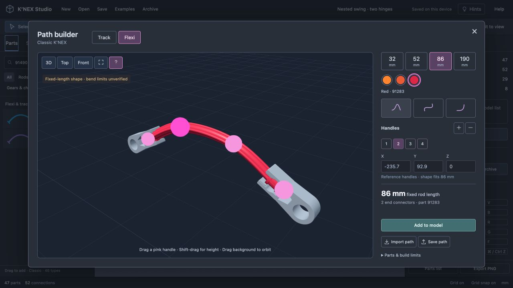
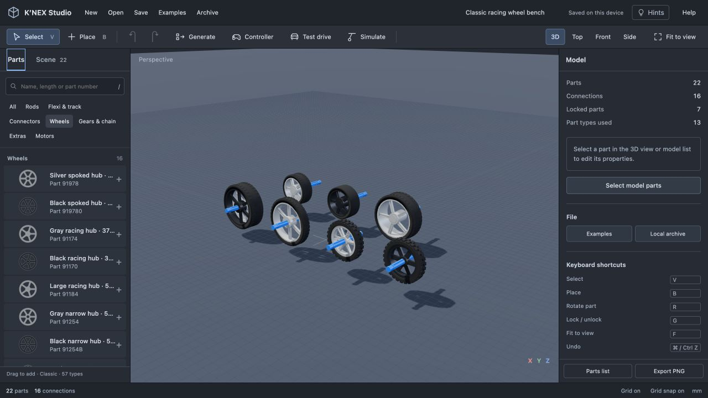
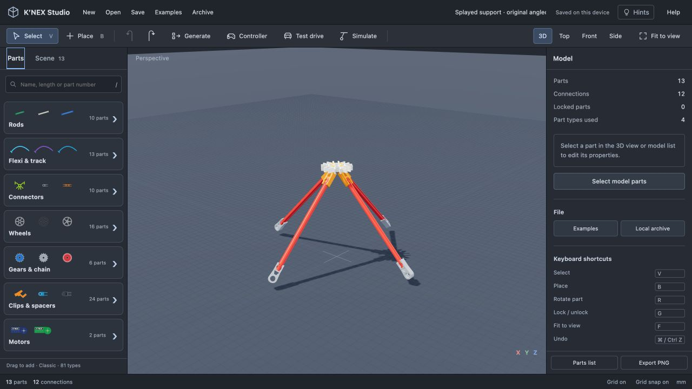
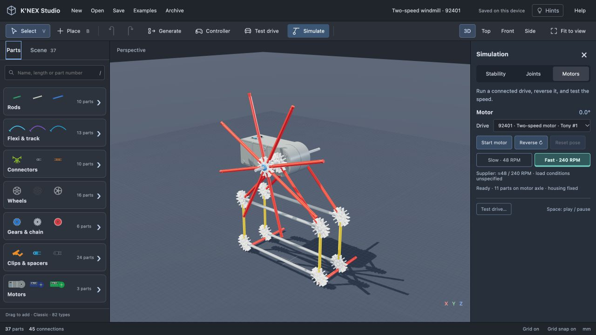

# Classic parts coverage

This is an expansion ledger, not a claim that the library is complete. Scope: original-size Classic rods, connectors, clips, wheels, motors and associated mechanical parts. Micro, Kid K’NEX, brick systems and damaged-product stock variants are excluded. A part appearing in a current supplier catalog does not establish its original release year.

Source: [K’NEX User Group picture catalog](https://www.knexusergroup.org.uk/en/kpartslist.pdf), Classic sections; individual supplier pages are attached to implemented definitions. Catalog part numbers identify actual products; they do not certify the editor's dimensions or physics. Shapes are reconstructions unless stated otherwise.

## Implemented families

| Family | Available | Known limits |
| --- | --- | --- |
| Standard rigid rods | Six original lengths and standard colors | Nominal lengths differ from the engine's effective socket spacing; four rigid-material variants implemented below; additional colors pending |
| Standard connectors | 1, straight 2, angled 2, 3, 4, 5, 8 way; 4 and 7 way 3D | Mold details approximate; additional original colors pending |
| Flexi rods | 12 variants across four approximate lengths, listed below | Fixed-length shape editing, tangent-aligned end sockets; no elastic dynamics or verified bend limits |
| Coaster track | 91430 cross-tie, split purple tubing identified in 51587 manual | Unsupported layout preview; no coaster vehicle or rail splice mechanics |
| Clips and spacers | 90900 tan drive clip, 848900 snap cap, 90994 blue spacer, 91224 sleeve; 90901 hole-end clip as 1-way connector | Three molded hinge halves, two rod-end stops, ten Y-clip colors, four ball-joint halves and the 91690 angled clip; other families pending |
| Wheels | 16 hubs/tyres: pulley, spoked, racing and narrow families | Rod-end bearings, through bores, compatible tyre seats and keyed drive; profiles and tolerances approximate |
| Gears and chain | 91317, 90988, 90985, 90993, 91998 and 90987 | Parallel-axis mesh only; chain is not an articulated transmission |
| Enclosed battery motors | 92840 blue, 22722 green, 92401 two-speed | Separate reconstructed housings; imposed preview speeds, no torque/load simulation |

## Flexi variants

Each entry has separate saved identity and a source link. Library clicks open the chosen variant in the path editor; dragging adds its straight stock shape. Length buttons and color swatches switch only among documented products. Older path files without a part identity still load as green 91108.

| Approximate length | Original color | Supplier reference |
| --- | --- | --- |
| 32 mm | Light blue | [91480B](https://shop.knexusergroup.org.uk/products/91480B) |
| 32 mm | Purple | [91480](https://shop.knexusergroup.org.uk/products/91480) |
| 52 mm | Mid blue | [91490](https://shop.knexusergroup.org.uk/products/91490) |
| 52 mm | Lilac | [914901](https://shop.knexusergroup.org.uk/products/914901) |
| 86 mm | Fluorescent orange | [91282](https://shop.knexusergroup.org.uk/products/91282) |
| 86 mm | Orange | [91282D](https://shop.knexusergroup.org.uk/products/91282D) |
| 86 mm | Red | [91283](https://shop.knexusergroup.org.uk/products/91283) |
| 190 mm | Green | [91108](https://shop.knexusergroup.org.uk/products/91108) |
| 190 mm | Fluorescent yellow | [91107](https://shop.knexusergroup.org.uk/products/91107) |
| 190 mm | Yellow | [91107Y](https://shop.knexusergroup.org.uk/products/91107Y) |
| 190 mm | Lilac | [91109](https://shop.knexusergroup.org.uk/products/91109) |
| 190 mm | Purple | [90966](https://shop.knexusergroup.org.uk/products/90966) |

Green 91108 uses its previously sourced approximate 3.7 g mass. Other flexis currently use an explicit unverified length-based estimate of 0.019 g/mm; this is not a supplier measurement. Material colors, rib sections and molding details remain photo approximations. Black-speckled 91101 and translucent 91110 still need their material rendering checked.

## Classic wheel expansion

Eleven additional parts have separate saved identities and supplier references:

| Family | Parts | Connection |
| --- | --- | --- |
| Spoked 37 mm hubs | [91978 silver](https://shop.knexusergroup.org.uk/products/91978), [919780 black](https://shop.knexusergroup.org.uk/products/919780) | Through-hole; small 91975 tyre. Silver has a pulley groove. |
| Racing 37 mm hubs | [91174 gray](https://shop.knexusergroup.org.uk/products/91174), [91170 black](https://shop.knexusergroup.org.uk/products/91170) | Free-spinning rod-end bearing; 91150 treaded or 91380 slick tyre. |
| Racing 50 mm hub | [91184](https://shop.knexusergroup.org.uk/products/91184) | Free-spinning rod-end bearing; 91160 tyre. |
| Narrow 50 mm hubs | [91254 gray](https://shop.knexusergroup.org.uk/products/91254), [91254B black](https://shop.knexusergroup.org.uk/products/91254B) | Through-hole; one hub in 91240, or two hubs in 91160. |
| Racing tyres | [91150 for 37 mm hubs](https://shop.knexusergroup.org.uk/products/91150), [91160 for 50 mm hubs](https://shop.knexusergroup.org.uk/products/91160) | Compatible hubs only; 91150 also fits a white 8-way connector. |
| Slick and narrow tyres | [91380 slick](https://shop.knexusergroup.org.uk/products/91380), [91240 narrow](https://shop.knexusergroup.org.uk/products/91240) | 37 mm racing hubs and 50 mm narrow hubs respectively. |

The [racing wheel guide](https://www.knexusergroup.org.uk/en/knex-hint-W4.html) distinguishes rod-end racing bearings from narrow through-hole hubs, and documents two narrow hubs in a wide tyre. The [spoked-wheel guide](https://www.knexusergroup.org.uk/en/knex-hint-W5.html) confirms small-tyre compatibility. The [drive-clip guide](https://www.knexusergroup.org.uk/en/knex-hint-W6.html) documents keyed drive.

Racing bearings spin without sliding or driving automatically with a motor. A tan clip can couple their key holes to an axle. Black flat-spoked hub key holes have not been verified, so keyed placement is unavailable for that variant. Multiple white connectors stacked inside one racing tyre are not yet supported.

Supplier approximate masses are recorded per part in `part-specs.js`. Hub diameters are supplier approximations; widths, clearances, spoke profiles, rubber tread and most tyre outside diameters remain photo estimates. These are not manufacturing dimensions. The plain black racing-hub reconstruction represents the pictured five-spoke variant; supplier stock can vary.

Open **Examples → Part reference scenes → Racing wheels & bearings** for the 22-part comparison bench. It is an original reference scene, not an official vehicle plan.

## Classic clips and hinge halves

| Part | Identity and source | Connection / supplier approximate mass |
| --- | --- | --- |
| Blue hinge half | [90912](https://shop.knexusergroup.org.uk/products/90912) | Male pivot plus standard rod socket; 0.8 g |
| Black hinge half | [90919](https://shop.knexusergroup.org.uk/products/90919) | Mating socket pivot plus rod socket; 0.62 g |
| Green hinge half | [90913](https://shop.knexusergroup.org.uk/products/90913) | Same mating family; 0.62 g |
| Blue rod-end stop | [91440](https://shop.knexusergroup.org.uk/products/91440) | Grips a Classic rod end; 0.61 g |
| Bronze rod-end stop | [914401](https://shop.knexusergroup.org.uk/products/914401) | Same end-stop family; mass estimated, not sourced |

Supplier product photos identify the distinct boss, socket ring, standard jaw and solid-backed end stop. The green product's title and image identify green; its description contains copied black-color wording. These are reconstructed profiles, not imported production CAD. The 6.3 mm mating-plane separation, boss/bore radii, body thicknesses and molding clearances are unverified photo estimates. No generic through-rod fit is assumed for the hinge holes. End stops have neither a center bore nor a drive key.

The [hinge guide](https://www.knexusergroup.org.uk/en/knex-hint-A8.html) distinguishes this two-piece hinge from axle-and-connector hinges. Opposite halves snap at coincident pivots, preserve all rigidly clipped neighbors and rotate without translation. Chained hinges participate in the existing coupled simulation. Contact stops, maximum permitted hinge angle, snap force and wear are not simulated. Automated stress tests check closure during unreachable pulls and release, locked supports, save/import and rotation in multiple orientations.

The **Molded double hinge** example has a mounting fixture locked in space. It demonstrates the two joints rather than a complete supported real-world build. The **Clips & hinge halves** reference scene also includes a rod with both end-stop variants.

## Classic Y clips

The [Classic connection guide](https://www.knexusergroup.org.uk/en/knex-hint-A10.html) shows the compact jaw gripping a rod sideways and a connector attached to the male rod-end peg. This is a rigid connection, with separately occupied grip and peg. Generic bore, keyed-drive, hinge and rod-end-to-jaw connections are unavailable. The Micro tan clip is excluded.

| Color | Supplier reference |
| --- | --- |
| Black | [90914](https://shop.knexusergroup.org.uk/products/90914) |
| Blue | [90916](https://shop.knexusergroup.org.uk/products/90916) |
| Fluorescent green | [90914FG](https://shop.knexusergroup.org.uk/products/90914FG) |
| Fluorescent orange | [90922](https://shop.knexusergroup.org.uk/products/90922) |
| Gold | [90917](https://shop.knexusergroup.org.uk/products/90917) |
| Green | [90914G](https://shop.knexusergroup.org.uk/products/90914G) |
| Gray | [909141](https://shop.knexusergroup.org.uk/products/909141) |
| Mid blue | [909142](https://shop.knexusergroup.org.uk/products/909142) |
| Red | [90923](https://shop.knexusergroup.org.uk/products/90923) |
| Silver | [90918](https://shop.knexusergroup.org.uk/products/90918) |

Each listing supplies an approximate 0.6 g mass. Their photos show the same peg-and-jaw family; colors and dimensions are reconstructed estimates, with no production-CAD or material-finish claim. In particular the modeled 10.1 mm peg-to-grip offset, 6.3 mm thickness and jaw profile are unverified. The orange 90914OR listing is deferred because its product image shows a blue clip. The low-resolution gray and mid-blue photos provide less shape detail; those variants reuse the common family profile supported by the other photos.

Side-on placement uses the nearest clear shaft position and conservative overlap checks. The reference bench includes ten separate three-part assemblies. Automated checks cover both attachment orders, arbitrary orientations, independent port occupancy, rejection of incompatible connections, rigid grouping, detach/reconnect, duplication and saving.

## Classic ball-and-socket clips

| Part | Supplier identity | Approximate supplier mass |
| --- | --- | --- |
| Standard ball end | [90940](https://shop.knexusergroup.org.uk/products/90940) | 0.73 g |
| Standard socket end | [90945](https://shop.knexusergroup.org.uk/products/90945) | 0.81 g |
| Large ball end | [99036B](https://shop.knexusergroup.org.uk/products/99036B) | 1.08 g |
| Large socket end | [99036S](https://shop.knexusergroup.org.uk/products/99036S) | 1.34 g |

The [Classic ball-joint guide](https://www.knexusergroup.org.uk/en/knex-hint-A9.html) documents both separate families and their spatial movement. Product photos, including the [assembled large pair](https://shop.knexusergroup.org.uk/products/99036), identify the ball, open cup and standard rod jaws. The large socket's individual image is low resolution, so its profile also uses the assembled-pair photo. Standard halves mate only with standard halves, and large halves only with large halves. Rod-end and side gripping use their standard jaws; invented through holes and drive keys are excluded.

These are photo reconstructions. Ball radii (3.6 and 5.2 mm), cup-seat shape, 6.3 mm nominal thickness, large-joint center offset and molding clearances are unverified estimates. The model's open cup is a simplified extruded profile, not production CAD. No measured travel limits, contact stops, elastic snap force or material friction are available. The spatial solver holds the centers together without limiting angular travel; a rod can overlap the socket at an extreme angle. Approximate part mass is sourced; inertia uses approximate body dimensions.

The original nine-part **Ball-joint pendulum** example combines both sizes and holds its mounting fixture in space. Terminal-arm editing exposes three rotation rings and direct aiming around the joint center. Chained joints run together in **Simulate → Joints**. Tests include both mating orders, rotated placement, incompatible-family rejection, standard rod jaws, mixed ball/hinge motion under hard pulls, fixed-support preservation, cancellation, frame-rate consistency and saved-pose resumption.

## Classic rigid rods

| Part | Supplier identity | Approximate supplier mass | Reconstructed shaft |
| --- | --- | --- | --- |
| Tan 128 mm | [90957](https://shop.knexusergroup.org.uk/products/90957) | 3.73 g | Ribbed |
| Black 190 mm | [919561](https://shop.knexusergroup.org.uk/products/919561), formerly 90956 | 5.96 g | Ribbed |
| Yellow-white 190 mm | [91956](https://shop.knexusergroup.org.uk/products/91956) | 5.95 g | Solid square |
| Blue 190 mm | [90956B](https://shop.knexusergroup.org.uk/products/90956B) | 4.55 g | Ribbed; lower-resolution photo |

[Hint A7](https://www.knexusergroup.org.uk/en/knex-hint-A7.html) confirms harder plastic and use as axles or structural members. Product photos distinguish the solid yellow-white shaft from the ribbed tan and black variants. The blue image provides less cross-section detail. Rib dimensions, the yellow-white 4.15 mm square section, end grooves and color are approximate photo reconstructions, not measured CAD. Supplier lengths are nominal; matching existing red/gray Classic grid endpoints preserves connector-center spacing. All variants accept standard end connections and axle bearings. Side clipping on the solid shaft is unverified and disabled; it is not silently treated as a ribbed rod.

The grid/frame generator uses actual rigid part identities, with black rigid diagonals for tan cells and no invented longer diagonals for 190 mm cells. The original four-storey Rigid-rod tower is generated from those parts and is not a manual replica. Physics uses each listed approximate mass, but treats all straight rods as rigid bodies, without stiffness, bending, buckling or fracture. Tests verify end alignment, off-center bearing movement, unsupported solid-shaft side-grip rejection, shared-boundary reuse, finite geometry and save/import.

## Classic angled clip

The orange [91690 angled clip](https://shop.knexusergroup.org.uk/products/91690) fits the triangular openings near a Classic connector's center. [Hint A15](https://www.knexusergroup.org.uk/en/knex-hint-A15.html) documents the rod at 45° to the connector plane and suggests splayed supporting legs. Its approximate supplier mass is 0.625 g.

The editor provides a separate keyed recess connection on either connector face. A peg occupies both sides of that opening; ordinary rod sockets remain independent. The clip's inclined jaw accepts end and side connections. Reverse assembly lets a connector attach to an existing clip, with Tab choosing the recess and face. Rotation controls are unavailable for the keyed fit. Attached parts form one rigid assembly, including during pattern repetition and save/import.

The modeled peg profile, 7.3 mm radial mounting position, 6.3 mm connector thickness and jaw dimensions are photo estimates. The 45° relationship is documented; manufacturing tolerances, insertion force, plastic flex and complete close-fitting collision geometry are not verified. The original 13-part **Splayed support** example demonstrates four legs and is not an official manual replica.

## Original two-speed motor

The [92401 battery motor](https://shop.knexusergroup.org.uk/products/92401), often called the Tony motor, has a larger four-AA case and separate direction and speed switches. Its listing gives approximate overall dimensions of 145 × 60 × 60 mm, approximate speeds of 48 and 240 RPM, and approximate mass of 167 g. Battery inclusion and speed measurement/load conditions are unspecified. [Hint M9](https://www.knexusergroup.org.uk/en/knex-hint-M9.html) and its mounting photo identify the body, projecting mounting lugs and connection to a Classic structure.

The editor reconstructs the broad stepped gray housing, lid ribs, rounded gearbox, paired switches and an open drive bore. White connector face mounts use a distinct estimated ±33.15 mm mounting plane, rather than the smaller motor's ±18.75 mm plane. Mount details, bore tolerances, screw locations and the default center of mass at [-43, 0, 0] mm are unverified photo estimates. Only the coaxial face mounting is implemented; no extra rear attachment points are inferred from indistinct photos. The 167 g source value can be overridden to include batteries or other payload.

**Simulate → Motors** exposes a saved Slow/Fast switch for this motor. Bench playback, controller keys and playground wheel speed use that choice. A custom RPM remains a preview option for the other motors. Playback does not simulate torque, internal gear efficiency, battery discharge or load-dependent speed. Part-to-part swept collision during rotation is still unavailable.

The original **Two-speed windmill** is a 37-part, 45-connection variation of the editor's windmill with 26 locked support/housing parts and an 11-part driven axle assembly. It is not an official manual replica. Tests cover both mounting orders in rotated frames, occupied faces, stock-rod length gating, a clear drive bore, fixed housing, the 5:1 speed ratio, reverse playback, save/clone/pattern retention and controller traction at each speed.

## Classic molded panels

The 35 original 910xx variants below use identified product photos from the [Classic panel catalog](https://shop.knexusergroup.org.uk/collections/discontinued-knex-panels), plus current [black small square 91070](https://shop.knexusergroup.org.uk/products/91070). The [P1 triangular](https://www.knexusergroup.org.uk/en/knex-hint-P1.html), [P2 square](https://www.knexusergroup.org.uk/en/knex-hint-P2.html), and [P3 large-square alternative](https://www.knexusergroup.org.uk/en/knex-hint-P3.html) guides establish how the molded pegs fit connector sockets.

| Mold family | Original variants | Modeled stock frame fit |
| --- | --- | --- |
| Triangle mini | 91010, 91011, 91012, 91013, 91014, 91016, 91018 | White legs, blue base |
| Triangle small | 91020, 91021, 91022, 91023, 91024, 91025, 91028 | Blue legs, yellow base |
| Triangle medium | 91030, 91031, 91032, 91035 | Yellow legs, red base |
| Triangle large | 91040, 91041, 91043, 91044 | Red legs, gray base |
| Square mini | 91060, 91064, 91068 | White sides |
| Square small | 91070, 91072, 91074, 91076, 91078 | Blue sides |
| Square medium | 91080, 91089 | Yellow sides |
| Square large | 91090, 91091, 91093 | Red sides |

Fits are reconstructed from the Classic stock grid and assembly photos, not measured manufacturing drawings. Square peg directions point diagonally outwards; triangle pegs point left, right and upwards. Square perforation counts are 1, 9, 28 and 68; triangular counts are 0, 3, 15 and 35. Photos show the raised outline rim and thicker peg collars. The 91070 listing gives approximately 64 × 64 mm. The model uses photo-estimated 1.65 mm plate thickness, 6.2 mm perforation diameter, rim shape, peg details and color. Surface lettering, texture, small mold marks and optical translucency are not reproduced.

Approximate weights from individual supplier listings are retained in `dist/part-specs.js`: mini/small/medium/large triangles generally 2.6/4.88/9/17.9 g (red medium 9.13 g); squares 3.6/7.56/15/29 g (black small 7.5 g). Their rigid rectangular inertia and centered mass are approximations. Face perforations are visual openings, with no verified axle-bearing or clip attachment. Conservative collision proxies do not model passage through them. Flexible, curved and other non-910xx panels are not silently mapped onto these rigid plates.

The original 35-part Panel wall has six panels, 24 peg connections and 34 frame connections. Tests cover every variant and peg, rotated frames, four-corner closure, matching stock sizes, mass, finite geometry, repeat with shared boundaries, disconnect/move and save/import. The eight-shape reference bench is not an official building plan.

## Remaining coverage and reference work

The following are identified candidates, not yet implemented. Their names and numbers come from the Classic catalog; geometry and behavior must be verified before adding them. This list must be expanded as the remaining catalog is audited.

| Family | Identified candidates | Required work |
| --- | --- | --- |
| Clips | 90914OR orange Y clip (photo mismatch); 90911 orange coaster-track splice; 23692E end cap | Distinct geometry and actual connections; parts without bores must not inherit through-hole behavior |
| Hinges | 9091213 packaged assembly | Audit package contents; implemented standard halves already mate |
| Connector variants | Original color variants; distinct 90910 orange track connector | Reuse canonical geometry only when mold and connections match; audit interlock, motor mount and tyre compatibility |
| Rigid/curved rods | 90956W white translucent rigid; 91995 long 405 (Mighty Makers scope to audit); 3011001/3012001/3013001 curved; 3007001 X-rod | Verify physical profiles, endpoint spacing, side clips and material differences |
| Gears | 91700 partial crown, 90996 multitrack, 91324/99119 snap-on, 90983 motor gear; original color variants | Tooth count, profile, grip, perpendicular/worm transmission; avoid treating every gear as a parallel spur gear |
| Motors | 92890 spring, 92815 12 V, 92875/20554/92880 tethered, 92845 control; 92660 solar | Separate housings, mounts, drive geometry and controls. The 12 V motor drives 90983 by a worm, not a coaxial rod bore |
| Wheel families | 20301 narrow wheel and remaining original variants | Verify distinct molded profile, axle grip and dimensions |
| Other panels | 99020 curved, 99005/99007/99008 flexible, 99013 special, 3310034 rectangular (scope to audit) | Attachment geometry, real sizes and optional mass; no generic plate substitutions |
| Other mechanisms | Pulleys, rubber bands, original coaster cars, lift components and special axles | Finish catalog audit and identify documented original parts and supported mechanics |

Additional motor references: [spring motor](https://www.knexusergroup.org.uk/en/knex-hint-M1.html), [12 V motor](https://www.knexusergroup.org.uk/en/knex-hint-M3.html), [two-speed motor](https://www.knexusergroup.org.uk/en/knex-hint-M9.html).

Scope exclusions confirmed during the clip audit: [3010001 straight clip without hole](https://shop.knexusergroup.org.uk/products/3010001) and [3020001 long hinge half](https://shop.knexusergroup.org.uk/products/3020001) are described as K-Force parts and are deferred from this original-parts expansion. [90911](https://shop.knexusergroup.org.uk/products/90911) joins orange Classic coaster track; it must not be implemented as a rod splice.
