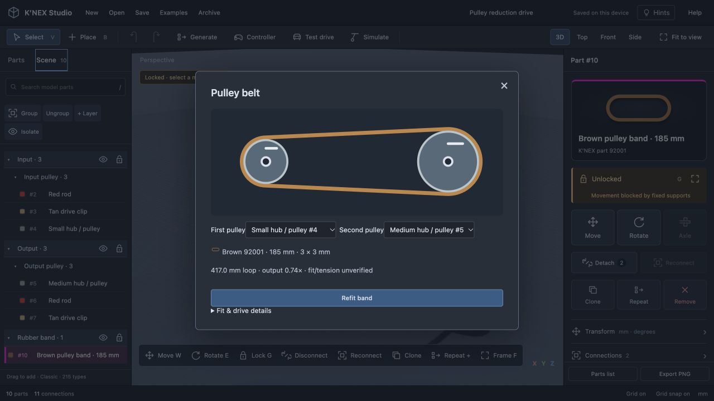
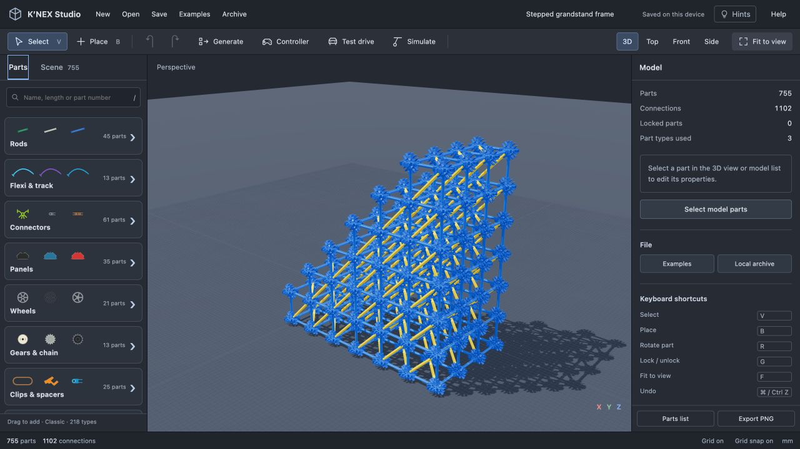
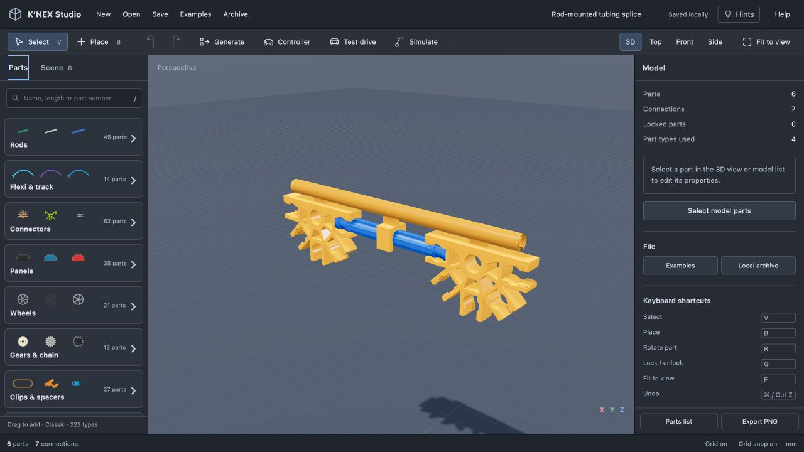
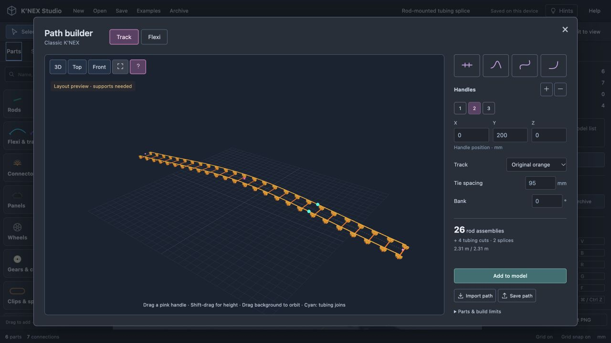

# Classic parts coverage

This is an expansion ledger, not a claim that the library is complete. Scope: original-size Classic rods, connectors, clips, wheels, motors and associated mechanical parts. Micro, Kid K’NEX, brick systems and damaged-product stock variants are excluded. A part appearing in a current supplier catalog does not establish its original release year.

Source: [K’NEX User Group picture catalog](https://www.knexusergroup.org.uk/en/kpartslist.pdf), Classic sections; individual supplier pages are attached to implemented definitions. Catalog part numbers identify actual products; they do not certify the editor's dimensions or physics. Shapes are reconstructions unless stated otherwise.

## Implemented families

| Family | Available | Known limits |
| --- | --- | --- |
| Standard rigid rods | Six original lengths and standard colors | Nominal lengths differ from the engine's effective socket spacing; five rigid-material variants and 34 additional straight-rod colors implemented below |
| Standard connectors | 1, straight 2, angled 2, 3, 4, 5, 8 way; 4 and 7 way 3D | 51 additional sourced color variants; mold details and surface finishes approximate |
| Flexi rods | 12 variants across four approximate lengths, listed below | Fixed-length shape editing, tangent-aligned end sockets; no elastic dynamics or verified bend limits |
| Coaster track | Purple tubing and 91430 cross-tie; orange 92602 tubing, 90910 tabs, 90958 rods, 90911 clips and 20501 inserts | Stock-aware orange paths and splice assemblies; no running coaster vehicle, elasticity or verified bend limits |
| Clips and spacers | 90900 tan drive clip, 848900 snap cap, 90994 blue spacer, 91224 sleeve; 90901 hole-end clip as 1-way connector | Three molded hinge halves, two rod-end stops, ten Y-clip colors, four ball-joint halves and the 91690 angled clip; other families pending |
| Wheels | 21 wheels/hubs/tyres: small one-piece, pulley, spoked, racing and narrow families | Rod-end bearings, through bores, compatible tyre seats and keyed drive; profiles and tolerances approximate |
| Gears and chain | 12 original gears plus 90987 chain; variants listed below | Parallel-axis and full crown right-angle mesh; chain is not an articulated transmission |
| Enclosed battery motors | 92840 blue, 22722 green, 92401 two-speed | Separate reconstructed housings; imposed preview speeds, no torque/load simulation |
| Other original motors | 92890 spring, 92815 external 12 V with dedicated 90983 gear; 92875 red and 20554 gray tethered kits | Finite spring turns, worm and dual-output previews; uncalibrated torque and internal ratios |

## Flexi variants

Each entry has separate saved identity and a source link. Library clicks open the chosen variant in the path editor; dragging adds its straight stock shape. Length buttons and color swatches switch only among documented products. Older path files without a part identity still load as green 91108.

| Approximate length | Original color | Supplier reference |
| --- | --- | --- |
| 32 mm | Light blue | [91480B](https://shop.knexusergroup.org.uk/products/91480B) |
| 32 mm | Purple | [91480](https://shop.knexusergroup.org.uk/products/91480) |
| 52 mm | Mid blue | [91490](https://shop.knexusergroup.org.uk/products/91490) |
| 52 mm | Lilac | [914901](https://shop.knexusergroup.org.uk/products/914901) |
| 86 mm | Fluorescent orange | [91282](https://shop.knexusergroup.org.uk/products/91282) |
| 86 mm | Orange | [91282D](https://shop.knexusergroup.org.uk/products/91282D) |
| 86 mm | Red | [91283](https://shop.knexusergroup.org.uk/products/91283) |
| 190 mm | Green | [91108](https://shop.knexusergroup.org.uk/products/91108) |
| 190 mm | Fluorescent yellow | [91107](https://shop.knexusergroup.org.uk/products/91107) |
| 190 mm | Yellow | [91107Y](https://shop.knexusergroup.org.uk/products/91107Y) |
| 190 mm | Lilac | [91109](https://shop.knexusergroup.org.uk/products/91109) |
| 190 mm | Purple | [90966](https://shop.knexusergroup.org.uk/products/90966) |

Green 91108 uses its previously sourced approximate 3.7 g mass. Other flexis currently use an explicit unverified length-based estimate of 0.019 g/mm; this is not a supplier measurement. Material colors, rib sections and molding details remain photo approximations. Black-speckled 91101 and translucent 91110 still need their material rendering checked.

## Classic wheel expansion

Eleven additional parts have separate saved identities and supplier references:

| Family | Parts | Connection |
| --- | --- | --- |
| Spoked 37 mm hubs | [91978 silver](https://shop.knexusergroup.org.uk/products/91978), [919780 black](https://shop.knexusergroup.org.uk/products/919780) | Through-hole; small 91975 tyre. Silver has a pulley groove. |
| Racing 37 mm hubs | [91174 gray](https://shop.knexusergroup.org.uk/products/91174), [91170 black](https://shop.knexusergroup.org.uk/products/91170) | Free-spinning rod-end bearing; 91150 treaded or 91380 slick tyre. |
| Racing 50 mm hub | [91184](https://shop.knexusergroup.org.uk/products/91184) | Free-spinning rod-end bearing; 91160 tyre. |
| Narrow 50 mm hubs | [91254 gray](https://shop.knexusergroup.org.uk/products/91254), [91254B black](https://shop.knexusergroup.org.uk/products/91254B) | Through-hole; one hub in 91240, or two hubs in 91160. |
| Racing tyres | [91150 for 37 mm hubs](https://shop.knexusergroup.org.uk/products/91150), [91160 for 50 mm hubs](https://shop.knexusergroup.org.uk/products/91160) | Compatible hubs only; 91150 also fits a white 8-way connector. |
| Slick and narrow tyres | [91380 slick](https://shop.knexusergroup.org.uk/products/91380), [91240 narrow](https://shop.knexusergroup.org.uk/products/91240) | 37 mm racing hubs and 50 mm narrow hubs respectively. |

The [racing wheel guide](https://www.knexusergroup.org.uk/en/knex-hint-W4.html) distinguishes rod-end racing bearings from narrow through-hole hubs, and documents two narrow hubs in a wide tyre. The [spoked-wheel guide](https://www.knexusergroup.org.uk/en/knex-hint-W5.html) confirms small-tyre compatibility. The [drive-clip guide](https://www.knexusergroup.org.uk/en/knex-hint-W6.html) documents keyed drive.

Racing bearings spin without sliding or driving automatically with a motor. A tan clip can couple their key holes to an axle. Black flat-spoked hub key holes have not been verified, so keyed placement is unavailable for that variant. Multiple white connectors stacked inside one racing tyre are not yet supported.

Supplier approximate masses are recorded per part in `part-specs.js`. Hub diameters are supplier approximations; widths, clearances, spoke profiles, rubber tread and most tyre outside diameters remain photo estimates. These are not manufacturing dimensions. The plain black racing-hub reconstruction represents the pictured five-spoke variant; supplier stock can vary.

Open **Examples → Part reference scenes → Racing wheels & bearings** for the 22-part comparison bench. It is an original reference scene, not an official vehicle plan.

## Classic clips and hinge halves

| Part | Identity and source | Connection / supplier approximate mass |
| --- | --- | --- |
| Blue hinge half | [90912](https://shop.knexusergroup.org.uk/products/90912) | Male pivot plus standard rod socket; 0.8 g |
| Black hinge half | [90919](https://shop.knexusergroup.org.uk/products/90919) | Mating socket pivot plus rod socket; 0.62 g |
| Green hinge half | [90913](https://shop.knexusergroup.org.uk/products/90913) | Same mating family; 0.62 g |
| Blue rod-end stop | [91440](https://shop.knexusergroup.org.uk/products/91440) | Grips a Classic rod end; 0.61 g |
| Bronze rod-end stop | [914401](https://shop.knexusergroup.org.uk/products/914401) | Same end-stop family; mass estimated, not sourced |

Supplier product photos identify the distinct boss, socket ring, standard jaw and solid-backed end stop. The green product's title and image identify green; its description contains copied black-color wording. These are reconstructed profiles, not imported production CAD. The 6.3 mm mating-plane separation, boss/bore radii, body thicknesses and molding clearances are unverified photo estimates. No generic through-rod fit is assumed for the hinge holes. End stops have neither a center bore nor a drive key.

The [hinge guide](https://www.knexusergroup.org.uk/en/knex-hint-A8.html) distinguishes this two-piece hinge from axle-and-connector hinges. Opposite halves snap at coincident pivots, preserve all rigidly clipped neighbors and rotate without translation. Chained hinges participate in the existing coupled simulation. Contact stops, maximum permitted hinge angle, snap force and wear are not simulated. Automated stress tests check closure during unreachable pulls and release, locked supports, save/import and rotation in multiple orientations.

The **Molded double hinge** example has a mounting fixture locked in space. It demonstrates the two joints rather than a complete supported real-world build. The **Clips & hinge halves** reference scene also includes a rod with both end-stop variants.

## Classic Y clips

The [Classic connection guide](https://www.knexusergroup.org.uk/en/knex-hint-A10.html) shows the compact jaw gripping a rod sideways and a connector attached to the male rod-end peg. This is a rigid connection, with separately occupied grip and peg. Generic bore, keyed-drive, hinge and rod-end-to-jaw connections are unavailable. The Micro tan clip is excluded.

| Color | Supplier reference |
| --- | --- |
| Black | [90914](https://shop.knexusergroup.org.uk/products/90914) |
| Blue | [90916](https://shop.knexusergroup.org.uk/products/90916) |
| Fluorescent green | [90914FG](https://shop.knexusergroup.org.uk/products/90914FG) |
| Fluorescent orange | [90922](https://shop.knexusergroup.org.uk/products/90922) |
| Gold | [90917](https://shop.knexusergroup.org.uk/products/90917) |
| Green | [90914G](https://shop.knexusergroup.org.uk/products/90914G) |
| Gray | [909141](https://shop.knexusergroup.org.uk/products/909141) |
| Mid blue | [909142](https://shop.knexusergroup.org.uk/products/909142) |
| Red | [90923](https://shop.knexusergroup.org.uk/products/90923) |
| Silver | [90918](https://shop.knexusergroup.org.uk/products/90918) |

Each listing supplies an approximate 0.6 g mass. Their photos show the same peg-and-jaw family; colors and dimensions are reconstructed estimates, with no production-CAD or material-finish claim. In particular the modeled 10.1 mm peg-to-grip offset, 6.3 mm thickness and jaw profile are unverified. The orange 90914OR listing is deferred because its product image shows a blue clip. The low-resolution gray and mid-blue photos provide less shape detail; those variants reuse the common family profile supported by the other photos.

Side-on placement uses the nearest clear shaft position and conservative overlap checks. The reference bench includes ten separate three-part assemblies. Automated checks cover both attachment orders, arbitrary orientations, independent port occupancy, rejection of incompatible connections, rigid grouping, detach/reconnect, duplication and saving.

## Classic ball-and-socket clips

| Part | Supplier identity | Approximate supplier mass |
| --- | --- | --- |
| Standard ball end | [90940](https://shop.knexusergroup.org.uk/products/90940) | 0.73 g |
| Standard socket end | [90945](https://shop.knexusergroup.org.uk/products/90945) | 0.81 g |
| Large ball end | [99036B](https://shop.knexusergroup.org.uk/products/99036B) | 1.08 g |
| Large socket end | [99036S](https://shop.knexusergroup.org.uk/products/99036S) | 1.34 g |

The [Classic ball-joint guide](https://www.knexusergroup.org.uk/en/knex-hint-A9.html) documents both separate families and their spatial movement. Product photos, including the [assembled large pair](https://shop.knexusergroup.org.uk/products/99036), identify the ball, open cup and standard rod jaws. The large socket's individual image is low resolution, so its profile also uses the assembled-pair photo. Standard halves mate only with standard halves, and large halves only with large halves. Rod-end and side gripping use their standard jaws; invented through holes and drive keys are excluded.

These are photo reconstructions. Ball radii (3.6 and 5.2 mm), cup-seat shape, 6.3 mm nominal thickness, large-joint center offset and molding clearances are unverified estimates. The model's open cup is a simplified extruded profile, not production CAD. No measured travel limits, contact stops, elastic snap force or material friction are available. The spatial solver holds the centers together without limiting angular travel; a rod can overlap the socket at an extreme angle. Approximate part mass is sourced; inertia uses approximate body dimensions.

The original nine-part **Ball-joint pendulum** example combines both sizes and holds its mounting fixture in space. Terminal-arm editing exposes three rotation rings and direct aiming around the joint center. Chained joints run together in **Simulate → Joints**. Tests include both mating orders, rotated placement, incompatible-family rejection, standard rod jaws, mixed ball/hinge motion under hard pulls, fixed-support preservation, cancellation, frame-rate consistency and saved-pose resumption.

## Classic rigid rods

| Part | Supplier identity | Approximate supplier mass | Reconstructed shaft |
| --- | --- | --- | --- |
| Tan 128 mm | [90957](https://shop.knexusergroup.org.uk/products/90957) | 3.73 g | Ribbed |
| Black 190 mm | [919561](https://shop.knexusergroup.org.uk/products/919561), formerly 90956 | 5.96 g | Ribbed |
| Yellow-white 190 mm | [91956](https://shop.knexusergroup.org.uk/products/91956) | 5.95 g | Solid square |
| Translucent 190 mm | [90956W](https://shop.knexusergroup.org.uk/products/90956W) | 5.97 g | Solid profile; transparency unmeasured |
| Blue 190 mm | [90956B](https://shop.knexusergroup.org.uk/products/90956B) | 4.55 g | Ribbed; lower-resolution photo |

[Hint A7](https://www.knexusergroup.org.uk/en/knex-hint-A7.html) confirms harder plastic and use as axles or structural members. Product photos distinguish the solid yellow-white shaft from the ribbed tan and black variants. The blue image provides less cross-section detail. Rib dimensions, the yellow-white 4.15 mm square section, end grooves and color are approximate photo reconstructions, not measured CAD. Supplier lengths are nominal; matching existing red/gray Classic grid endpoints preserves connector-center spacing. All variants accept standard end connections and axle bearings. Side clipping on the solid shaft is unverified and disabled; it is not silently treated as a ribbed rod.

The grid/frame generator uses actual rigid part identities, with black rigid diagonals for tan cells and no invented longer diagonals for 190 mm cells. The original four-storey Rigid-rod tower is generated from those parts and is not a manual replica. Physics uses each listed approximate mass, but treats all straight rods as rigid bodies, without stiffness, bending, buckling or fracture. Tests verify end alignment, off-center bearing movement, unsupported solid-shaft side-grip rejection, shared-boundary reuse, finite geometry and save/import.

## Classic angled clip

The orange [91690 angled clip](https://shop.knexusergroup.org.uk/products/91690) fits the triangular openings near a Classic connector's center. [Hint A15](https://www.knexusergroup.org.uk/en/knex-hint-A15.html) documents the rod at 45° to the connector plane and suggests splayed supporting legs. Its approximate supplier mass is 0.625 g.

The editor provides a separate keyed recess connection on either connector face. A peg occupies both sides of that opening; ordinary rod sockets remain independent. The clip's inclined jaw accepts end and side connections. Reverse assembly lets a connector attach to an existing clip, with Tab choosing the recess and face. Rotation controls are unavailable for the keyed fit. Attached parts form one rigid assembly, including during pattern repetition and save/import.

The modeled peg profile, 7.3 mm radial mounting position, 6.3 mm connector thickness and jaw dimensions are photo estimates. The 45° relationship is documented; manufacturing tolerances, insertion force, plastic flex and complete close-fitting collision geometry are not verified. The original 13-part **Splayed support** example demonstrates four legs and is not an official manual replica.

## Original two-speed motor

The [92401 battery motor](https://shop.knexusergroup.org.uk/products/92401), often called the Tony motor, has a larger four-AA case and separate direction and speed switches. Its listing gives approximate overall dimensions of 145 × 60 × 60 mm, approximate speeds of 48 and 240 RPM, and approximate mass of 167 g. Battery inclusion and speed measurement/load conditions are unspecified. [Hint M9](https://www.knexusergroup.org.uk/en/knex-hint-M9.html) and its mounting photo identify the body, projecting mounting lugs and connection to a Classic structure.

The editor reconstructs the broad stepped gray housing, lid ribs, rounded gearbox, paired switches and an open drive bore. White connector face mounts use a distinct estimated ±33.15 mm mounting plane, rather than the smaller motor's ±18.75 mm plane. Mount details, bore tolerances, screw locations and the default center of mass at [-43, 0, 0] mm are unverified photo estimates. Only the coaxial face mounting is implemented; no extra rear attachment points are inferred from indistinct photos. The 167 g source value can be overridden to include batteries or other payload.

**Simulate → Motors** exposes a saved Slow/Fast switch for this motor. Bench playback, controller keys and playground wheel speed use that choice. A custom RPM remains a preview option for the other motors. Playback does not simulate torque, internal gear efficiency, battery discharge or load-dependent speed. Part-to-part swept collision during rotation is still unavailable.

The original **Two-speed windmill** is a 37-part, 45-connection variation of the editor's windmill with 26 locked support/housing parts and an 11-part driven axle assembly. It is not an official manual replica. Tests cover both mounting orders in rotated frames, occupied faces, stock-rod length gating, a clear drive bore, fixed housing, the 5:1 speed ratio, reverse playback, save/clone/pattern retention and controller traction at each speed.

## Classic molded panels

The 35 original 910xx variants below use identified product photos from the [Classic panel catalog](https://shop.knexusergroup.org.uk/collections/discontinued-knex-panels), plus current [black small square 91070](https://shop.knexusergroup.org.uk/products/91070). The [P1 triangular](https://www.knexusergroup.org.uk/en/knex-hint-P1.html), [P2 square](https://www.knexusergroup.org.uk/en/knex-hint-P2.html), and [P3 large-square alternative](https://www.knexusergroup.org.uk/en/knex-hint-P3.html) guides establish how the molded pegs fit connector sockets.

| Mold family | Original variants | Modeled stock frame fit |
| --- | --- | --- |
| Triangle mini | 91010, 91011, 91012, 91013, 91014, 91016, 91018 | White legs, blue base |
| Triangle small | 91020, 91021, 91022, 91023, 91024, 91025, 91028 | Blue legs, yellow base |
| Triangle medium | 91030, 91031, 91032, 91035 | Yellow legs, red base |
| Triangle large | 91040, 91041, 91043, 91044 | Red legs, gray base |
| Square mini | 91060, 91064, 91068 | White sides |
| Square small | 91070, 91072, 91074, 91076, 91078 | Blue sides |
| Square medium | 91080, 91089 | Yellow sides |
| Square large | 91090, 91091, 91093 | Red sides |

Fits are reconstructed from the Classic stock grid and assembly photos, not measured manufacturing drawings. Square peg directions point diagonally outwards; triangle pegs point left, right and upwards. Square perforation counts are 1, 9, 28 and 68; triangular counts are 0, 3, 15 and 35. Photos show the raised outline rim and thicker peg collars. The 91070 listing gives approximately 64 × 64 mm. The model uses photo-estimated 1.65 mm plate thickness, 6.2 mm perforation diameter, rim shape, peg details and color. Surface lettering, texture, small mold marks and optical translucency are not reproduced.

Approximate weights from individual supplier listings are retained in `dist/part-specs.js`: mini/small/medium/large triangles generally 2.6/4.88/9/17.9 g (red medium 9.13 g); squares 3.6/7.56/15/29 g (black small 7.5 g). Their rigid rectangular inertia and centered mass are approximations. Face perforations are visual openings, with no verified axle-bearing or clip attachment. Conservative collision proxies do not model passage through them. Flexible, curved and other non-910xx panels are not silently mapped onto these rigid plates.

The original 35-part Panel wall has six panels, 24 peg connections and 34 frame connections. Tests cover every variant and peg, rotated frames, four-corner closure, matching stock sizes, mass, finite geometry, repeat with shared boundaries, disconnect/move and save/import. The eight-shape reference bench is not an official building plan.

## Remaining coverage and reference work

The following are identified candidates, not yet implemented. Their names and numbers come from the Classic catalog; geometry and behavior must be verified before adding them. This list must be expanded as the remaining catalog is audited.

| Family | Identified candidates | Required work |
| --- | --- | --- |
| Clips | 90914OR orange Y clip (photo mismatch) | Distinct geometry and actual connections; parts without bores must not inherit through-hole behavior |
| Hinges | 9091213 packaged assembly: covered by existing halves | Supplier confirms 90912 blue plus 90919 black; not a third distinct molded part |
| Connector variants | Remaining unlisted original connector variants | Reuse canonical geometry only when mold and connections match; audit interlock, motor mount and tyre compatibility |
| Rigid/curved rods | 3310042 rigid 234; 91995 long 405 (Mighty Makers scope to audit); 3011001/3012001/3013001 curved; 3007001 X-rod | Verify physical profiles, endpoint spacing, side clips and material differences |
| Gears | 91700 partial crown, 90996 multitrack; additional original variants | Tooth count, profile, grip, partial engagement/worm transmission; avoid treating every gear as a parallel spur gear |
| Motors | 92880 compact tethered, 92845 control; 92660 solar | Separate housings, mounts, drive geometry and controls. The 12 V motor drives 90983 by a worm, not a coaxial rod bore |
| Wheel families | Remaining original variants | Verify distinct molded profile, axle grip and dimensions; 20301 is implemented below |
| Other panels | 99020 curved, 99005/99007/99008 flexible, 99013 special, 3310034 rectangular (scope to audit) | Attachment geometry, real sizes and optional mass; no generic plate substitutions |
| Other mechanisms | Additional rubber-band sizes, original coaster cars, lift components and 91620 stub axle | Brown 92001 two-pulley drive implemented below; finish remaining catalog audit |

Additional motor references: [spring motor](https://www.knexusergroup.org.uk/en/knex-hint-M1.html), [12 V motor](https://www.knexusergroup.org.uk/en/knex-hint-M3.html), [two-speed motor](https://www.knexusergroup.org.uk/en/knex-hint-M9.html).

Scope exclusions confirmed during the clip audit: [3010001 straight clip without hole](https://shop.knexusergroup.org.uk/products/3010001) and [3020001 long hinge half](https://shop.knexusergroup.org.uk/products/3020001) are described as K-Force parts and are deferred from this original-parts expansion. [90911](https://shop.knexusergroup.org.uk/products/90911) joins orange Classic coaster track; it must not be implemented as a rod splice.

## Classic snap-on and color-variant gears

| Part | Verified supplier description | Mount |
| --- | --- | --- |
| [91324](https://shop.knexusergroup.org.uk/products/91324) | Gray snap-on, 14 teeth, 25 mm, approx. 1.9 g; listing allows gray or black supply | Free-spinning rod-end bearing |
| [99119](https://shop.knexusergroup.org.uk/products/99119) | Black snap-on, 14 teeth, 25 mm, approx. 1.9 g | Free-spinning rod-end bearing |
| [91313](https://shop.knexusergroup.org.uk/products/91313) | Gold, 14 teeth, 25 mm, approx. 3.12 g | Through axle; tan clip for driven rotation |
| [91317D](https://shop.knexusergroup.org.uk/products/91317d) | Dark blue, 14 teeth, 25 mm, approx. 3.03 g; shade varies | Through axle; tan clip for driven rotation |
| [91993](https://shop.knexusergroup.org.uk/products/91993) | Gray crown, 34 teeth, 55 mm, approx. 11.16 g | Through axle; tan clip for driven rotation |
| [90997](https://shop.knexusergroup.org.uk/products/90997) | Black crown, 82 teeth, 130 mm, approx. 24 g | Through axle; tan clip for driven rotation |

[Hint G2](https://www.knexusergroup.org.uk/en/knex-hint-G2.html) explicitly describes snap-on gears as freely spinning on a Classic rod end. Their modeled center is capped, with a rear bearing recess: they cannot accept a through axle or tan key. End mounting is the default placement mode. The motor traversal now carries motion through independently mounted gears while leaving their locked support rods fixed. An unmounted, locked or displaced gear blocks the drive before any poses change.

The **Snap-on idler gears** example has a red 34-tooth input, a gray 14-tooth free idler and a keyed gold 14-tooth output. Output rotation matches the input direction at 34/14 times its speed. The motor housing, white idler pin and two output bearings form a locked test fixture; it is not a freestanding official model. **Classic gear variants** is a separate reference scene.

All new widths (6.3 mm), tooth shapes, cap profile and bearing clearances remain photo estimates. Full crown gears support parallel-axis and right-angle meshing. There is no contact, backlash, torque or slip calculation. The green multitrack part is deliberately pending: its [90996 product listing](https://shop.knexusergroup.org.uk/products/90996) says 84 outer teeth, while [Hint G6](https://www.knexusergroup.org.uk/en/knex-hint-G6.html) says 82; both say 64 inner teeth. The partial crown 91700 also needs distinct engagement logic rather than a full-ring substitute.

## Classic connector color variants

The additional 51 identities below were checked against supplier photos and the original-size Classic catalog. They use the same connection layout as the matching existing connector family. The library now contains 61 connector-category entries, including the cross-tie, and 174 visible part types overall. Micro and K-Force connectors are excluded.

The visual **Connector shape** filter separates one-way, straight two-way, angled two-way, three-, four-, five-, eight-way and the two 3D families. Search by part number clears the shape filter. Dark thumbnails have a fine contrasting outline. Original default identities are unchanged; saved variants keep their own IDs and supplier approximate masses.

Motor face mounts and the two tyres that fit an eight-way connector now use its verified shape instead of requiring the white part ID. Tests cover both assembly orders and save/reload for all five new eight-way colors. Interlocking variants retain their actual open channel, reject a false axle bore and mate with either 3D family. All nine families retain their triangular angled-clip recesses. Pattern copies preserve color and do not merge different product identities.

Geometry remains a photo reconstruction: exact mold revisions, fit tolerances and color rendering are not measured. Granite speckling and metallic surface effects currently use a representative solid tint. Listing weights are approximate supplier values. The **Black connector windmill** is an original demonstration using 90968 eight-way connectors, not a new official manual model; **Classic connector colors** is a separate reference scene.

| Part reference | Supplier identity | Approximate mass |
| --- | --- | --- |
| [909011](https://shop.knexusergroup.org.uk/products/909011) | K’NEX Clip with Hole end Purple | 0.84 g |
| [909012](https://shop.knexusergroup.org.uk/products/909012) | K’NEX Clip with Hole end Grey | 0.84 g |
| [91902](https://shop.knexusergroup.org.uk/products/91902) | K’NEX Connector 2-way straight Brown | 1.41 g |
| [91902D](https://shop.knexusergroup.org.uk/products/91902d) | K’NEX Connector 2-way straight Dark brown | 1.41 g |
| [909023](https://shop.knexusergroup.org.uk/products/909023) | K’NEX Connector 2-way straight White | 1.41 g |
| [91903](https://shop.knexusergroup.org.uk/products/91903) | K’NEX Connector 2-way Fluorescent orange | 1.26 g |
| [909031](https://shop.knexusergroup.org.uk/products/909031) | K’NEX Connector 2-way Light Green | 1.26 g |
| [91901](https://shop.knexusergroup.org.uk/products/91901) | K’NEX Connector 2-way Light grey granite | 1.26 g |
| [909032](https://shop.knexusergroup.org.uk/products/909032) | K’NEX Connector 2-way Red | 1.26 g |
| [91909](https://shop.knexusergroup.org.uk/products/91909) | K’NEX Connector 3-way Dark grey granite | 1.676 g |
| [91904](https://shop.knexusergroup.org.uk/products/91904) | K’NEX Connector 3-way Fluorescent Red | 1.676 g |
| [909042](https://shop.knexusergroup.org.uk/products/909042) | K’NEX Connector 3-way Grey | 1.676 g |
| [909041](https://shop.knexusergroup.org.uk/products/909041) | K’NEX Connector 3-way Pink | 1.676 g |
| [909052](https://shop.knexusergroup.org.uk/products/909052) | K’NEX Connector 4-way Black | 2.076 g |
| [90905D](https://shop.knexusergroup.org.uk/products/90905d) | K’NEX Connector 4-way Dark green | 2.076 g |
| [91908](https://shop.knexusergroup.org.uk/products/91908) | K’NEX Connector 4-way Fluorescent Green | 2.076 g |
| [909055](https://shop.knexusergroup.org.uk/products/909055) | K’NEX Connector 4-way Grey | 2.076 g |
| [909053](https://shop.knexusergroup.org.uk/products/909053) | K’NEX Connector 4-way Light green | 2.076 g |
| [91905](https://shop.knexusergroup.org.uk/products/91905) | K’NEX Connector 4-way Metallic green | 2.076 g |
| [909056](https://shop.knexusergroup.org.uk/products/909056) | K’NEX Connector 4-way Mid Blue | 2.076 g |
| [909057](https://shop.knexusergroup.org.uk/products/909057) | K’NEX Connector 4-way Red | 2.076 g |
| [90905W](https://shop.knexusergroup.org.uk/products/90905w) | K’NEX Connector 4-way White | 2.076 g |
| [99086](https://shop.knexusergroup.org.uk/products/99086) | K’NEX Connector 4-way Yellow | 2.0 g |
| [909062](https://shop.knexusergroup.org.uk/products/909062) | K’NEX Connector 5-way Dark Grey | 2.495 g |
| [909064](https://shop.knexusergroup.org.uk/products/909064) | K’NEX Connector 5-way Light Green | 2.495 g |
| [90949](https://shop.knexusergroup.org.uk/products/90949) | K’NEX Connector 5-way Light grey | 2.495 g |
| [90906L](https://shop.knexusergroup.org.uk/products/90906l) | K’NEX Connector 5-way Light yellow | 2.495 g |
| [909063](https://shop.knexusergroup.org.uk/products/909063) | K’NEX Connector 5-way Mid Blue | 2.495 g |
| [90906OR](https://shop.knexusergroup.org.uk/products/90906or) | K’NEX Connector 5-way Orange | 2.495 g |
| [909065](https://shop.knexusergroup.org.uk/products/909065) | K’NEX Connector 5-way Red | 2.495 g |
| [909092D](https://shop.knexusergroup.org.uk/products/909092d) | K’NEX Connector 4-way 3D Dark purple | 2.152 g |
| [90909FG](https://shop.knexusergroup.org.uk/products/90909fg) | K’NEX Connector 4-way 3D Fluor. Green | 2.152 g |
| [909092](https://shop.knexusergroup.org.uk/products/909092) | K’NEX Connector 4-way 3D Purple | 2.152 g |
| [909093](https://shop.knexusergroup.org.uk/products/909093) | K’NEX Connector 4-way 3D Red | 2.17 g |
| [909091](https://shop.knexusergroup.org.uk/products/909091) | K’NEX Connector 4-way 3D Silver | 2.17 g |
| [90909W](https://shop.knexusergroup.org.uk/products/90909w) | K’NEX Connector 4-way 3D White | 2.152 g |
| [99084](https://shop.knexusergroup.org.uk/products/99084) | K’NEX Connector 4-way 3D Yellow | 2.2 g |
| [909075](https://shop.knexusergroup.org.uk/products/909075) | K’NEX Connector 7-way 3D Black | 3.26 g |
| [90907B](https://shop.knexusergroup.org.uk/products/90907b) | K’NEX Connector 7-way 3D Dark blue | 3.26 g |
| [909073](https://shop.knexusergroup.org.uk/products/909073) | K’NEX Connector 7-way 3D Light Green | 3.26 g |
| [909072](https://shop.knexusergroup.org.uk/products/909072) | K’NEX Connector 7-way 3D Lilac | 3.26 g |
| [91907](https://shop.knexusergroup.org.uk/products/91907) | K’NEX Connector 7-way 3D Metallic blue | 3.26 g |
| [909074](https://shop.knexusergroup.org.uk/products/909074) | K’NEX Connector 7-way 3D Mid Blue | 3.26 g |
| [909076](https://shop.knexusergroup.org.uk/products/909076) | K’NEX Connector 7-way 3D Red | 3.26 g |
| [90907W](https://shop.knexusergroup.org.uk/products/90907w) | K’NEX Connector 7-way 3D White | 3.26 g |
| [99085](https://shop.knexusergroup.org.uk/products/99085) | K’NEX Connector 7-way 3D Yellow | 3.3 g |
| [90968](https://shop.knexusergroup.org.uk/products/90968) | K’NEX Connector 8-way Black | 3.57 g |
| [908003](https://shop.knexusergroup.org.uk/products/908003) | K’NEX Connector 8-way Blue | 3.57 g |
| [908004](https://shop.knexusergroup.org.uk/products/908004) | K’NEX Connector 8-way Orange | 3.57 g |
| [90908P](https://shop.knexusergroup.org.uk/products/90908p) | K’NEX Connector 8-way Purple | 3.57 g |
| [908005](https://shop.knexusergroup.org.uk/products/908005) | K’NEX Connector 8-way Silver | 3.57 g |

## Classic rod color variants

The picker filters the six original Classic stock sizes by nominal length. Each color keeps its own part number and supplier approximate mass. The modeled endpoint spacing follows the existing square-root-of-two stock progression, not the rounded label. Sixteen-millimetre rods have no side grip; longer ribbed rods retain side grips and sliding axle connections. The solid-profile translucent rigid rod 90956W shares the conservative no-side-grip restriction of 91956. Its transparency and exact cross-section are not measured.

| Size | Variant | Part | Mass |
| --- | --- | --- | --- |
| 16 mm | Black | [90960](https://shop.knexusergroup.org.uk/products/90960) | 0.467 g |
| 16 mm | Dark green | [90950D](https://shop.knexusergroup.org.uk/products/90950d) | 0.467 g |
| 16 mm | White | [90950W](https://shop.knexusergroup.org.uk/products/90950w) | 0.467 g |
| 32 mm | Black | [90961](https://shop.knexusergroup.org.uk/products/90961) | 0.79 g |
| 32 mm | Blue | [90963](https://shop.knexusergroup.org.uk/products/90963) | 0.79 g |
| 32 mm | Gold | [90964](https://shop.knexusergroup.org.uk/products/90964) | 0.79 g |
| 32 mm | Light Green | [909512](https://shop.knexusergroup.org.uk/products/909512) | 0.79 g |
| 32 mm | Mid Blue | [909513](https://shop.knexusergroup.org.uk/products/909513) | 0.79 g |
| 32 mm | Orange | [951003](https://shop.knexusergroup.org.uk/products/951003) | 0.79 g |
| 32 mm | Silver | [90965](https://shop.knexusergroup.org.uk/products/90965) | 0.79 g |
| 32 mm | Teal | [90962](https://shop.knexusergroup.org.uk/products/90962) | 0.79 g |
| 54 mm | Black | [909523](https://shop.knexusergroup.org.uk/products/909523) | 1.314 g |
| 54 mm | Dark Blue | [90952B](https://shop.knexusergroup.org.uk/products/90952b) | 1.314 g |
| 54 mm | Fluorescent green | [90952FG](https://shop.knexusergroup.org.uk/products/90952fg) | 1.314 g |
| 54 mm | Light purple | [909522](https://shop.knexusergroup.org.uk/products/909522) | 1.314 g |
| 54 mm | Metallic blue | [91952](https://shop.knexusergroup.org.uk/products/91952) | 1.314 g |
| 54 mm | Orange | [952002](https://shop.knexusergroup.org.uk/products/952002) | 1.314 g |
| 54 mm | White | [90952W](https://shop.knexusergroup.org.uk/products/90952w) | 1.314 g |
| 86 mm | Dark Gray | [909532D](https://shop.knexusergroup.org.uk/products/909532d) | 2.0 g |
| 86 mm | Gold | [90953G](https://shop.knexusergroup.org.uk/products/90953g) | 2.0 g |
| 86 mm | Gray | [909532](https://shop.knexusergroup.org.uk/products/909532) | 2.0 g |
| 86 mm | Gray granite | [91953](https://shop.knexusergroup.org.uk/products/91953) | 2.0 g |
| 86 mm | Red | [909533](https://shop.knexusergroup.org.uk/products/909533) | 2.0 g |
| 128 mm | Black | [909542](https://shop.knexusergroup.org.uk/products/909542) | 3.04 g |
| 128 mm | Blue | [90954B](https://shop.knexusergroup.org.uk/products/90954b) | 3.04 g |
| 128 mm | Metallic green | [91954](https://shop.knexusergroup.org.uk/products/91954) | 3.04 g |
| 128 mm | Orange | [90958](https://shop.knexusergroup.org.uk/products/90958) | 3.12 g |
| 128 mm | Pink | [909541](https://shop.knexusergroup.org.uk/products/909541) | 3.04 g |
| 128 mm | White | [90954W](https://shop.knexusergroup.org.uk/products/90954w) | 3.04 g |
| 190 mm | Fluorescent orange | [91955](https://shop.knexusergroup.org.uk/products/91955) | 4.45 g |
| 190 mm | Light gray | [90955LG](https://shop.knexusergroup.org.uk/products/90955lg) | 4.48 g |
| 190 mm | Mid blue | [90955MB](https://shop.knexusergroup.org.uk/products/90955mb) | 4.48 g |
| 190 mm | Purple | [909553](https://shop.knexusergroup.org.uk/products/909553) | 4.48 g |
| 190 mm | White | [90955W](https://shop.knexusergroup.org.uk/products/90955w) | 4.48 g |
| 190 mm | Translucent rigid | [90956W](https://shop.knexusergroup.org.uk/products/90956w) | 5.97 g |

Geometry and colors are photo reconstructions; metallic and granite finishes are represented by tint. Supplier listings for red 32 mm 909514 and red 54 mm 909524 currently show mismatched longer pink/black rods, so those entries are deferred. The permanent curved 3011001/3012001/3013001 rods remain pending measured endpoint directions and curve dimensions; they are not substituted with flexis. Special 234/405 mm rods and metal shafts also remain pending fit/scope verification. Color editions using the same Classic molds are included regardless of the later sets they appeared in; Micro, Kid and K-Force-specific mechanisms are excluded.

Procedural grids, frames, roofs and octagons accept these colors. Braces use a same-named color in the next stock size when available; otherwise the standard next-size rod. Every generated diagonal remains a real catalog part. **Rod color lattice** demonstrates this with black cells and gold diagonals.

## Classic spring motor 92890

The [supplier listing](https://shop.knexusergroup.org.uk/products/92890) identifies the fast spring motor and lists an approximate mass of 20.5 g. [Hint M1](https://www.knexusergroup.org.uk/en/knex-hint-M1.html) documents backward winding through the central drive bore and four mounting eyes on the case. The four eyes form two coaxial pairs, as shown in [USD394286, figures 1–7](https://patents.google.com/patent/USD394286S/en). [Original 78790 instructions, pages 12–13](https://www.knexusergroup.org.uk/bk/78790.pdf) show rods passing through those pairs with a separate driven axle.

The motor has a transparent housing, visible colored gears, spring-coil detail, a central drive bore and four selectable mounting eyes. Unlike the battery housings, it does not accept an invented 8-way connector face mount. A rod long enough to pass through both eyes of a pair links to both automatically. Side mounting holes are bearings, not drive outputs. Their positions are used for snapping, sliding bounds, collision passage and articulated-joint pivots.

Housing envelope (about 63 × 44 × 18.9 mm), eye spacing (modeled as 53.03 mm), 6.3 mm eye depths, center of mass, bore diameters and internal gear details are reconstruction estimates. The patent establishes the shape and eye arrangement, not calibrated dimensions. No exact CAD claim is made. Gear colors vary across the supplier photo and the later manual; this reconstruction follows the supplier's green/blue/red example. Internal gears and spring are visual details, not an independent gear train.

Turn the connected axle backward with its rotation ring, middle-drag or Shift-R to wind it, or use **↶ +1 turn** in **Simulate → Motors**. **Release spring** rotates the axle and connected transmission forward, consumes the stored turns, and stops at zero; **Hold** pauses. Winding is preserved by save/import, cloning, undo and reset. Preview RPM is user-controlled: no spring constant, calibrated speed curve, winding capacity, torque, load response or elastic dynamics is claimed. The 20-turn cap is a software preview guard, not a manufacturer limit. The remote battery controller and vehicle test currently exclude this motor rather than treating it as an electric motor; spring-driven vehicle acceleration/coasting remains future work.

The **Spring motor fan** example is a 14-part, 16-link test fixture, with two mounting rods and their clips locked in space. Its seven-part rotor can be wound and released. It is an original demonstration of the mounting and drive system, not a reproduction of the manual's racer or a freestanding supported structure.

## Full crown gear transmission

[Hint G1](https://www.knexusergroup.org.uk/en/knex-hint-G1.html), especially assembly photo hg1d.jpg, confirms Classic crown teeth transferring rotation between perpendicular rods. **90° gears** offers this arrangement when at least one selected part is a full crown gear. R advances the contact around the rim. The raised-tooth face is used; the back face is rejected. Existing parallel mesh connections remain readable.

Contact validation checks axis alignment, radial pitch distance and the pinion height above the crown face. The 3 mm face height and tooth clearances are photo estimates. Ratios use tooth counts; direction follows tangential velocity at the contact, including reversed rods and reverse drive. Displaced gears, locked outputs and conflicting loops reject the drive before any rotation.

The original **Three-axis crown gearbox** has 14 parts, 15 links and five locked fixture parts. Two 34:14 stages multiply speed by approximately 5.90. This is a spatial transmission test, not a freestanding manual build. Tests cover both assembly orders, multiple rim positions, rotated frames, long running/reversal, wrong faces, locking, reload and frame-rate consistency. No new physical parts are invented. Partial crowns and multitrack gears remain pending; torque, backlash and collision contact are not simulated.

## Original 12 V worm drive

| Part | Source | Mass used |
| --- | --- | --- |
| 92815 motor | [Supplier motor page](https://shop.knexusergroup.org.uk/products/92815), [independent supplier](https://knexreplacementparts.com/product/12v-motor-classic-sized/) | Approx. 96.45 g from independent supplier; original supplier's 96 g listing is a pack including gear and clip |
| 90983 white/cream gear | [Supplier gear page](https://shop.knexusergroup.org.uk/products/90983) | Approx. 6.73 g |

[Hint M3](https://www.knexusergroup.org.uk/en/knex-hint-M3.html) and its mounting photos show two underside mounting sleeves, a separate perpendicular driven axle, spacers and tan drive clips. The official [89790 Ferris wheel manual](https://www.basicfun.com/wp-content/uploads/2023/02/89790-KNEX-6ft-Ferris-Wheel.pdf), page 11, corroborates this mounting and dedicated gear arrangement. The supplier explicitly states that 90983 does not mesh with other K’NEX gears.

The reconstruction uses a cylindrical gray case, rear power jack, thin mounting plate, two open sleeves and the exposed olive worm. Approximate dimensions: 28 mm case diameter, 51 mm cylinder length, 75 mm sleeve spacing, 45 mm sleeve length, 41 mm gear diameter, 24.5 mm worm-to-output axis offset. These are photo/grid-based estimates, not manufacturer measurements. The 56 visual perimeter teeth and seven visible worm turns are also unverified visual approximations; neither is used as a physical speed ratio. Key details and clearances are approximate.

Worm drive connects only this dedicated pair. Playback requires a tan-keyed axle, separate bearing support and an aligned gear. Missing keys/bearings, displaced gears or locked driven groups block all motion. Ordinary gears can be added separately to the keyed axle. The original 19-part reduction bench demonstrates a separate 14:82 stage and locks its mounting fixture in space.

The listed 66 RPM has an unspecified reference shaft. Output preview defaults to 5 RPM as a software setting; no calibrated worm ratio, torque, self-locking, backlash, friction, electrical power or lead contact is simulated. The exposed worm is static visual geometry while output motion is imposed. Reverse previews changed supply polarity rather than a physical reversing switch. The externally powered motor is unavailable in remote vehicle controls. Saved files preserve actual part and worm connection identities.

## Classic 25 mm one-piece wheels

| Part | Source | Mount | Approximate supplier mass |
| --- | --- | --- | --- |
| Open center 91140 | [Supplier listing](https://shop.knexusergroup.org.uk/products/91140) | Friction fit through a Classic axle; optional tan key | 1.53 g |
| Closed center 918300 | [Supplier listing](https://shop.knexusergroup.org.uk/products/918300) | Free bearing on a rod end | 1.7 g |

[Hint W1](https://www.knexusergroup.org.uk/en/knex-hint-W1.html) distinguishes the friction-fit and free-bearing versions and shows a tan key on the open wheel. Both are original-size Classic parts; their separate Micro use is outside this editor's scope. They are complete plastic wheels, with no invented tyre seat. The closed wheel has no through hole or verified key connection.

Photo reconstructions include the six lightening holes, molded rim blocks, three-lobed open center and blind bearing cap. The supplier's 25 mm diameter is approximate. Modeled 6.3 mm width, 4.3 mm blind-bearing depth, hole sizes, lobes and grip/key tolerances are unverified estimates. Friction fit is treated as a rigid grip: no slip force or friction coefficient is simulated. Disconnect to reposition the gripping wheel; the blind wheel rotates independently but cannot slide along its axle.

The six-part **Small wheels · grip and spin** example is a fixture locked in space, not a car or official manual build. Running its motor moves the red axle, gripping wheel and tan clip; the closed wheel remains free. The playground recognizes these complete wheels as rolling surfaces and uses their 12.5 mm modeled radius. Existing flat-ground driving limits remain: no tire deformation, calibrated traction or suspension/contact solver. Tests cover both assembly orders, off-center and rotated shafts, opposite rod ends, optional key, invalid connections, independent rotation, forward/reverse drive, locked-output atomicity, open geometry, save/import and driving consistency at 30/60/120 FPS.

## Classic pulley-band drive

[Brown 92001](https://shop.knexusergroup.org.uk/products/92001) is listed as an approximately 185 mm unstretched rubber band with a 3 × 3 mm section, intended for pulleys, and approximate mass 3.52 g. [Hint W7](https://www.knexusergroup.org.uk/en/knex-hint-W7.html) and assembly photo hl7a.jpg show an open belt on Classic hub/pulleys. [Hint W6](https://www.knexusergroup.org.uk/en/knex-hint-W6.html) documents using tan keys to couple pulleys and axles.

**Generate → Pulley belt**, or the band in **Clips & spacers**, fits this band between the small 90978 / 90978G / 909782 and medium 90979 / 90979G hub/pulleys. The visual front preview shows the two radii, tangent spans, fitted loop length and ideal output/input ratio. Grooves must be coplanar with parallel axes, rims cannot overlap, and a groove cannot hold both a tyre and band. Select an existing band to refit it while keeping its identity and mass override. Insertion/refitting is one undo step. Copies and saved models preserve the fitted shape and both contacts.

The band has an actual hollow loop and rectangular cross-section. Its centerline uses the existing reconstructed groove core radius plus half the band thickness, resulting in modeled radii 18.5 and 25 mm. These are not calibrated groove pitch measurements. The listing does not establish whether 185 mm means flattened length or circumference; no automatic stretch percentage, certified fit, tension or material strength is inferred. The 1000 mm center-span cap is a software limit, not a physical stretch limit. The band is a fitted geometric and no-slip kinematic preview; there is no elastic, slipping, torque, creep, wear, friction or joint-force simulation. Its visually uniform surface remains static while the pulleys rotate. Crossed belts, additional pulley routing and other band sizes are not yet supported.

Motor playback traverses belt and gear stages together, using modeled pitch-radius ratios. Opposite shaft orientations preserve the correct open-belt direction. Missing contacts/bearings, displaced pulley centers, a locked belt/output, or conflicting transmission ratios reject the entire motor step before any part moves. An unkeyed pulley can spin on its bearing without driving the rod. Refit the band after changing pulley positions; it does not automatically stretch during joint physics.

The original **Pulley reduction drive** fixture has 10 parts, 11 connections and three locked supports. Small-to-medium output is 0.74× input speed. This is a mounting/transmission example held in space, not a freestanding manual replica. Tests cover all supported pulley-size pairs, tangent-loop length, rotated assemblies, reversed rods, mixed gear stages, both directions, atomic failures, shape validation, hollow geometry, mass center, copy/save/refit preservation and 30/60/120 FPS.

## Classic pulley variants

The original silver pulley identities remain compatible with saved builds. Three additional supplier identities now appear in the Wheels flyout:

| Part | Approximate diameter | Supplier mass | Tyre fitting |
| --- | --- | --- | --- |
| [90978G gray small](https://shop.knexusergroup.org.uk/products/90978g) | 37 mm | 4.12 g | 91975 small |
| [90979G gray medium](https://shop.knexusergroup.org.uk/products/90979g) | 50 mm | 7.5 g | 90976 medium (app ID 91976), 91977 large |
| [909782 white small](https://shop.knexusergroup.org.uk/products/909782) | 37 mm | 3.79 g | 91975 small |

Supplier product JSON `weight` fields in grams preserve the listed decimal masses; its rounded `grams` fields are not used. The white listing identifies use in the London Eye set. These are Classic-size variants, not Micro parts. Palette icons and 3D materials retain gray, silver or white.

Photos of 90978G and 909782 show the small pulley's six ribs, recessed web, center bore and two drive holes. Photos of [silver 90979](https://shop.knexusergroup.org.uk/products/90979) and gray 90979G show a different five-rib face with flared ribs and five molding bosses. The medium front now follows that visible face, without the previously exposed pair of key holes. [Hint W6](https://www.knexusergroup.org.uk/en/knex-hint-W6.html) establishes the tan-clip drive method. The reverse-face recess layout remains an estimate inherited from the existing drive mount; the available photo does not resolve that face. Widths of 6.2 / 12 mm, groove profile, rib/boss sizes, recess depth and tolerances are reconstruction estimates, not verified CAD.

All five pulley identities support through-axle placement, off-center sliding, free rotation, tan-key drive and the brown 92001 band. Tyres are restricted to the documented families; a groove cannot take a tyre and belt together. Belt transmission retains the previous ideal no-slip assumptions and unverified physical fit/tension.

**Examples → Pulley colors & fits** contains 13 parts and 13 connections with four locked supports. The white small pulley drives a gray medium pulley at 0.74× speed; a separate gray small pulley and tyre remain free on their locked axle. It is an original comparison fixture, not a freestanding model or manual replica.

Tests cover all 25 pulley pairs, both drive directions, atomic locked-output rejection, off-center sliding on rotated shafts in both assembly orders, documented tyre compatibility in both orders, real bore openings, distinct medium front/back geometry, sourced colors/masses, free-tyre independence and save/reload preservation.

## Procedural stepped profiles and frames

The stepped builders reuse the already referenced Classic stock rod families, white 8-way connectors and interlocking blue 3D connector pairs. A cell edge equals rod length plus two 10.1 mm socket offsets. A diagonal uses the next stock length in the square-root-of-two progression, following the existing grid/truss construction. Color variants and rigid rods keep their existing part identities and compatible diagonals.

- **Stepped profile:** a filled 2D stepped lattice, vertical or horizontal, using white 8-way connectors.
- **Stepped frame:** the same profile repeated across depth, with paired blue 3D nodes and cross-depth rods. Optional braces occupy XY and XZ planes only.
- **Steps / Rise cells / Depth bays:** one stock cell per step run; rise may span several cells with an intermediate node at every stock length. The frame contains one named layer per step, covering every part once. Limits are 1–30 per control and 2,500 total parts, with rejection before assembly.

`placeFrame` reuses existing matching parts and connections. Growing step count, rise or depth at the same origin preserves the old lattice. Extending in depth shares the boundary profile. Existing IDs, lock flags, mass overrides and groups remain intact. Blocked supports cause their incomplete spans to be skipped. The source model remains unchanged until insertion, which is one undo step.

Numeric dimensions, side subdivisions and placement origin now refresh as the user types. Add is disabled while that preview is pending or invalid, preventing insertion of an older preview. Desktop builder layout keeps the preview and dimensions within the dialog while the controls scroll separately, including when the shape buttons wrap.

The gallery has a **37-part stepped profile** (48 connections) and **755-part stepped grandstand frame** (1,102 connections). Both are original designs. No solid treads, seating panels, strength, buckling or usable-load claim is implied. Existing approximate part geometry and collision bounds still apply.

Verification covers every supported stock rod/color family, compatible braced and unbraced cases, both flat planes, multi-cell rise, exact end-port coincidence and opposing normals, no repeated sockets or duplicate rods, connectedness, per-step layer coverage, preservation during growth and repeated insertion, blocked supports, serialization, and the 1,801-part flat / 2,435-part spatial stress builds.

## Original orange coaster track

The original [63030 coaster manual, pages 3–4, photos 5–8](https://www.knexusergroup.org.uk/bk/63030.pdf) shows split tubing pressed over connector tabs and paired track connectors side-clipped into the end regions of special orange rods. [Classic hint R1](https://www.knexusergroup.org.uk/en/knex-hint-R1.html) identifies the corresponding parts:

- **90910 orange 5-way track connector:** standard five Classic rod sockets, center axle bore, flat lower bar and projecting tubing tab. Supplier mass 2.63 g.
- **90958 orange 128 mm rod:** the existing part identity now has the visible end stops shown in the manual. Stock endpoint coordinates are preserved for old builds.
- **92602 orange split tubing:** supplier stock approximately 1.73 m, mass 13 g per stock length. Generated cuts retain that maximum length and scale mass by cut length.

Choose **Original orange** in Path builder, or select the orange tubing in **Flexi & track**. Each crosspiece is three actual parts: one special rod and two track connectors, joined through their middle side grips. The gallery's **Original orange track** is a 32-part hill section with 40 connections. It demonstrates the manual's assembly method, not a replica of the full coaster. Track connectors also support the ordinary end, side and through-hole placement tools. Dedicated tubing attachment is currently generated by Path builder; arbitrary manual tubing snapping is not implemented.

The generated gauge is approximately 113.8 mm, derived from the existing modeled rod length and side-grip end clearance. This is **not a verified factory gauge**. Tab dimensions/position, tubing section, end-stop profile and tolerances are photo estimates. Molded stops now limit coaxial through-bore placement and sliding, as described below. No material bending limit, twist limit, flexible deformation, running car or track-contact physics is claimed. Layouts still need user-built support frames. The original 90911 splicer and 20501 tubing joiner are implemented below.

Track links reject mismatched orange/purple fitting families and duplicate use of one mounting tab. Mounts are placed at rail sample points and link offsets use actual distance along each rail. Curves that reverse an inner rail against the centerline are rejected as geometrically folded; this does not establish a safe material bend radius. Wider orange presets accommodate its gauge. Existing purple paths and saved path designs retain their default family.

Verification covers banked hills, S-curves and corners; exact modeled tab/rail and rod/grip coincidence; connectedness; stock and cut-mass limits; source identities; duplicate tab rejection; fitting-family rejection; five-way connector placement; cloning and serialization. The original orange rod retains its length, with a larger cross-section only at the reconstructed stops.

## Classic tubing splices and longer generated paths

Two distinct original-size fittings are included, using supplier photographs plus [63030, photo 6 on pages 3–4](https://www.knexusergroup.org.uk/bk/63030.pdf) and [Classic coaster hint R1](https://www.knexusergroup.org.uk/en/knex-hint-R1.html):

| Part | Role | Supplier mass |
| --- | --- | --- |
| [90911 orange splicer](https://shop.knexusergroup.org.uk/products/90911) | Side-clips onto a Classic rod, with a tab parallel to that rod supporting two tubing ends | 0.72 g |
| [20501 red splice](https://shop.knexusergroup.org.uk/products/20501) | Thin insert joining two lengths of Classic coaster tubing inline | 0.1 g |

These have no invented axle bores, male rod pegs or rod-end sockets. The orange splicer's C-shaped jaw uses ordinary side-grip placement in either assembly order and excludes the small green rod mold. Its tab supports the two tube ends meeting at the middle. The six-part **Supported tubing splice** example follows that arrangement, with a blue rod and orange track connectors at its ends. It is a reference fixture, not a freestanding model. The red insert is mostly hidden inside the tubing in an assembled model; choosing it in the palette opens the orange track builder.

Orange paths longer than one 1.73 m stock length now produce separate tubing cuts and actual red splices. The builder chooses seams at sampled rail points, keeping them at least 15 mm along the rail from support tabs. This clearance is a modeled geometry allowance, not a verified factory tolerance. Each cut fits stock, each pair of cut ends coincides at one splice, and its local frame is preserved to avoid twisting the tubing opening at banked/spatial seams. A tube end and each half of a splice can only be used once. Saved split-tube normals survive copying, patterns and model files; older files remain readable.

The **Long track** preset produces two approximately 2.31 m rails, four stock cuts and two inserts. The gallery version uses 95 mm support spacing: 84 parts and 108 connections. Optional hints show cyan markers at the otherwise hidden inline joints. Total stock use is not optimized across a parts inventory, and unused stock is not a modeled part. Purple track keeps its existing single-stock limit until its splice compatibility is separately verified. General manual tubing attachment, elastic bending, splice strength and coaster-car contact remain unfinished.

The splicer's 10 mm modeled rail offset, jaw dimensions and tab profile, plus the insert's 18 × 1.6 mm nominal modeled strip envelope, are photo reconstructions without verified dimensions. Existing tube cross-section and gauge uncertainty remain. The tests verify stock limits, seam positions and clearance, continuous saved frames, complete connection graphs, duplicate-end rejection, compatibility rejection, side grips in rotated poses and both assembly orders, and the manual-based fixture.

Browser verification also exposed a pending-save race: refreshing during the 160 ms autosave delay could restore the previous build. The editor now shows `Saving…` while pending and flushes that save on page hide. Immediate reload after loading the 84-part long track preserves all 108 connections.

## Classic tethered motors

[Hint M2](https://www.knexusergroup.org.uk/en/knex-hint-M2.html) documents a separate battery holder and motor, a central through-drive and a perpendicular rod-end drive socket. Both outputs can run together. The holder can dock to the motor, and rods through its mounting eyes attach the kit to a structure.

| Kit | Verified supplier details |
| --- | --- |
| [92875 red holder](https://shop.knexusergroup.org.uk/products/92875) | Approx. 116 cm lead, 92.6 g, 3 V from two AA batteries, forward/off/reverse, approx. 36 RPM |
| [20554 gray holder](https://shop.knexusergroup.org.uk/products/20554) | Short 15 cm lead, approx. 82 g; listed as the corresponding motor kit with a gray battery holder |

The editor models each **docked kit as one catalog part**: transparent gearbox, visible yellow gear, electric motor can, two mounting passages, holder, switch and schematic folded lead. The lead metadata retains its stock length, but the displayed curve is not that length and is not flexible physics. The holder cannot yet be detached or positioned separately. Case sizes, mount spacing, bore clearances, center of mass and small molded details are reconstruction estimates, not measured CAD. Supplier mass inclusion of batteries and RPM load conditions are unspecified.

Use **Through-hole** for the central drive or either mounting passage, and **End** for the perpendicular drive socket. Both assembly orders work. The end socket retains its rod and allows rotation without axial sliding. Mounting rods remain separate from the driven shafts; invented connector face mounts are disabled.

Motor playback and controller keys rotate both attached transmissions. A blocked output rejects the whole step before either shaft moves. The source does not identify which axis the listed RPM measures or specify the relative output speed and direction. Both use an explicitly **uncalibrated 1:1 preview**, not a verified internal gear ratio. There is no torque, load response, battery discharge, gear-contact calculation or coupling of the outputs during manual dragging and joint simulation. Shared output transmissions are rejected. Vehicle testing currently supports only one connected output per tethered motor; use Motors to preview both.

**Tethered motor · two outputs** and **Gray tethered motor** are original 17-part test fixtures with 16 connections and seven locked mounting parts. They demonstrate the referenced mounting and drive methods, not a freestanding official build. Tests cover both mounting orders in rotated frames, open through bores and blind end socket geometry, dual-output reversal, fixed supports, one-output operation, blocked-drive atomicity and save/import.

The [92880](https://shop.knexusergroup.org.uk/products/92880) photograph shows a different compact housing. It remains pending rather than inheriting this kit's shape.

## Molded stops on orange rods

The [90958 orange rod](https://shop.knexusergroup.org.uk/products/90958) has molded stops near its ends, visible in the supplier photograph and used in the original orange coaster system. The same photo-estimated cross geometry now supplies the editor's axial contact limits. A coaxial bearing can slide in its current free region but cannot cross either stop, even when a mouse drag jumps across it. Moving the rod through a stationary bearing obeys the same limit. Spin remains free.

Through-hole placement searches for a clear nearby position instead of placing the bore over the stop. Static overlap checks also recognize this interference. Ordinary rods and end-socket connections retain their existing behavior. Old saved poses already overlapping a stop can withdraw toward the nearer free region; the editor does not automatically rewrite those saves.

**Examples → Molded axle stops** is a five-part test fixture with one sliding, rotating arm and three locked support parts. Select **Slide and spin** in the Scene list and drag its gold arrow. It is an original fixture held in space, not a freestanding manual model.

The 11.8 mm end offset, 1.2 mm stop width, 7.4 mm cross diameter and bore thicknesses remain reconstruction estimates. Contact uses axial intervals and conservative bore widths; it is not an elastic snap fit, force calculation or general collision solver. Noncoaxial contact, side-grip stop clearances and rotation collision are not certified.

Reference audit: the [20301 narrow red 37 mm wheel](https://shop.knexusergroup.org.uk/products/20301) is pictured in the Classic catalog and has a distinct spoked profile. The subsequent manual audit below establishes its Classic through-axle and tan drive-clip mounting; supplier product data supplies its approximate mass. Tyre compatibility remains unverified.

## Hollow procedural frames

The rectangular frame generator has **Open interior** and **Open ends** options. It retains the outer lattice with stock-length edges, existing blue 3D connector pairs and their available XY/XZ braces. Open ends removes the X-end grids, including their unused central nodes; YZ diagonals are not invented. Four faces can take matching square panels instead of braces. Panel pegs keep their four separate socket connections.

A default **Hall** preset spans 8 × 4 × 3 blue-rod cells, 600 × 300 × 225 mm between outer connector centers: 660 parts and 906 connections, compared with 1,047 parts and 1,554 connections for the same filled lattice. Opening its ends yields 602 parts and 826 connections. The revised **Paneled tunnel** is 144 parts and 240 connections, with a continuous passage along X. Stock connector bodies reduce the usable opening relative to center spacing.

Generation still reuses matching parts and skips blocked additions. It does not remove existing interior objects or members. One insertion is one undo step. Layer membership and original IDs, locks and payloads are preserved when reusing parts. Original saved tunnel models remain unchanged until the user chooses a new example.

Eight focused tests cover standard stock lengths, one-cell dimensions, all four square-panel sizes, full peg/socket alignment, a connected 2,116-part shell, duplicate generation, extension along all three axes, preserved interior objects, saved-model round trips and open-ended passage geometry. This is not a structural strength, buckling, manufacturing-fit or load-capacity calculation.

## Narrow red wheel and automatic drive-clip capture

The [20301 narrow red wheel](https://shop.knexusergroup.org.uk/products/20301) is now in Wheels, bringing the visible Classic catalog to 225 types. Its supplier photograph establishes the flanged rim and crossed spoke pattern; the listing identifies 37 mm diameter and its product data gives approximately 2.06 g. Width (modeled 6.2 mm), rib section, bore tolerances and key clearance remain photo estimates.

The original [12078 Ferris Wheel manual, page 9, step 13](https://static.knexdb.com/12078-Collect-and-Build-Ferris-Wheel.pdf) shows this wheel threading onto a Classic gray axle, then receiving a tan drive clip. The editor supports that through-hole and keyed mounting. It slides and spins freely until keyed to the shaft. No tyre, belt fit or extra spoke attachment is offered without verified compatibility. The manual's Micro spokes and brick components are not added to this Classic-only catalog.

Placing a tan drive clip against an already mounted wheel, pulley, gear or compatible connector now also captures the aligned shaft if it reaches through the clip's full bore. Adding that shaft last works too. Off-axis, perpendicular and out-of-reach rods are rejected; one bore cannot capture two overlapping rods. Existing saved models are not rewritten. Redundant hand-authored shaft links were removed from the affected example factories.

Examples → Part reference scenes → Racing wheels & bearings includes the red wheel with its clip: 25 parts and 19 connections. The part remains a reconstruction, not measured CAD or a grip-force simulation. Tests verify both assembly orders, independent sliding/spinning, keyed motor rotation, unsupported tyre rejection, round trips and the existing pantograph/scale mechanisms.

## Smooth Classic end cap

**23692E Black sleeve end cap** joins the existing 848900 snap cap as a separate catalog part, bringing the visible Classic catalog to 226 types. The [supplier photograph](https://shop.knexusergroup.org.uk/products/23692e) shows a smooth cylindrical shell, and its product data gives approximately 0.32 g. The supplier-linked [50 Model Building Set manual, page 5, Surfer step 4](https://www.knexusergroup.org.uk/bk/12211.pdf) explicitly illustrates the smooth cap as an alternative to the snap cap on a Classic rod end.

The cap attaches rigidly to either rod end, in either assembly order. It has one end socket and no through bore, side grip or drive key. Its modeled 8.4 mm outside diameter, 10 mm length, insertion depth and wall thickness are estimates, not measured CAD or verified fit tolerances. Existing cap models remain unchanged.

**Examples → Part reference scenes → Clips & hinge halves** includes an **Alternative end caps** group showing both caps on a white rod. Isolate and frame that group to inspect them. Tests cover rotated assembly, endpoint alignment, socket occupancy, mass, open mouth/closed rear geometry and saved-model round trips.

The [9091213 packaged hinge](https://shop.knexusergroup.org.uk/products/9091213) is confirmed as the existing 90912 blue and 90919 black halves, not another molded part. The orange 90914OR listing remains deferred because its photo shows a ball-shaped end inconsistent with the listed rod-end identity. The [91620 stub-axle hint](https://www.knexusergroup.org.uk/en/knex-hint-W8.html) establishes attachment to 5-way/8-way connector faces and a free wheel on its rod end; detailed mounting geometry remains pending.

