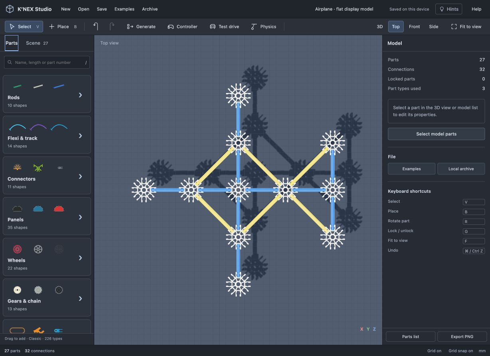

# Build K’NEX models through MCP

This local MCP server gives an AI host the editor's parts catalog and building operations. Ask the host: **“Use K’NEX Studio to build an airplane, validate the connections and show it in the editor.”** The host plans and calls tools; this server does not contain its own language model or require a model API key.

## Install and connect

Requires Node.js 20 or newer. From your checkout:

```sh
npm ci
codex mcp add knex-studio -- node /absolute/path/to/knex-studio/mcp/server.mjs
codex mcp get knex-studio --json
```

Use the absolute Node executable path if your desktop host does not inherit your terminal PATH. Start a new host session after configuration. Other stdio MCP hosts can use:

```json
{
  "mcpServers": {
    "knex-studio": {
      "command": "node",
      "args": ["/absolute/path/to/knex-studio/mcp/server.mjs"]
    }
  }
}
```

The host launches the server. Running `npm run mcp` alone waits for protocol messages on stdin; it is not a standalone chat window. Protocol output goes only to stdout, diagnostics to stderr. Built with the official [MCP TypeScript SDK](https://ts.sdk.modelcontextprotocol.io/v2/serving/stdio). [Codex MCP configuration](https://developers.openai.com/codex/mcp).

## Workflow

1. `search_parts`, `create_build`, `connection_targets`, `edit_build`: build from actual catalog shapes. Use named aliases for parts. `attach` creates a new part and solves its socket placement; matching free endpoints close automatically.
2. `inspect_build`, `validate_build`, `undo_build`: inspect world-space ports, repair mistakes and validate. Every edit requires `expectedRevision`; invalid batches leave the draft unchanged.
3. `publish_build`: saves an immutable `.knex` snapshot and returns a local preview URL. Open it, then choose **Load AI build**. Existing browser work is archived and Undo is available. Published snapshots stay saved after the server exits.

The server also offers `example_airplane` and the `build_knex` prompt. The included airplane is an original **27-part flat display silhouette**, made from stock rods and eight-way connectors. It has 32 actual socket connections and one connected component. It is not an official kit, a detailed aircraft replica or a flight simulation. [Download the example](airplane.knex).



Coordinates use millimetres, Y up, and quaternions `[x,y,z,w]`. Edits support place, attach, translate a complete connected assembly, pattern repeat, lock and remove with undo. Attachment supports the editor's rigid-part connection modes, including holes, hinges, interlocks and gear fits.

## Storage and boundaries

- Drafts and undo history are session-local. Publish before closing the host. Files default to `~/knex-studio-builds`; `KNEX_BUILDS_DIR` can select a dedicated directory. Files are never overwritten.
- The companion editor binds to `127.0.0.1` on an available port. It only serves this repository's `dist` directory and a token-protected, read-only snapshot endpoint. It rejects foreign Host/Origin headers. It does not accept browser editing commands or provide shell/file-system tools.
- GitHub Pages stays a static demo. It cannot run the Node MCP server. The generated `.knex` files also open in that public demo using **Open**.
- Validation checks approximate part meshes and connectivity, including fitted-pair exemptions inherited from the editor. It does not prove structural strength, balance, motor torque or flight. Flexible paths, physics controls and reading unsaved changes back from a browser are not exposed in this first version.
- Limits: 2,500 parts per build, 200 operations per batch, 16 drafts per session and 40 undo snapshots. Search and inspection are paginated.

Run `npm run test:mcp` for actual stdio-client and loopback-preview integration tests, or `npm test` for the complete suite.
