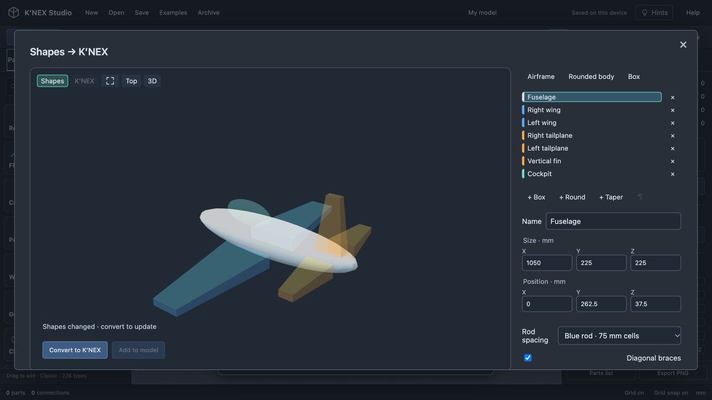
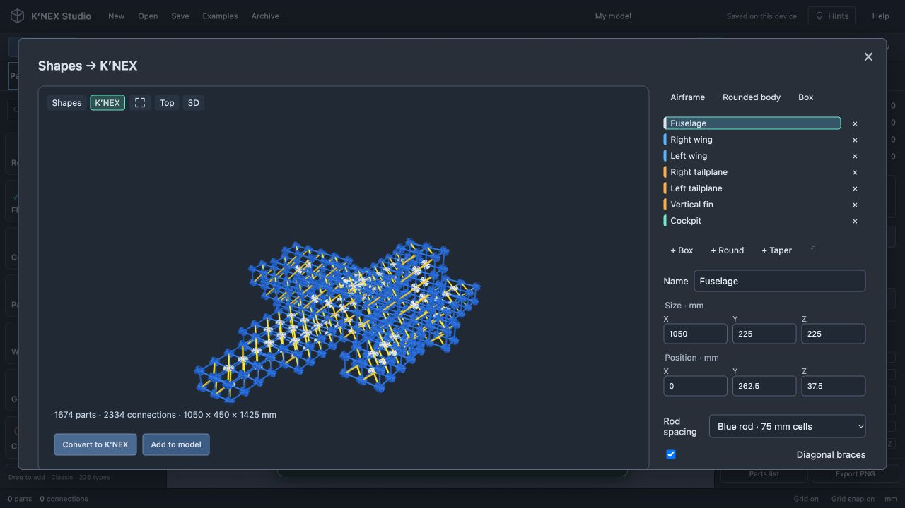
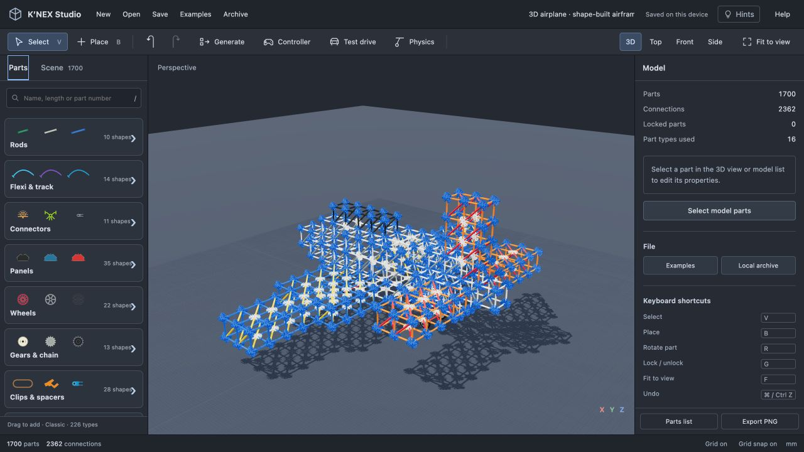

# Experimental grid-shell converter

This prototype creates stepped surface grids. It does not reproduce the angled, sparse assemblies used in real airplane manuals and is not the basis for the next aircraft builder. See [the manual study and construction requirements](aircraft-manual-study.md). The original files remain available for comparison.

Open **Generate → Grid shell · experimental**. Combine boxes, ellipsoids and tapered volumes, drag them in the preview, or edit their size and position. Choose a rod spacing, then **Build grid shell**. The preview switches to the actual parts. **Add to model** places the new frame beside existing work and supports Undo.



The converter samples the union of the volumes on a grid whose pitch is the selected stock rod plus the two socket offsets. It keeps the outer surface lattice, shares overlapping nodes and edges, and uses single white eight-way connectors for planar junctions or interlocked blue connectors for spatial junctions. XY and XZ faces can use the next stock rod length as a diagonal. It never invents YZ diagonal sockets or stretches a rod.

Curves and tapers become stepped surfaces. A feature that misses the grid is reported rather than silently omitted. Detached volumes, unsupported lengths and oversized builds are rejected. The resulting frame must have actual aligned sockets and pass the editor's modeled mesh-interference check. Conversion and collision validation run in a worker; the preview renders repeated meshes using instancing.



## Prompting through MCP

Use `shape_to_frame` with `previewOnly: true` first. It returns the expected part count, grid pitch, dimensions and approximation warnings without changing a build. Use `previewOnly: false` to create a validated draft, then inspect and publish it.

```json
{
  "name": "Rounded chassis",
  "rod": "r-blue",
  "braced": true,
  "previewOnly": true,
  "shapes": [
    {"name": "Body", "kind": "ellipsoid", "center": [0, 150, 0], "size": [450, 225, 225]},
    {"name": "Roof", "kind": "box", "center": [0, 262.5, 0], "size": [150, 75, 75]}
  ]
}
```

Each shape uses `name`, `kind`, `center` and `size` in millimetres. Tapers also use `axis` (0=X, 1=Y, 2=Z), `tipScale` above 0 and at most 1, and optional `reverse`. Tip scale applies to both dimensions perpendicular to the taper axis. Volumes are axis-aligned. There are at most 24 shapes, 100,000 sampled cells and 2,500 output parts. Smaller rods increase the detail and part count.

## Preserved aircraft grid experiment

**Examples → Aircraft grid test** builds a 1,700-part original display airframe with 2,362 connections: a shaped fuselage, thick tapered wings, cockpit, horizontal tailplane, vertical fin and four 47 mm tyres on two supported axles. Stock color variants distinguish the body, cockpit, wings and tail. Region layers remain editable. The shell is approximately 1,050 × 450 × 1,425 mm measured between grid nodes before the landing gear is added.



[Airplane model](airplane-3d.knex) · [Rough-volume recipe](airplane-shapes.json)

The Aircraft grid test preset converts only the rough shell. The detailed airplane adds wheel assemblies through the regular socket/axle solver, with spacers and caps, and validates the completed model. Arbitrary shape conversion does not infer wheels, motors or mechanisms automatically.

This is an original reconstruction, not an official K’NEX aircraft kit or a tested physical assembly. Part geometry is approximate; collision checks retain the editor's fitted-pair exemptions. The result is a surface frame, not an aerodynamic skin. Flight, strength and stability are not certified. Arbitrary mesh import, rotated primitives, subtractive volumes and automatic mechanical design are not implemented. Rough editing has local undo during the dialog; saved `.knex` files contain the converted parts, not a persistent parametric history.

MCP `example_airplane` now builds the separate [straight-rod swept-wing plane](swept-wing-plane.md). The grid experiment remains preserved here.
