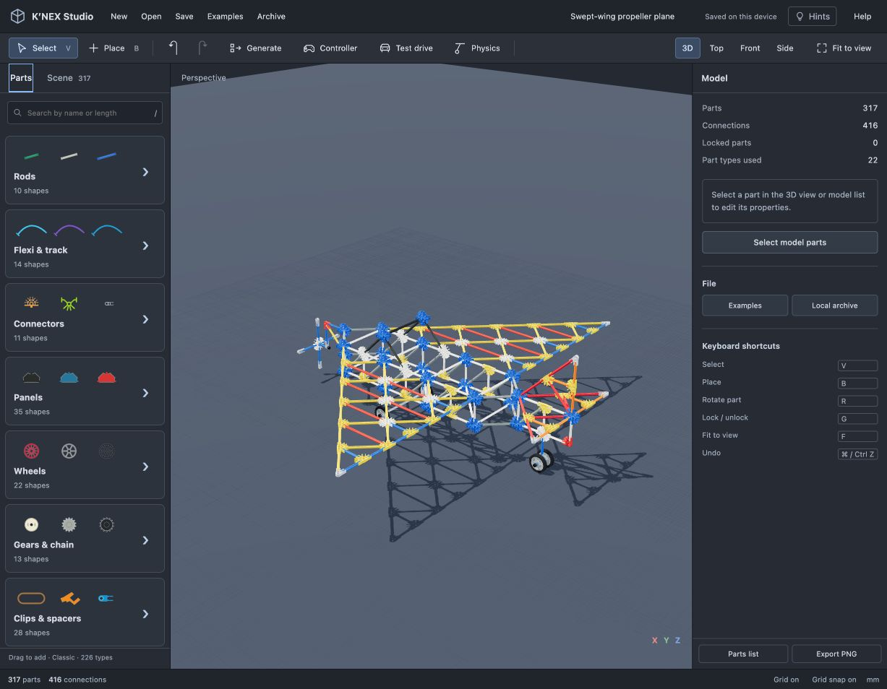

# Straight-rod swept-wing plane

Open **Examples → Swept-wing plane** or call MCP `example_airplane`. An already-running MCP server must be restarted to load this updated example.

[Editable model](swept-wing-plane.knex) · [Parts list CSV](swept-wing-parts.csv)

## Construction

317 catalog parts and 416 connections, organized into ten assembly layers. The plane has a 1,050 mm span between the outer wing connector centers. Its wing webs form triangles from stock rods and actual diagonal sockets. Two side trusses, transverse members and pointed end sections give the fuselage real depth. A raised cockpit, separate tail boom, horizontal stabilizers and upright triangular fin complete the airframe. White and gray stock rod variants distinguish the fuselage from the wings.

The main axle passes through two bearings. The rear axle supports a compact twin wheel. Four 47 mm tyres rest at floor level in the initial pose. The four-blade propeller sits on a straight axle in a separate front bearing. Spacers and caps retain the rotating parts. No part is locked to an invisible display stand.

The construction graph splits shared spans at real connector centers and deduplicates overlapping members. It chooses a real connector pattern and orientation that supports each incident rod direction. Spatial nodes use correctly interlocked blue connector pairs. Every span must match a catalog rod and two socket offsets; there are no stretched rods, flexible paths, surface cells or hidden filler parts.

## Reference and scope

[Original Flying Fun instructions, pages 11–15](https://d2npjmct0hwe3x.cloudfront.net/wp-content/uploads/manuals/10-Model-Flying-Fun-Set-11556.pdf) informed the triangular wing tips, separate raised fuselage, upright tail and spacer-retained propeller assembly. This is an original larger straight-rod alternative, **not an exact replica of that manual**. Ed explicitly deferred rod bending. The curved-rod 79621 airplane was not reproduced or silently substituted with flexis.

Detailed part geometry remains reconstructed. Connection and collision checks do not certify strength, aerodynamic flight or complete rigid-body behavior under every physics setting. The propeller is freely mounted, not motor driven.

## Verification

The automated aircraft tests verify stock catalog types, straight rods, aligned endpoint positions and directions, unique socket use, supported through-hole positions, one connected assembly, three-dimensional fuselage depth and zero modeled mesh collisions. A rotation regression checks the propeller's complete revolution in 15-degree increments, preserving the blade connections and checking the surrounding support at each pose. The editor gallery and the MCP preview both load the editable model.
